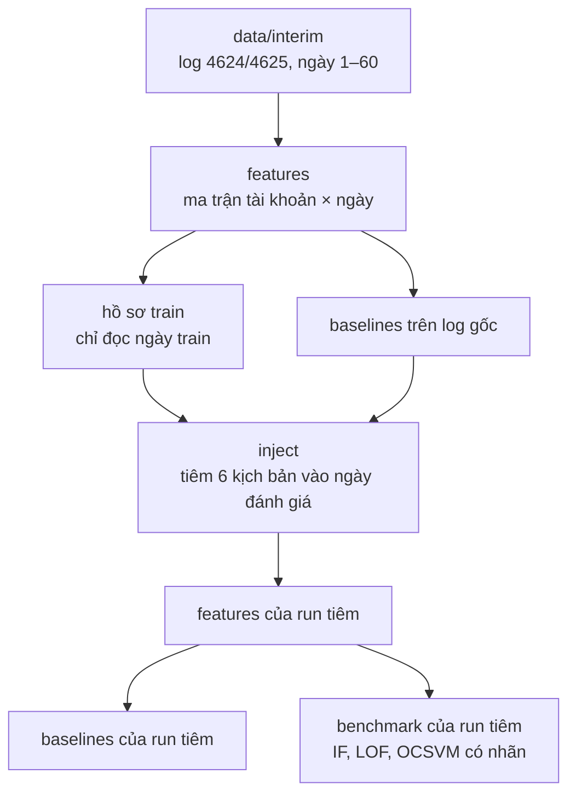

# UEBA Benchmark: Windows Security Event Log (4624 / 4625)

Benchmark các mô hình phát hiện bất thường cho bài toán phân tích hành vi người dùng (UEBA), dùng log đăng nhập thành công (`EventID 4624`) và thất bại (`EventID 4625`) của bộ LANL, ngày 1–60.

## 1. Cấu trúc thư mục

```text
ueba-benchmark/
├── main.py                 # Điều phối pipeline theo stage
├── environment.yml         # Môi trường conda (conda-forge, Python 3.11)
├── requirements.txt        # Thư viện cho pip
├── pyproject.toml          # Khai báo package src (pip install -e .)
├── configs/                # Đường dẫn dữ liệu, schema đặc trưng, tham số mô hình, cấu hình tiêm
├── data/                   # Không nằm trong Git
│   ├── raw/                # Log gốc LANL (wls_day-XX.bz2)
│   ├── interim/            # Log 4624/4625 theo ngày (.parquet), điểm bắt đầu của pipeline
│   ├── features/           # Ma trận đặc trưng thô (tài khoản × ngày), hồ sơ train
│   ├── processed/          # Ma trận đã chuẩn hoá, sẵn sàng train
│   └── injection_runs/     # Mỗi run tiêm một thư mục: log đã tiêm, nhãn, ma trận riêng
├── src/
│   ├── data/               # Log thô -> interim, kiểm tra chất lượng
│   ├── features/           # Trích đặc trưng (Polars), đặc trưng lịch sử 7 ngày, tiền xử lý
│   ├── injection/          # Bộ tiêm 6 kịch bản bất thường, nhãn và manifest
│   ├── models/             # Isolation Forest, LOF, One-Class SVM trên giao diện PyOD
│   ├── baselines/          # z-score, luật ngưỡng, đếm thất bại, ngẫu nhiên
│   └── evaluation/         # Chia train/test theo thời gian, chỉ số đánh giá
├── scripts/                # Script bổ trợ (hồ sơ train, chuyển đổi raw, kiểm tra interim...)
├── demo/                   # Demo web
├── experiments/            # Kết quả và mô hình đã lưu
├── docs/                   # Tài liệu kỹ thuật
├── reports/                # Báo cáo theo tuần
└── tests/                  # Kiểm thử pytest
```

## 2. Thiết lập môi trường

```bash
git clone https://github.com/lamvu0607-creator/ueba-benchmark.git
cd ueba-benchmark
```

LOF cần thư viện `hnswlib`. Bản trên PyPI phải biên dịch C++, nên trên Windows nên cài qua conda-forge.

### 2.1 Conda (khuyên dùng)

Trên Windows, mở Anaconda Prompt và gõ:

```bat
cd /d D:\duong\dan\ueba-benchmark
conda env create -f environment.yml
conda activate ueba
pip install -e . --no-deps
python -c "import hnswlib, pyod, polars; print('ok')"
```

Trên Linux/macOS các lệnh giống hệt, chỉ khác dòng `cd`.

### 2.2 venv

Windows (PowerShell), nên dùng Python 3.11 hoặc 3.12:

```powershell
py -3.12 -m venv .venv
.venv\Scripts\activate
python -m pip install --upgrade pip
pip install chroma-hnswlib        # hnswlib dựng sẵn, không cần trình biên dịch
pip install -r requirements.txt
pip install -e .
```

Nếu pip vẫn đòi Microsoft Visual C++ để biên dịch `hnswlib`, xoá tạm dòng `hnswlib>=0.8.0` trong `requirements.txt` rồi cài lại.

Linux/macOS:

```bash
python3 -m venv .venv
source .venv/bin/activate
pip install -r requirements.txt
pip install -e .
```

Kiểm tra sau khi cài:

```bash
python -m pytest tests -q
```

## 3. Chạy pipeline

Log gốc trong `data/raw/` quá nặng, nên hiện tại pipeline chạy từ `data/interim/` và bỏ qua bước chuyển raw → interim (`scripts/convert_raw_to_interim.py`). Cần có 120 file Parquet: `data/interim/event_4624/event_4624_day-01.parquet` đến `day-60`, và bộ `event_4625` tương ứng. Kiểm tra đủ file:

```bash
python scripts/validate_interim.py --mode fast
```

Pipeline chỉ tạo ma trận đặc trưng, điểm bất thường và bảng kết quả (CSV, Parquet). README này không gồm bước vẽ biểu đồ hay làm báo cáo.

### 3.1 Luồng xử lý



Bộ tiêm chỉ dùng hồ sơ của ngày train và bỏ qua các tài khoản-ngày mà baseline luật đã cảnh báo trên log gốc.

### 3.2 Toàn bộ quy trình

Chạy lần lượt từ thư mục gốc của repo:

```bash
# 1. Đặc trưng của log gốc: interim -> data/features/raw/, data/processed/
python main.py --stage features --interim-only

# 2. Hồ sơ train cho bộ tiêm -> data/features/train_profiles/
python scripts/injection_profiles_summary.py

# 3. Baselines trên log gốc -> experiments/results/baselines/
python main.py --stage baselines

# 4. Tiêm một run khối test (train ngày 1–42, tiêm và đánh giá ngày 43–60)
python main.py --stage inject --block test --injection-seed 20261061 --run-id test_seed20261061

# 5–7. Đặc trưng, baselines và benchmark có nhãn của run đó
python main.py --stage features  --events-dir data/injection_runs/test_seed20261061/events_injected
python main.py --stage baselines --events-dir data/injection_runs/test_seed20261061/events_injected
python main.py --stage benchmark --events-dir data/injection_runs/test_seed20261061/events_injected
```

Kết quả của run nằm ở `experiments/injection_runs/test_seed20261061/` (`results/`, `models/`). Run tiêm không ghi đè ma trận hay kết quả của log gốc. Benchmark cuối lặp bước 4–7 với 5 seed, từ 20261061 đến 20261065.

Khối `dev` dùng để chọn tham số trước khi chạy test: train ngày 1–35, tiêm và đánh giá ngày 36–42. Khối này cần hồ sơ và baseline riêng, tạo bằng `python scripts/injection_profiles_summary.py --train-end-day 35` và `python main.py --stage baselines --split-day 35`, rồi mới chạy `python main.py --stage inject --block dev`.

`--interim-only` buộc đọc `data/interim/` kể cả khi máy còn thư mục `data/cleaned/` của giai đoạn cũ.

### 3.3 Từng giai đoạn

| Stage | Lệnh | Đầu vào → đầu ra |
|---|---|---|
| `features` | `python main.py --stage features --interim-only` | interim → `data/features/raw/`, `data/processed/` |
| | thêm `--start-day 1 --end-day 10` | chỉ tính một dải ngày |
| `baselines` | `python main.py --stage baselines` | ma trận processed → `experiments/results/baselines/` |
| `benchmark` | `python main.py --stage benchmark` | ma trận processed → `experiments/results/` (không nhãn) |
| | thêm `--models isolation_forest local_outlier_factor one_class_svm` | chỉ chạy một số mô hình |
| `inject` | `python main.py --stage inject --block test` | interim + hồ sơ train → `data/injection_runs/<run_id>/` |
| `difficulty` | `python main.py --stage difficulty --events-dir <run>/events_injected` | run tiêm → `difficulty.parquet` |

Mọi stage trừ `inject` nhận thêm `--events-dir <run>/events_injected` để chạy trên một run tiêm thay vì log gốc.

`--stage all` là luồng cũ: chạy `clean` (interim → `data/cleaned/`), `features` và `benchmark` không nhãn. Luồng hiện tại là các lệnh ở mục 3.2.
