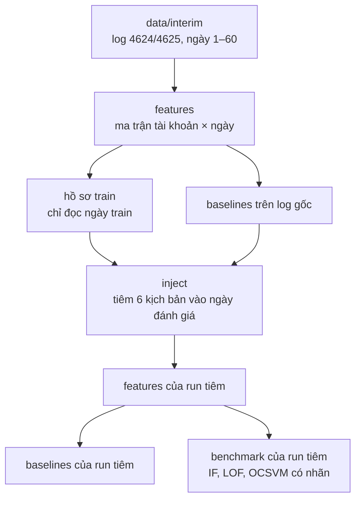

# UEBA Benchmark: Windows Security Event Log (4624 / 4625)

Benchmark các mô hình phát hiện bất thường cho bài toán phân tích hành vi người dùng (UEBA), dùng log đăng nhập thành công (`EventID 4624`) và thất bại (`EventID 4625`) của bộ LANL, ngày 1–60.

## 1. Cấu trúc thư mục

```text
ueba-benchmark/
├── main.py                 # Điều phối pipeline theo stage
├── requirements.txt        # Thư viện cho pip
├── pyproject.toml          # Khai báo package src (pip install -e .)
├── configs/                # Đường dẫn dữ liệu, schema đặc trưng, tham số mô hình, cấu hình tiêm
├── data/                   # Không nằm trong Git
│   ├── raw/                # Log gốc LANL (wls_day-XX.bz2)
│   ├── interim/            # Log 4624/4625 theo ngày (.parquet), điểm bắt đầu của pipeline
│   ├── features/           # Ma trận đặc trưng thô (tài khoản × ngày), hồ sơ train
│   ├── processed/          # Ma trận đã chuẩn hoá, sẵn sàng train
│   └── injection_runs/     # Mỗi run tiêm một thư mục: log đã tiêm, nhãn, ma trận riêng
├── src/
│   ├── data/               # Log thô -> interim, kiểm tra chất lượng
│   ├── features/           # Trích đặc trưng (Polars), đặc trưng lịch sử 7 ngày, tiền xử lý
│   ├── injection/          # Bộ tiêm 6 kịch bản bất thường, nhãn và manifest
│   ├── models/             # Isolation Forest, LOF, One-Class SVM trên giao diện PyOD
│   ├── baselines/          # z-score, luật ngưỡng, đếm thất bại, ngẫu nhiên
│   └── evaluation/         # Chia train/test theo thời gian, chỉ số đánh giá
├── scripts/                # Script bổ trợ (hồ sơ train, chuyển đổi raw, kiểm tra interim...)
├── demo/                   # Demo web
├── experiments/            # Kết quả và mô hình đã lưu
├── docs/                   # Tài liệu kỹ thuật
├── reports/                # Báo cáo theo tuần
└── tests/                  # Kiểm thử pytest
```

## 2. Thiết lập môi trường

```bash
git clone https://github.com/lamvu0607-creator/ueba-benchmark.git
cd ueba-benchmark
```

LOF cần thư viện `hnswlib`. Bản trên PyPI phải biên dịch C++, nên trên Windows cài `chroma-hnswlib` (bản dựng sẵn, vẫn `import hnswlib`).

Windows (PowerShell), nên dùng Python 3.11 hoặc 3.12:

```powershell
py -3.12 -m venv .venv
.venv\Scripts\activate
python -m pip install --upgrade pip
pip install chroma-hnswlib        # hnswlib dựng sẵn, không cần trình biên dịch
pip install -r requirements.txt
pip install -e .
```

Nếu pip vẫn đòi Microsoft Visual C++ để biên dịch `hnswlib`, xoá tạm dòng `hnswlib>=0.8.0` trong `requirements.txt` rồi cài lại.

Linux/macOS:

```bash
python3 -m venv .venv
source .venv/bin/activate
pip install -r requirements.txt
pip install -e .
```

Kiểm tra sau khi cài:

```bash
python -m pytest tests -q
```

## 3. Chạy pipeline

Log gốc (raw) quá lớn nên không đưa lên được. Vì vậy pipeline chạy từ `data/interim/` và bỏ qua bước chuyển raw → interim (`scripts/convert_raw_to_interim.py`). Cần có 120 file Parquet: `data/interim/event_4624/event_4624_day-01.parquet` đến `day-60`, và bộ `event_4625` tương ứng. Kiểm tra đủ file:

```bash
python scripts/validate_interim.py --mode fast
```

Pipeline chỉ tạo ma trận đặc trưng, điểm bất thường và bảng kết quả (CSV, Parquet). README này không gồm bước vẽ biểu đồ hay làm báo cáo.

### 3.1 Luồng xử lý



Bộ tiêm chỉ dùng hồ sơ của ngày train và bỏ qua các tài khoản-ngày mà baseline luật đã cảnh báo trên log gốc.

### 3.2 Toàn bộ quy trình

Một lệnh chạy hết pipeline từ interim, từ thư mục gốc của repo:

```bash
python scripts/reproduce.py
```

Lệnh này kiểm tra SHA-256 của 120 file interim và chạy kiểm thử. Sau đó nó tính đặc trưng, hồ sơ train và baselines, tiêm 5 run test (seed 20261061–20261065), chạy lưới 22 đặc trưng, rồi so kết quả với `experiments/grid/test_22f/grid_summary.csv`. Kết quả ghi vào `experiments/reproduce/test_22f/`. Lệnh mất nhiều giờ. Thêm `--skip-existing` để bỏ qua các bước đã có đầu ra.

Muốn chạy tay từng bước cho một run, gõ lần lượt:

```bash
# 1. Đặc trưng của log gốc: interim -> data/features/raw/, data/processed/
python main.py --stage features --interim-only

# 2. Hồ sơ train cho bộ tiêm -> data/features/train_profiles/
python scripts/injection_profiles_summary.py

# 3. Baselines trên log gốc -> experiments/results/baselines/
python main.py --stage baselines

# 4. Tiêm một run khối test (train ngày 1–42, tiêm và đánh giá ngày 43–60)
python main.py --stage inject --block test --injection-seed 20261061 --run-id test_seed20261061

# 5–7. Đặc trưng, baselines và benchmark có nhãn của run đó
python main.py --stage features  --events-dir data/injection_runs/test_seed20261061/events_injected
python main.py --stage baselines --events-dir data/injection_runs/test_seed20261061/events_injected
python main.py --stage benchmark --events-dir data/injection_runs/test_seed20261061/events_injected
```

Kết quả của run nằm ở `experiments/injection_runs/test_seed20261061/` (`results/`, `models/`). Run tiêm không ghi đè ma trận hay kết quả của log gốc. Benchmark cuối lặp bước 4–7 với 5 seed, từ 20261061 đến 20261065.

Khối `dev` dùng để chọn tham số trước khi chạy test: train ngày 1–35, tiêm và đánh giá ngày 36–42. Khối này cần hồ sơ và baseline riêng, tạo bằng `python scripts/injection_profiles_summary.py --train-end-day 35` và `python main.py --stage baselines --split-day 35`, rồi mới chạy `python main.py --stage inject --block dev`.

`--interim-only` buộc đọc `data/interim/` kể cả khi máy còn thư mục `data/cleaned/` của giai đoạn cũ.

### 3.3 Từng giai đoạn

Mọi stage chạy bằng `python main.py --stage <tên>`. Đường dẫn dữ liệu lấy từ `configs/system_config.yaml`, tham số mô hình từ `configs/model_params.yaml`.

#### `features`: trích đặc trưng

```bash
python main.py --stage features --interim-only
```

- Việc làm: đọc log 4624/4625 từng ngày, gom thành ma trận mỗi dòng là một tài khoản trong một ngày. Ma trận có 41 đặc trưng, gồm cả đặc trưng lịch sử so với 7 ngày trước. Sau đó chuẩn hoá (log1p, xử lý giá trị thiếu) và kiểm tra theo schema `configs/feature_schema.yaml`.
- Đầu vào: `data/interim/`.
- Đầu ra: `data/features/raw/feature_matrix_raw.parquet` (ma trận thô) và `data/processed/feature_matrix_processed.parquet` (ma trận đã chuẩn hoá, các stage sau đọc file này).
- `--interim-only`: luôn đọc `data/interim/`, kể cả khi máy còn thư mục `data/cleaned/` của giai đoạn cũ.
- `--start-day 1 --end-day 10`: chỉ tính một dải ngày, dùng để chạy thử cho nhanh.

#### `baselines`: các phương pháp so sánh

```bash
python main.py --stage baselines
```

- Việc làm: chấm điểm bằng các phương pháp đơn giản không học máy: ngẫu nhiên, z-score và luật ngưỡng. Ngưỡng tính từ dữ liệu train (ngày 1–42), ngân sách cảnh báo 1% số dòng mỗi ngày (`configs/baselines.yaml`). Không phương pháp nào đọc nhãn.
- Đầu vào: `data/processed/feature_matrix_processed.parquet`.
- Đầu ra: `experiments/results/baselines/`, gồm `baseline_scores.parquet` (điểm từng dòng) và `thresholds.json` (ngưỡng). Nếu có nhãn thì thêm `baseline_metrics.csv`.
- Trên log gốc, kết quả này còn có một công dụng nữa: bộ tiêm bỏ qua các tài khoản-ngày mà luật đã cảnh báo, để nhãn tiêm không trùng với bất thường có sẵn. Vì vậy phải chạy stage này trước `inject`.
- `--split-day 35`: đổi mốc train (dùng cho khối dev). Kết quả ghi riêng vào `experiments/results/baselines_d35/`.

#### `benchmark`: chạy mô hình

```bash
python main.py --stage benchmark
```

- Việc làm: fit mô hình trên train (ngày ≤ 42), chấm điểm ngày test, rồi tính bảng xếp hạng. Mặc định chạy 6 mô hình: Isolation Forest, LOF, One-Class SVM, z-score, luật ngưỡng, ngẫu nhiên. Mỗi loại tài khoản (User, Machine) được fit một mô hình riêng.
- Đầu vào: `data/processed/feature_matrix_processed.parquet`.
- Đầu ra: `experiments/results/`, gồm `benchmark_summary.csv` (bảng xếp hạng), `anomaly_scores.parquet` (điểm từng dòng), `model_topk_overlap.csv` (mức trùng top-K giữa các mô hình), `split_info.json` và `run_manifest.json` (seed, commit, phiên bản thư viện). Mô hình đã fit lưu ở `experiments/models/`.
- Trên log gốc không có nhãn, nên chỉ đo được tỷ lệ cảnh báo, độ ổn định và mức trùng giữa mô hình. Chỉ số cần nhãn (PR-AUC, recall) chỉ có khi chạy trên run tiêm.
- `--models isolation_forest local_outlier_factor one_class_svm`: chỉ chạy một số mô hình.
- Tuỳ chọn khác: `--seed`, `--split-day`, `--budget-ratio` (mặc định lấy trong `configs/system_config.yaml`), `--no-segments` (một mô hình chung cho mọi loại tài khoản).

#### `inject`: tiêm bất thường để có nhãn

```bash
python main.py --stage inject --block test --injection-seed 20261061 --run-id test_seed20261061
```

- Việc làm: chọn tài khoản nạn nhân dựa trên hồ sơ train, rồi nhân bản sự kiện thật của chính họ để tạo 6 kịch bản: brute-force, password spraying, đăng nhập ngoài giờ, máy lạ, tài khoản ngủ đông thức dậy, đổi kiểu đăng nhập. Log gốc không bị sửa.
- Đầu vào: `data/interim/`, hồ sơ train `data/features/train_profiles/` (tạo bằng `python scripts/injection_profiles_summary.py`), kết quả `baselines` trên log gốc, và `configs/injection.yaml`.
- Đầu ra: `data/injection_runs/<run_id>/`, gồm `events_injected/` (log của các ngày đánh giá đã tiêm, cùng định dạng interim), `injection_manifest.csv` (mỗi lần tiêm một dòng), `labels.parquet` (nhãn) và `run_config.json` (khối, seed, ngày đánh giá).
- `--block test`: train ngày 1–42, tiêm và đánh giá ngày 43–60. `--block dev`: train ngày 1–35, đánh giá ngày 36–42, dùng để chọn tham số trước khi chạy test.
- `--injection-seed`, `--run-id`: đổi seed và tên run. Mặc định tên run là `<khối>_seed<seed>`.

#### `difficulty`: chấm độ khó mẫu tiêm (tuỳ chọn)

```bash
python main.py --stage difficulty --events-dir data/injection_runs/test_seed20261061/events_injected
```

- Việc làm: gắn độ khó cho từng mẫu tiêm. Hiện mới có khung, chưa cài cách chấm nào (oracle `none`), nên cột độ khó để trống.
- Đầu ra: `difficulty.parquet` trong thư mục run.

#### Chạy trên một run tiêm: `--events-dir`

Thêm `--events-dir <run>/events_injected` vào `features`, `baselines`, `benchmark` hoặc `difficulty` để chạy trên log đã tiêm thay vì log gốc:

- `features` lấy log đã tiêm cho các ngày đánh giá, ngày train vẫn đọc từ interim gốc. Ma trận ghi vào thư mục run, không đè `data/processed/`.
- `baselines` và `benchmark` đọc ma trận và `labels.parquet` của run, chỉ đánh giá các ngày của run, và tính thêm chỉ số có nhãn (PR-AUC, ROC-AUC, precision và recall theo ngân sách). Kết quả ghi vào `experiments/injection_runs/<run_id>/results/`.

#### Stage không dùng

`clean` (interim → `data/cleaned/`) và `all` (`clean` → `features` → `benchmark` không nhãn) là luồng cũ. `plots` vẽ hình từ điểm đã lưu. Luồng hiện tại không cần ba stage này.
