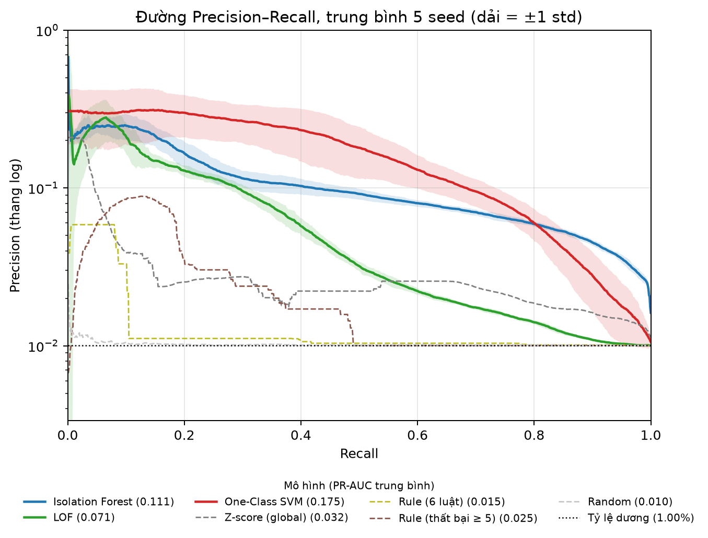
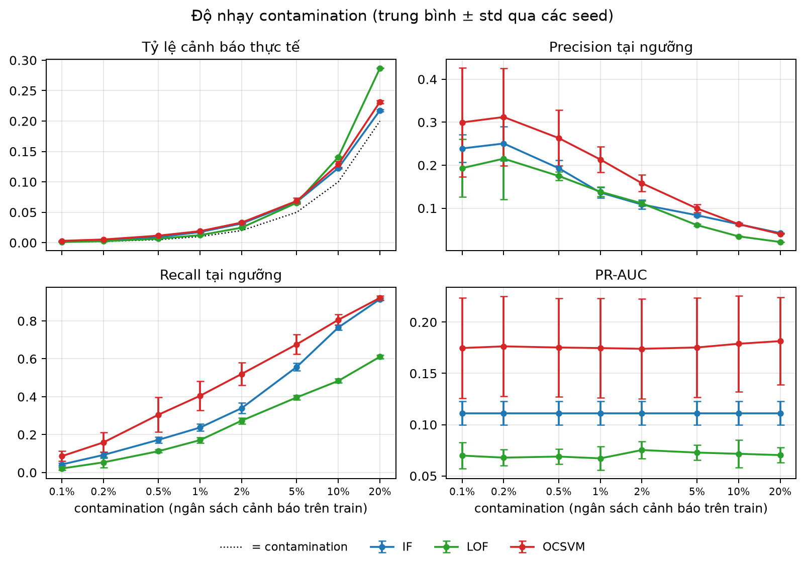
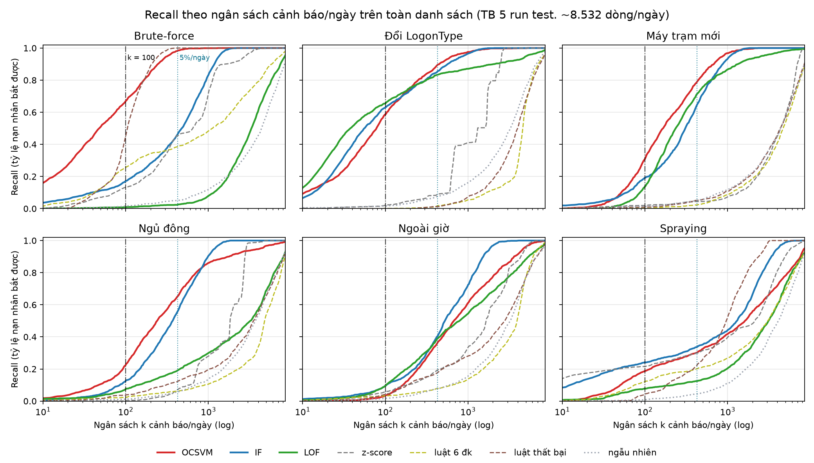
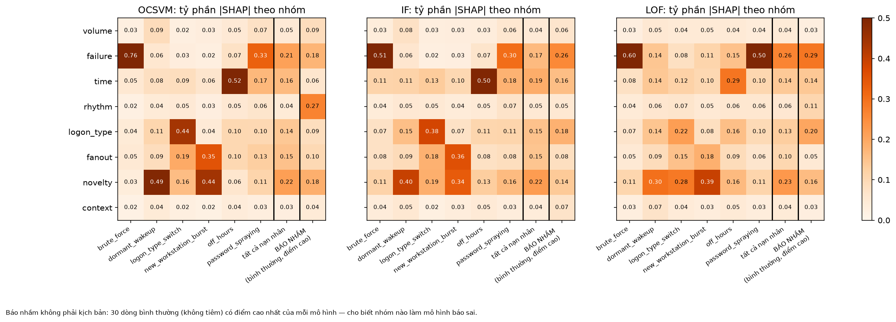

# Báo cáo kỹ thuật: Benchmark Isolation Forest / LOF / One-Class SVM trên log xác thực Windows

**Đề tài:** Benchmark Isolation Forest / LOF / One-Class SVM trên log xác thực (Event 4624/4625)
**Chương trình:** Thực chiến AI, đề tài thực tập 6 tuần, 2 thực tập sinh
**Phiên bản:** 1.0, ngày 15/10/2026. Mã nguồn và số liệu ở nhánh `feature/target-rate-1pct`, commit `ee0d52f`
**Căn cứ:** [`docs/Tong quan de tai ueba.md`](../../docs/Tong%20quan%20de%20tai%20ueba.md) (gọi tắt là *đề cương*)

> Báo cáo này gom kết quả của tuần 1–5 thành một tài liệu độc lập. Người đọc không cần mở các báo cáo tuần để hiểu
> phương pháp và kết quả; đường dẫn tới số liệu gốc được ghi ở cuối mỗi mục. Mọi số liệu định lượng tính trên
> **nhãn tổng hợp** (tấn công được tiêm vào log thật) nên là **cận trên lạc quan** của hiệu năng trên tấn công thật.

---

## Tóm tắt

1. **Bài toán.** Phát hiện hành vi bất thường của tài khoản người dùng từ log đăng nhập Windows (4624 thành công,
   4625 thất bại) của bộ LANL Unified Host, 60 ngày, khoảng 943 triệu sự kiện sau làm sạch. Đơn vị phân tích là
   một dòng (tài khoản, ngày). Không có nhãn thật, nên hiệu năng được đo bằng 6 kịch bản tấn công tiêm vào log.
2. **Đặc trưng.** 41 đặc trưng hành vi được sinh theo một không gian tổ hợp có kiểm soát và lọc qua phễu 2 vòng.
   Phân tích SHAP và thí nghiệm loại bỏ trên dev rút gọn còn **22 đặc trưng** cho benchmark cuối.
3. **Thiết kế đánh giá.** Chia theo thời gian: train ngày 1–42, test ngày 43–60; chọn cấu hình trên khối dev
   (ngày 36–42, fit 1–35) nằm trong train. Mỗi run tiêm đúng 1% số dòng User. 5 seed, báo cáo trung bình ± độ lệch chuẩn.
4. **Kết quả chính (test, 22 đặc trưng, 5 seed).** One-Class SVM tốt nhất: **recall top-100 cảnh báo/ngày 0,336 ± 0,070,
   PR-AUC 0,175 ± 0,048**, gấp khoảng 3,4 lần recall và 7 lần PR-AUC của luật "số lần thất bại ≥ 5", gấp 17 lần
   ngẫu nhiên về PR-AUC. Thứ hạng ổn định: **OCSVM > IF > LOF > z-score > các luật > ngẫu nhiên.**
5. **Phát hiện quan trọng.**
   - Phát hiện tốt brute-force, đổi loại logon, bùng nổ máy trạm mới; **hai điểm mù chung** là dời hoạt động sang
     ban đêm và rải mật khẩu (password spraying), do giới hạn của đặc trưng tính theo từng tài khoản.
   - Chọn scaler quyết định mô hình dựa trên khoảng cách: đổi RobustScaler sang StandardScaler nâng PR-AUC OCSVM từ 0,03 lên 0,24 trên dev.
   - Bớt đặc trưng làm mô hình **tốt hơn**: từ 41 xuống 22 đặc trưng, recall IF tăng 0,16 → 0,24 trên test.
   - Cấu hình OCSVM tốt nhất trên dev (`g01`) **kém ổn định** trên test; cấu hình `nc1000` ổn định hơn và được khuyến nghị khi triển khai.
   - LOF dùng chỉ mục láng giềng xấp xỉ đa luồng nên **không tất định** ở mức từng lần fit.
6. **Khuyến nghị.** Triển khai OCSVM cho phân khúc User với ngân sách khoảng 100 cảnh báo/ngày, chạy song song một
   luật riêng cho dò/rải mật khẩu; tài khoản dịch vụ, hệ thống và quản trị dùng luật và danh sách trắng thay cho học máy (mục 8).

---

## Mục lục

1. Giới thiệu
2. Dữ liệu
3. Phương pháp
4. Kết quả
5. Phân tích
6. Đánh giá định tính: review thủ công top 50
7. Hạn chế đã biết
8. Khuyến nghị triển khai
9. Tái lập và vận hành
10. Đối chiếu tiêu chí hoàn thành (đề cương mục 4.1)

Phụ lục A: 22 đặc trưng của benchmark cuối · Phụ lục B: bản đồ số liệu

---

## 1. Giới thiệu

### 1.1. Bối cảnh

UEBA (User and Entity Behavior Analytics) phát hiện tấn công bằng cách học hành vi bình thường của tài khoản rồi
cảnh báo khi hành vi lệch đi. Log đăng nhập Windows là nguồn dữ liệu phổ biến nhất cho bài toán này: mỗi lần
đăng nhập thành công sinh Event 4624, mỗi lần thất bại sinh Event 4625. Các tấn công như dò mật khẩu, chiếm đoạt
tài khoản hay di chuyển ngang đều để lại dấu vết trong hai loại sự kiện này.

Ba thuật toán phát hiện bất thường không giám sát thường được dùng làm mốc là **Isolation Forest (IF)**,
**Local Outlier Factor (LOF)** và **One-Class SVM (OCSVM)**. Đề tài đặt câu hỏi: trên log xác thực thật, với một
quy trình đánh giá chặt chẽ, ba mô hình này hơn một luật ngưỡng đơn giản bao nhiêu, và mỗi mô hình bắt được loại
tấn công nào?

### 1.2. Mục tiêu và câu hỏi

| # | Câu hỏi | Trả lời ở |
|---|---|---|
| Q1 | Mô hình nào xếp hạng tài khoản bất thường tốt nhất trong ngân sách cảnh báo thực tế? | Mục 4.2 |
| Q2 | Mô hình có vượt luật ngưỡng số lần thất bại và chấm điểm ngẫu nhiên không? | Mục 4.2 |
| Q3 | Mỗi mô hình bắt tốt loại tấn công nào, bỏ sót loại nào, vì sao? | Mục 4.4, 5.5 |
| Q4 | Đặc trưng nào đóng góp, đặc trưng nào gây nhiễu? | Mục 5.3 |
| Q5 | Kết quả có ổn định qua seed, qua lần chạy lại và nhạy với tham số đến đâu? | Mục 4.3, 5.6 |

### 1.3. Phạm vi

- **Trong phạm vi:** log 4624/4625 đã ẩn danh của LANL; ma trận (tài khoản × ngày); 3 mô hình + 4 mốc tham chiếu;
  nhãn tổng hợp 6 kịch bản; đánh giá phân khúc tài khoản người dùng (User).
- **Ngoài phạm vi** (đề cương mục 2.2): mô hình học sâu, phát hiện theo thời gian thực, tích hợp SIEM, nhãn tấn công thật.

---

## 2. Dữ liệu

### 2.1. Nguồn

Bộ **LANL Unified Host and Network Dataset**: log Windows Security của mạng doanh nghiệp Los Alamos, đã ẩn danh,
**60 ngày**. Dự án dùng hai loại sự kiện:

| Sự kiện | Ý nghĩa | Ví dụ ngày 1 |
|---|---|---|
| 4624 | Đăng nhập thành công | 14,1 triệu |
| 4625 | Đăng nhập thất bại | 0,34 triệu (2,3%) |

Mỗi sự kiện có 21 trường, chia 6 nhóm: thời gian (`Time`, epoch giây), sự kiện (`EventID`), danh tính
(`UserName`, `DomainName`, `LogonID`, `Subject*`), máy (`LogHost`, `Source`, `Destination`), xác thực
(`LogonType`, `AuthenticationPackage`, `FailureReason`, `Status`, …) và tiến trình (`Process*`). Ý nghĩa từng trường
ở [`docs/data_dictionary.md`](../../docs/data_dictionary.md).

**Quy mô sau làm sạch:** khoảng **943 triệu sự kiện**; ma trận đặc trưng có **1.055.283 dòng** (tài khoản, ngày).

### 2.2. Phân loại tài khoản

Khoá của một tài khoản là cặp (`DomainName`, `UserName`). Tài khoản được chia 5 loại theo tên:

| Loại | Dòng train (ngày 1–42) | Dòng test (ngày 43–60) | Số tài khoản (60 ngày) | Tỷ lệ sự kiện |
|---|---|---|---|---|
| Machine (tên kết thúc `$`) | 404.907 | 180.092 | 13.497 | 45% |
| **User** | **314.847** | **152.740** | **18.003** | 36% |
| Admin (`Administrator`) | 1.371 | 630 | 825 | 3% |
| Service (`AppService`, `Scanner`, …) | 317 | 137 | 10 | 12% |
| System (`nt authority\…`) | 170 | 72 | 6 | 3% |

**Quyết định:** đánh giá chỉ trên **User** vì (1) đây là đối tượng tấn công chiếm đoạt tài khoản nhắm tới; (2) Admin,
Service, System quá ít thực thể để học máy có nghĩa (ví dụ System có 6 tài khoản, ít hơn số láng giềng k = 20 của
LOF) và hành vi của chúng gần như tất định, phù hợp với luật hơn; (3) tài khoản Machine không được tiêm. Chi tiết:
[`docs/reports/thong_ke_loai_tai_khoan.md`](../../docs/reports/thong_ke_loai_tai_khoan.md).

### 2.3. Chất lượng dữ liệu và các quyết định làm sạch

Khảo sát chất lượng (tuần 1, notebook `01_data_quality_single_day.ipynb` và `02`–`06`) dẫn tới 5 quyết định,
cài đặt trong `src/data/cleaner.py` và có unit test (`tests/test_cleaner.py`):

| # | Vấn đề phát hiện | Quyết định | Lý do |
|---|---|---|---|
| 1 | `LogonTypeDescription` thiếu ở vài bản ghi 4624 | Điền theo bảng ánh xạ chuẩn của Microsoft từ `LogonType` | Quan hệ 1–1, không cần đoán |
| 2 | `Subject*`, `Process*`, `Status` thiếu 92–100% | Bỏ cột (21 → 11 cột) | Không mang thông tin; giữ lại chỉ tốn bộ nhớ |
| 3 | `Source`, `LogonID`, `DomainName` có giá trị thiếu | Điền nhãn `"Unknown"`, chuẩn hoá `DomainName` về chữ thường | Giữ đủ số dòng và trục thời gian; thiếu `Source` vẫn là thông tin (có đặc trưng `missing_source_ratio`) |
| 4 | Bản ghi trùng hoàn toàn (ngày 1: 2,1%) | Xoá trùng tuyệt đối | Tránh thổi phồng số sự kiện |
| 5 | Lệch giờ mùa hè từ ngày 42 | Trừ 3.600 giây cho ngày ≥ 42 | Đưa 60 ngày về cùng trục 24 giờ, quan trọng cho đặc trưng ngoài giờ |

Nhật ký và số liệu kiểm chứng: [`docs/nhat_ky_trien_khai_pipeline.md`](../../docs/nhat_ky_trien_khai_pipeline.md).

### 2.4. Từ log tới ma trận đặc trưng

```
data/interim/ (log theo ngày, parquet)
  └─ clean  (src/data/cleaner.py)          → data/cleaned/   11 cột, đã khử trùng, đã chỉnh giờ
      └─ features (src/features/extractor.py, template_engine.py, history.py)
                                            → data/features/raw/  ma trận (tài khoản × ngày)
          └─ preprocessor                   → data/processed/feature_matrix_processed.parquet
```

Mỗi bước chạy bằng `python main.py --stage <clean|features|…>`, có ghi log và kiểm tra lược đồ
(`FeatureSchema.validate_features`). Đặc trưng lịch sử của ngày t chỉ dùng dữ liệu các ngày ≤ t−1.

---

## 3. Phương pháp

### 3.1. Đặc trưng

#### 3.1.1. Quy trình xây bộ 41 đặc trưng

Bộ đặc trưng đi qua 4 phiên bản (16 → 24 → 39 → 41). Phiên bản v4 dùng **không gian tổ hợp 4 trục** để sinh ứng
viên một cách có hệ thống thay vì liệt kê theo cảm tính:

| Trục | Giá trị |
|---|---|
| Phép đo (14) | đếm, đếm phân biệt, tỷ phần, độ đều, fan-out, độ mới, Jaccard, độ dịch phân bố, chênh so với trung bình, z so với nhóm, … |
| Đối tượng (4) | mọi sự kiện, thất bại, thành công, ban đêm |
| Chiều (8) | sự kiện, Source, LogHost, cặp (Source, LogHost), giờ, loại logon, gói xác thực, lý do thất bại |
| Cửa sổ (7) | 1 ngày; khung 5/15/60 phút; 7/14 ngày trước; toàn lịch sử |

3.136 tổ hợp → lọc ngữ pháp còn 471 → **vòng 1** lọc bằng lập luận an ninh (trùng, không gắn kịch bản, khó diễn
giải, biến thể dư) còn 78 → **vòng 2** lọc bằng số đo trên dữ liệu thật theo 4 cổng:

| Cổng | Điều kiện | Còn lại |
|---|---|---|
| E – rò rỉ thời gian | Giá trị không đổi khi cắt dữ liệu ở t−1 | 78 |
| B – có thông tin | NULL ≤ 50%, không hằng số > 99% | 68 |
| A – không trùng | max(\|Pearson\|, \|Spearman\|) < 0,85 với các biến đã chọn | 29 |
| C – phân tách kịch bản | AUC ≥ 0,70 với ít nhất một kịch bản | 26 |

Chốt 15 biến mới (VIF ≤ 10) → 39 core; v4.1 thêm 2 biến dự bị → **41 core**, chia 8 nhóm theo nghĩa:
volume (3), failure (6), time (8), rhythm (4), logon_type (6), fanout (6), novelty (5), context (3).
Mỗi đặc trưng có tên, công thức, kiểu dữ liệu và diễn giải trong [`configs/feature_schema.yaml`](../../configs/feature_schema.yaml)
và bảng ở README mục 4. Chi tiết phễu: [`docs/reports/bao_cao_bo_dac_trung_v4.md`](../../docs/reports/bao_cao_bo_dac_trung_v4.md).

**Lưu ý phương pháp:** cổng C dùng nhãn tiêm, nên nó chỉ chứng minh đặc trưng phản ứng đúng chiều với kịch bản,
không chứng minh đặc trưng làm mô hình tốt hơn. Câu hỏi sau được trả lời bằng thí nghiệm loại bỏ ở mục 5.3.

#### 3.1.2. Bộ 22 đặc trưng của benchmark cuối

Trên khối dev, SHAP cho thấy nhóm **rhythm** (nhịp thời gian giữa các sự kiện) ít giúp bắt nạn nhân nhưng là nguồn
báo nhầm chính của OCSVM, và 18 đặc trưng có đóng góp dưới mức chia đều ở mọi mô hình, mọi run. Bỏ 4 đặc trưng
rhythm và 18 đặc trưng SHAP thấp (3 trùng nhau, tổng bỏ 19) cho **22 đặc trưng** (danh sách ở Phụ lục A). Quy trình
chọn và kiểm tra trên test ở mục 5.3. Bộ 22 được áp dụng qua `drop_features` trong cấu hình lưới; lược đồ vẫn giữ đủ 41 core.

### 3.2. Mô hình

Ba mô hình và bốn mốc tham chiếu dùng chung một giao diện (`src/models/base.py`, `pipeline.py`):
**đặc trưng → điền thiếu bằng median → scaler → mô hình**, mọi bước chỉ fit trên train của phân khúc; điểm càng
cao càng bất thường; ngưỡng cảnh báo = phân vị (1 − contamination) của **điểm train** (không dùng nhãn).

| Mô hình | Cài đặt | Lý do |
|---|---|---|
| **Isolation Forest** | scikit-learn `IsolationForest`, fit toàn bộ train | Chuẩn, nhanh, không phụ thuộc thang đo |
| **LOF** | LOF trên láng giềng xấp xỉ **HNSW** (hnswlib), chỉ mục trên các dòng duy nhất | LOF chính xác không chạy được trên 315.000 dòng × nhiều cấu hình; khử trùng tránh k-distance = 0 (điểm LOF ≈ 10¹⁰) |
| **One-Class SVM** | Nhân RBF xấp xỉ **Nystroem** + `SGDOneClassSVM` | OCSVM chính xác có độ phức tạp bậc 2–3 theo số mẫu; `nu` = contamination |

Tham số mặc định ở [`configs/model_params.yaml`](../../configs/model_params.yaml); các cấu hình của lưới ở
[`configs/benchmark_grid_dev_22f.yaml`](../../configs/benchmark_grid_dev_22f.yaml).

### 3.3. Mốc tham chiếu

| Mốc | Điểm số | Vai trò |
|---|---|---|
| **Ngẫu nhiên** | Băm tất định theo dòng | Sàn hiệu năng (đề cương 5.3) |
| **Luật số lần thất bại ≥ 5** | Số lần thất bại trong ngày; ngưỡng cố định L = 5 ước lượng từ log train (trung vị số lần sai trước khi bị khoá) | Thứ đội vận hành làm được trong 10 phút (đề cương 5.3) |
| Luật 6 điều kiện | Tỷ lệ luật thoả: thất bại, khoá, NTLM, ngoài giờ, cùng giây, từ xa | Luật phong phú hơn |
| Z-score bền vững | max \|z\| (median, MAD) trên các đặc trưng | Đo giá trị của mô hình hoá đa biến |

Z-score lấy max trên nhiều đặc trưng thay vì một đặc trưng như đề cương mô tả, vì không có một đặc trưng đơn lẻ
nào đại diện cho cả 6 kịch bản. Chi tiết: [`reports/week4/baselines_report.md`](../week4/baselines_report.md).

### 3.4. Thiết kế đánh giá

#### 3.4.1. Chia tập theo thời gian

| Khối | Fit | Chấm | Dùng để |
|---|---|---|---|
| **Dev** | ngày 1–35 | ngày 36–42 | Chọn cấu hình, chọn đặc trưng, SHAP |
| **Test** | ngày 1–42 (70% thời gian) | ngày 43–60 (30%) | Báo cáo kết quả, chạy với cấu hình đã chốt |

Dev nằm hoàn toàn trong train, nên test không tham gia bất kỳ lựa chọn nào (một ngoại lệ được ghi ở mục 5.3).

#### 3.4.2. Nhãn tổng hợp: 6 kịch bản tấn công

Bộ tiêm (`src/injection/`) chèn sự kiện vào **log**, sau đó toàn bộ đặc trưng được tính lại, kể cả đặc trưng lịch
sử 7 ngày. Nguyên tắc: không bịa giá trị trường, mọi sự kiện tiêm là bản sao một sự kiện thật của train (của chính
nạn nhân nếu có); hồ sơ hành vi chỉ dựng từ train của khối; nạn nhân là tài khoản User có ≥ 7 ngày hoạt động trong
train, mỗi tài khoản tối đa một lần; bỏ các (tài khoản, ngày) vốn đã bị luật cảnh báo trên log gốc.

| Kịch bản | Hành vi được tiêm | Đề cương 5.2 |
|---|---|---|
| `brute_force` | 8–25 lần 4625 từ một nguồn lạ trong 5–30 phút; bị khoá sau L = 5 lần sai | ✔ |
| `password_spraying` | Một nguồn lạ thử 1–3 lần sai trên 5–13 tài khoản trong một cửa sổ 30–90 phút | ✔ |
| `off_hours` | Dời toàn bộ một ngày hoạt động điển hình sang 0–7 giờ | ✔ |
| `new_workstation_burst` | Đăng nhập thành công từ 4–10 máy chưa từng dùng trong 0,5–2 giờ | ✔ |
| `dormant_wakeup` | Tài khoản im lặng lâu hơn khoảng nghỉ dài nhất của chính nó bỗng có một ngày hoạt động điển hình | ✔ |
| `logon_type_switch` | Cả ngày đăng nhập chuyển sang loại logon chưa từng dùng, ưu tiên 2 → 3/5 | ✔ một phần (log chỉ có khoảng 35 tài khoản chủ yếu dùng type 2) |

**Lượng tiêm:** mỗi run tiêm đúng **1% số dòng User** của khối chấm (đề cương: 0,5–1%): dev 553 nạn nhân/run,
test 1.543 nạn nhân/run (257–258 mỗi kịch bản). Mỗi khối có 5 run với 5 seed tiêm khác nhau.

Bộ tiêm đã được đối chiếu với đề cương và sửa 4 chỗ (2 lỗi mã, 2 lệch thiết kế) trước khi chạy lưới chính thức;
chi tiết ở [`reports/week4/tom_tat_tuan4.md`](../week4/tom_tat_tuan4.md) mục 2.3.

#### 3.4.3. Chỉ số

| Chỉ số | Định nghĩa | Vai trò |
|---|---|---|
| **Recall top-100/ngày** | Mỗi ngày lấy 100 dòng điểm cao nhất; tỷ lệ nạn nhân lọt vào, gộp qua các ngày | **Chỉ số chính**: khớp năng lực xem khoảng 100 cảnh báo/ngày của SOC (khoảng 1,2% số dòng User mỗi ngày) |
| PR-AUC | Diện tích dưới đường precision–recall | Chỉ số chính của đề cương; đo chất lượng xếp hạng toàn danh sách |
| ROC-AUC | Khả năng phân tách tổng thể | Chỉ số phụ; dùng khi so theo kịch bản |
| P@10/50/100 | Tỷ lệ nạn nhân trong K dòng điểm cao nhất của cả khối | Trải nghiệm analyst |
| Recall tại ngân sách 5% | Recall khi cảnh báo 5% dòng điểm cao nhất | Đề cương 5.4 |
| Tỷ lệ cảnh báo | Tỷ lệ dòng vượt ngưỡng train | Gánh nặng vận hành |
| Thời gian fit / chấm | Đo trên cùng máy | Khả năng mở rộng |

Recall top-100/ngày được chọn làm chỉ số chính vì ROC-AUC quá lạc quan khi dương chỉ chiếm 1% (ví dụ IF có ROC-AUC
cao hơn OCSVM nhưng chỉ bắt khoảng 70% số nạn nhân của OCSVM trong 100 cảnh báo/ngày), còn PR-AUC cộng cả những
mức recall analyst không bao giờ đạt tới. Cài đặt: `src/evaluation/metrics.py`, có unit test.

#### 3.4.4. Seed, chọn cấu hình và nhật ký

- **Một "seed" = một cặp (run tiêm, `random_state` mô hình):** 5 cặp với model seed 42, 7, 2024, 1, 2. Độ lệch chuẩn
  vì vậy gồm cả biến động của dữ liệu tiêm lẫn của mô hình.
- **Quy tắc chọn cấu hình** (ghi trong manifest trước khi chạy): PR-AUC trung bình cao nhất trên dev.
- **Dòng train được sắp cố định** trước khi fit, vì IF (lấy mẫu con) và OCSVM (SGD) phụ thuộc thứ tự dòng.
- **Nhật ký chung** `experiments/logs/experiment_log.csv`: mọi lần fit ghi thời điểm, commit, cấu hình, run, seed,
  kết quả (đề cương 5.6). Mỗi lưới có thêm `grid_manifest.json` với commit, phiên bản thư viện và sha256 của ma trận đầu vào.

---

## 4. Kết quả

### 4.1. Lưới cấu hình trên dev (22 đặc trưng)

**Bảng 4.1: 3 mô hình × 13 cấu hình, TB ± std qua 5 run dev** (cấu hình được chọn in đậm)

| Mô hình | Cấu hình | Recall top-100/ngày | PR-AUC |
|---|---|---|---|
| IF | mặc định (100 cây, max_samples auto) | 0,238 ± 0,011 | 0,093 ± 0,010 |
| IF | **300 cây, max_samples 1024** | **0,264 ± 0,012** | **0,128 ± 0,016** |
| IF | max_features 0,5 | 0,227 ± 0,036 | 0,093 ± 0,016 |
| LOF | **k = 20, RobustScaler** | **0,192 ± 0,025** | **0,078 ± 0,025** |
| LOF | k = 20, StandardScaler | 0,060 ± 0,010 | 0,014 ± 0,001 |
| LOF | k = 20, QuantileTransformer | 0,082 ± 0,015 | 0,027 ± 0,002 |
| LOF | k = 100, StandardScaler | 0,084 ± 0,016 | 0,018 ± 0,002 |
| OCSVM | RobustScaler | 0,094 ± 0,026 | 0,033 ± 0,010 |
| OCSVM | StandardScaler, γ = scale, 300 thành phần | 0,412 ± 0,034 | 0,239 ± 0,026 |
| OCSVM | QuantileTransformer | 0,174 ± 0,016 | 0,073 ± 0,006 |
| OCSVM | StandardScaler, 1.000 thành phần (`nc1000`) | 0,383 ± 0,067 | 0,227 ± 0,049 |
| OCSVM | StandardScaler, γ = 0,005 | 0,395 ± 0,015 | 0,215 ± 0,009 |
| OCSVM | **StandardScaler, γ = 0,1 (`g01`)** | **0,407 ± 0,033** | **0,248 ± 0,028** |

Ba cấu hình OCSVM StandardScaler hàng đầu chênh nhau dưới 1 std; theo quy tắc chọn đã ghi (PR-AUC), `g01` được
chọn. Mỗi run dev có khoảng 54.960 dòng chấm và 553 nạn nhân.

📁 [`experiments/grid/dev_22f/`](../../experiments/grid/dev_22f/) · Cấu hình: `configs/benchmark_grid_dev_22f.yaml`

### 4.2. Benchmark cuối trên test

**Bảng 4.2: TB ± std qua 5 run test, 22 đặc trưng, tỷ lệ dương 1,01%** (mỗi run khoảng 153.570 dòng chấm, 1.543 nạn nhân)

| Mô hình | PR-AUC | ROC-AUC | P@10 | P@50 | P@100 | **Recall top-100/ngày** | Recall top 5% | Tỷ lệ cảnh báo | Fit (s) | Chấm (s) |
|---|---|---|---|---|---|---|---|---|---|---|
| **OCSVM** (`g01`) | **0,175 ± 0,048** | 0,892 ± 0,032 | 0,46 ± 0,18 | 0,38 ± 0,10 | 0,29 ± 0,10 | **0,336 ± 0,070** | 0,606 ± 0,054 | 0,069 ± 0,005 | 5 ± 0 | 0,9 ± 0,1 |
| IF | 0,111 ± 0,011 | 0,921 ± 0,005 | 0,24 ± 0,17 | 0,19 ± 0,03 | 0,22 ± 0,03 | 0,242 ± 0,016 | 0,468 ± 0,028 | 0,067 ± 0,001 | 12 ± 1 | 2,2 ± 0,1 |
| LOF | 0,071 ± 0,013 | 0,717 ± 0,007 | 0,28 ± 0,36 | 0,11 ± 0,14 | 0,11 ± 0,10 | 0,175 ± 0,006 | 0,360 ± 0,017 | 0,065 ± 0,001 | 8 ± 0 | 2,6 ± 0,1 |
| Z-score | 0,032 ± 0,003 | 0,743 ± 0,003 | 0,14 ± 0,09 | 0,25 ± 0,10 | 0,23 ± 0,04 | 0,075 ± 0,011 | 0,154 ± 0,010 | 0,072 ± 0,001 | 2 ± 0 | 0,2 ± 0,0 |
| Luật 6 điều kiện | 0,015 ± 0,001 | 0,536 ± 0,004 | 0,00 ± 0,00 | 0,02 ± 0,03 | 0,04 ± 0,03 | 0,073 ± 0,012 | 0,124 ± 0,011 | 0,361 ± 0,000 | 1 ± 0 | 0,1 ± 0,0 |
| **Luật thất bại ≥ 5** | 0,025 ± 0,000 | 0,623 ± 0,005 | 0,00 ± 0,00 | 0,00 ± 0,00 | 0,01 ± 0,00 | 0,098 ± 0,010 | 0,198 ± 0,002 | 0,050 ± 0,000 | 1 ± 0 | 0,1 ± 0,0 |
| **Ngẫu nhiên** | 0,010 ± 0,000 | 0,503 ± 0,013 | 0,02 ± 0,04 | 0,01 ± 0,02 | 0,02 ± 0,01 | 0,014 ± 0,003 | 0,052 ± 0,007 | 0,050 ± 0,001 | 2 ± 0 | 0,3 ± 0,0 |
| *OCSVM `nc1000` (đối chiếu)* | *0,189 ± 0,013* | *0,908 ± 0,005* | *0,30 ± 0,19* | *0,29 ± 0,16* | *0,25 ± 0,15* | *0,373 ± 0,022* | *0,639 ± 0,022* | *0,074 ± 0,002* | *47 ± 2* | *3,7 ± 0,1* |

Ghi chú: P@K tính trên cả khối 18 ngày; tỷ lệ cảnh báo ở contamination 5%; luật 6 điều kiện không có ngưỡng điều
chỉnh được nên cờ 36% số dòng; thời gian đo trên 315 nghìn dòng train và 154 nghìn dòng test, CPU đa luồng.

**Trả lời Q1 và Q2:**
1. **OCSVM tốt nhất** theo cả chỉ số chính lẫn PR-AUC. Với 100 cảnh báo/ngày, OCSVM bắt khoảng **một phần ba** số nạn
   nhân, và khoảng 29% cảnh báo là đúng (precision top-100/ngày 0,29).
2. **Cả ba mô hình đều vượt hai mốc của đề cương.** So với luật thất bại ≥ 5: OCSVM gấp 3,4 lần về recall top-100/ngày
   và 7 lần về PR-AUC; IF gấp 2,5 và 4,4 lần; LOF gấp 1,8 và 2,8 lần. So với ngẫu nhiên: PR-AUC gấp 7–17 lần.
3. **ROC-AUC không phân biệt được mô hình tốt:** IF có ROC-AUC cao nhất (0,921) nhưng recall top-100/ngày chỉ bằng
   khoảng 70% OCSVM. Phần danh sách mà ROC-AUC "thưởng" là phần không ai đọc tới.
4. **Mô hình đa biến có giá trị gia tăng thật:** z-score (cùng đặc trưng, không mô hình hoá tương quan) chỉ đạt 0,075 recall.
5. **Luật thất bại xếp hạng kém** (P@10 = 0): những dòng có nhiều lần thất bại nhất là tài khoản thật vốn hay gõ sai,
   không phải nạn nhân. Luật đếm thất bại đơn thuần vì vậy sinh nhiều báo động giả.

📁 [`experiments/grid/test_22f/`](../../experiments/grid/test_22f/) (`grid_summary.csv`, `grid_runs.csv`) ·
OCSVM `nc1000`: [`experiments/grid/test_22f_nc1000/`](../../experiments/grid/test_22f_nc1000/)

### 4.3. Đường PR và độ nhạy contamination



**Hình 4.1.** Đường precision–recall trung bình qua 5 seed (vertical averaging, không chọn seed đẹp nhất).
OCSVM giữ precision khoảng 0,3 tới recall khoảng 0,3 rồi giảm dần; z-score có precision cao ở vài cảnh báo đầu rồi rơi nhanh.



**Hình 4.2 và bảng 4.3: Độ nhạy contamination** (đề cương 5.6: 0,1–5%, thêm 10% và 20%)

| c | OCSVM P / R | IF P / R | LOF P / R | Tỷ lệ cảnh báo thực tế (OCSVM) | Cảnh báo/ngày (OCSVM, khoảng) |
|---|---|---|---|---|---|
| 0,1% | 0,30 / 0,09 | 0,24 / 0,04 | 0,19 / 0,02 | 0,3% | 25 |
| 0,2% | 0,31 / 0,16 | 0,25 / 0,09 | 0,22 / 0,05 | 0,5% | 40 |
| 0,5% | 0,26 / 0,31 | 0,19 / 0,17 | 0,18 / 0,11 | 1,2% | 100 |
| 1% | 0,21 / 0,41 | 0,14 / 0,24 | 0,14 / 0,17 | 1,9% | 160 |
| 2% | 0,16 / 0,52 | 0,11 / 0,34 | 0,11 / 0,27 | 3,3% | 280 |
| 5% | 0,10 / 0,68 | 0,08 / 0,56 | 0,06 / 0,40 | 6,9% | 590 |

- **Contamination chỉ dời điểm vận hành, không đổi chất lượng xếp hạng:** PR-AUC OCSVM chỉ dao động 0,174–0,181
  dù `nu` đổi theo contamination; IF và LOF chỉ đổi ngưỡng.
- **Chọn contamination là chọn ngân sách analyst.** Ở c = 0,5%, OCSVM bật khoảng 100 cảnh báo/ngày (khoảng 8.500
  dòng User/ngày), cứ khoảng 4 cảnh báo có 1 tấn công, bắt khoảng 31% nạn nhân.
- **Tỷ lệ cảnh báo thực tế cao hơn contamination 1,4–2,5 lần** vì khối chấm có thêm 1% dương và hành vi trôi so với
  train. Ngưỡng đặt theo phân vị train không giữ đúng ngân sách khi dữ liệu trôi; cần theo dõi khi triển khai.

### 4.4. Theo loại tấn công

**Bảng 4.4: ROC-AUC theo kịch bản, test, 22 đặc trưng, TB 5 run**

| Kịch bản | OCSVM | IF | LOF | Z-score | Luật thất bại | Luật 6 đk | Ngẫu nhiên |
|---|---|---|---|---|---|---|---|
| brute_force | **0,992** | 0,945 | 0,581 | 0,915 | 0,988 | 0,751 | 0,500 |
| logon_type_switch | **0,973** | 0,967 | 0,909 | 0,791 | 0,359 | 0,406 | 0,501 |
| new_workstation_burst | **0,973** | 0,959 | 0,936 | 0,521 | 0,495 | 0,459 | 0,491 |
| dormant_wakeup | 0,907 | **0,942** | 0,554 | 0,785 | 0,513 | 0,418 | 0,513 |
| off_hours | 0,801 | **0,872** | 0,739 | 0,687 | 0,510 | 0,571 | 0,508 |
| password_spraying | 0,709 | 0,842 | 0,586 | 0,759 | **0,875** | 0,613 | 0,503 |

ROC-AUC theo kịch bản được tính với cùng tập dòng âm. Để thấy mức "lọt vào ngân sách", bảng 4.5 dùng recall
top-100/ngày. Cột "Tất cả" khớp với bảng 4.2 (OCSVM 0,336, IF 0,242, LOF 0,174).

**Bảng 4.5: Recall top-100/ngày theo kịch bản, test, 22 đặc trưng, TB ± std 5 run**

| Kịch bản | OCSVM (`g01`) | IF | LOF | Z-score | Luật thất bại | Hạng trung vị của nạn nhân (OCSVM) |
|---|---|---|---|---|---|---|
| brute_force | **0,67 ± 0,37** | 0,17 ± 0,02 | 0,01 ± 0,00 | 0,13 ± 0,02 | 0,45 ± 0,03 | top 0,9% |
| logon_type_switch | 0,59 ± 0,05 | 0,63 ± 0,02 | **0,65 ± 0,02** | 0,02 ± 0,01 | 0,00 ± 0,00 | top 1,3% |
| new_workstation_burst | **0,31 ± 0,20** | 0,19 ± 0,04 | 0,14 ± 0,04 | 0,02 ± 0,02 | 0,01 ± 0,01 | top 2,2% |
| password_spraying | 0,19 ± 0,04 | **0,24 ± 0,04** | 0,08 ± 0,07 | 0,22 ± 0,05 | 0,05 ± 0,03 | top 22% |
| dormant_wakeup | **0,23 ± 0,07** | 0,13 ± 0,01 | 0,07 ± 0,02 | 0,00 ± 0,00 | 0,04 ± 0,01 | top 4,0% |
| off_hours | 0,03 ± 0,02 | **0,10 ± 0,01** | 0,09 ± 0,01 | 0,06 ± 0,01 | 0,04 ± 0,01 | top 12,9% |
| **Tất cả** | **0,34 ± 0,07** | 0,24 ± 0,02 | 0,17 ± 0,01 | 0,08 ± 0,01 | 0,10 ± 0,01 | top 3,1% |

So với 41 đặc trưng (thí nghiệm tuần 5, OCSVM `nc1000`), bộ 22 nâng recall của IF và LOF ở hầu hết kịch bản
(logon_type_switch IF 0,42 → 0,63, LOF 0,51 → 0,65; new_workstation_burst IF 0,07 → 0,19), còn OCSVM gần như giữ nguyên
(0,32 → 0,34; dormant_wakeup 0,17 → 0,23). Thứ tự kịch bản dễ/khó không đổi.



**Hình 4.3.** Recall theo ngân sách k cảnh báo/ngày, mỗi ô một kịch bản (22 đặc trưng). Đường càng lên sớm càng tốt.

**Trả lời Q3:**
- **Bắt tốt:** brute_force (OCSVM 0,67 ở 100 cảnh báo/ngày và gần 1,0 ở 5%, nhưng dao động mạnh giữa các run, mục 5.6),
  logon_type_switch (cả ba mô hình, LOF và IF nhỉnh hơn OCSVM), new_workstation_burst (OCSVM tốt nhất).
- **Bắt yếu:** dormant_wakeup (cao nhất 0,23). Ở bộ 41 đặc trưng, nạn nhân bị bỏ sót có nhiều sự kiện hơn nạn nhân bị
  bắt (trung vị 155 so với 85, xét "bị ít nhất một mô hình bắt"); với bộ 22 đặc trưng hiện tượng này không còn
  (139 so với 187). Nạn nhân OCSVM bắt được vẫn là những ngày bận (trung vị 226 sự kiện).
- **Điểm mù chung:** off_hours và password_spraying (phân tích ở mục 5.5).
- **Không có mô hình nào thắng ở mọi kịch bản:** luật thất bại tốt nhất ở spraying về ROC-AUC; IF tốt hơn OCSVM ở
  dormant_wakeup và off_hours về ROC-AUC, và ở spraying, off_hours về recall. Điều này ủng hộ việc kết hợp mô hình và
  luật (mục 8).

📁 [`experiments/grid/test_22f/grid_scenarios_summary.csv`](../../experiments/grid/test_22f/grid_scenarios_summary.csv) ·
[`experiments/analysis/scenario_22f/`](../../experiments/analysis/scenario_22f/) (bản 41 đặc trưng:
[`experiments/analysis/scenario/`](../../experiments/analysis/scenario/), [`reports/week5/phan_tich_theo_kich_ban.md`](../week5/phan_tich_theo_kich_ban.md))

### 4.5. Chi phí tính toán

| Bước | Thời gian | Ghi chú |
|---|---|---|
| Làm sạch + đặc trưng 60 ngày | vài giờ | Bước ghép lịch sử 7 ngày chiếm phần lớn; 14 ngày tốn thêm khoảng 200 s và gần gấp đôi RAM |
| Fit OCSVM `g01` / `nc1000` | 5 s / 47 s | 315 nghìn dòng train; `nc1000` dùng ma trận 315k × 1000 (> 2 GB, biến đổi theo khối) |
| Fit IF / LOF | 12 s / 8 s | LOF HNSW đa luồng; LOF chính xác không khả thi ở quy mô này |
| Chấm 154 nghìn dòng | 1–3 s mỗi mô hình | Đủ nhanh cho chấm theo lô hằng ngày |
| Lưới test (3 mô hình + 4 baseline × 5 seed + quét contamination) | khoảng 1 giờ | Phần lớn là 120 lần fit của quét contamination |

---

## 5. Phân tích

### 5.1. Vì sao OCSVM vượt LOF

Nhiều bài so sánh xếp OCSVM ở nhóm kém. Kết quả ngược lại ở đây có ba nguyên nhân:

1. **Loại bất thường quyết định thuật toán thắng.** Các khảo sát lớn (ví dụ ADBench, NeurIPS 2022) cho thấy
   phương pháp toàn cục thắng với bất thường toàn cục, còn LOF mạnh với bất thường cục bộ. Năm trên sáu kịch bản
   ở đây là bất thường toàn cục: bị khoá tài khoản, nhiều máy nguồn mới, cả ngày đổi loại logon.
2. **Bằng chứng trực tiếp: LOF gần như mù với brute-force** (ROC-AUC 0,58, recall top-100/ngày 0,01) trong khi OCSVM
   đạt 0,99. Train có sẵn khoảng 600 dòng User thật giống brute-force (bị khoá, ≥ 8 lần thất bại). Nạn nhân tiêm có
   láng giềng gần nhất chính là các dòng này, mật độ tương đương nên LOF ≈ 1, tức "bình thường". OCSVM đo khoảng cách
   tới khối dữ liệu chính; 600 trên 315.000 dòng là vùng thưa nên bị coi là bất thường.
3. **Tiền xử lý quyết định** (mục 5.2).

### 5.2. Scaler: lựa chọn "an toàn" theo sách giáo khoa có thể sai

`RobustScaler` chia mỗi đặc trưng cho IQR của train. Trên dữ liệu UEBA, nhiều đặc trưng là tỷ lệ phần lớn bằng 0:
đặc trưng có IQR rất nhỏ bị phóng đại (`failure_ratio` lên khoảng 1.400 đơn vị), còn đặc trưng có IQR = 0 giữ nguyên
đơn vị gốc, trong đó có chính các đặc trưng tách nạn nhân tốt nhất. Mô hình dựa trên khoảng cách chỉ "thấy" vài
đặc trưng bị phóng đại.

| OCSVM, dev, 22 đặc trưng | Recall top-100/ngày | PR-AUC |
|---|---|---|
| RobustScaler | 0,094 | 0,033 |
| QuantileTransformer | 0,174 | 0,073 |
| **StandardScaler** | **0,412** | **0,239** |

LOF thì ngược lại: RobustScaler tốt nhất (0,078 so với 0,014 PR-AUC), vì nó bắt mạnh vài kịch bản có đặc trưng bị
phóng đại. Isolation Forest không bị ảnh hưởng vì không phụ thuộc thang đo. **Bài học:** cần kiểm tra thang đo sau
tiền xử lý trước khi kết luận một mô hình kém.

### 5.3. Chọn đặc trưng: từ 41 xuống 22

#### 5.3.1. SHAP: mô hình dùng đúng tín hiệu

KernelSHAP trên một run dev, 180 nạn nhân (30 mỗi kịch bản) và 30 báo nhầm điểm cao nhất của mỗi mô hình. Mỗi dòng
được chuẩn hoá thành tỷ phần |SHAP| để so giữa ba mô hình có thang điểm khác nhau.

| Kịch bản | Nhóm đặc trưng chính (tỷ phần OCSVM / IF / LOF) |
|---|---|
| brute_force | failure 0,76 / 0,51 / 0,60 |
| off_hours | time 0,52 / 0,50 / 0,29 |
| logon_type_switch | logon_type 0,44 / 0,38 / 0,22 |
| new_workstation_burst | novelty 0,44 / 0,34 / 0,39 và fanout |
| dormant_wakeup | novelty 0,49 / 0,40 / 0,30 (chủ yếu `days_since_last_activity`) |
| **Báo nhầm** (dòng bình thường điểm cao nhất) | OCSVM: **rhythm 0,27**; IF, LOF: failure |

Mỗi kịch bản được giải thích bằng đúng nhóm đặc trưng thiết kế cho nó, nhất quán ở cả ba mô hình. Nhóm **rhythm**
(nhịp giữa các sự kiện) chỉ chiếm khoảng nửa mức chia đều ở nạn nhân, nhưng chiếm 0,27 (gấp gần 3 lần mức chia đều)
ở báo nhầm của OCSVM, gần như toàn bộ do `delta_t_cv`. LIME được chạy để đối chiếu nhưng khớp kém ở từng dòng (với
LOF chỉ giải thích được 6% điểm), nên SHAP là căn cứ chính.



**Hình 5.1.** Tỷ phần |SHAP| theo nhóm (hàng) và kịch bản (cột), mỗi bảng một mô hình. Ô đậm gần như nằm trên một
"đường chéo": mỗi kịch bản có đúng một nhóm nổi bật.

#### 5.3.2. Ablation theo nhóm đặc trưng (đề cương 5.6)

Bỏ lần lượt từng nhóm, đo hiệu ghép cặp so với đủ 41 đặc trưng trên cùng run và seed (5 run dev). Đối chứng: chỉ xáo
thứ tự dòng train đã làm PR-AUC OCSVM lệch −0,020 ± 0,019 (do SGD), nên với OCSVM một thay đổi phải vượt mức này.

| Bỏ nhóm (còn lại) | ΔPR-AUC OCSVM | ΔPR-AUC IF | ΔPR-AUC LOF | Thay đổi rõ nhất theo kịch bản |
|---|---|---|---|---|
| failure (35) | **−0,056 ± 0,018** | −0,007 | +0,002 | OCSVM brute_force −0,57 recall |
| novelty (36) | −0,039 ± 0,016 | −0,018 | −0,028 | OCSVM burst −0,32; LOF logon_type_switch −0,50 |
| fanout (35) | −0,014 ± 0,003 | −0,012 | +0,002 | OCSVM burst −0,14 |
| logon_type (35) | −0,011 ± 0,005 | +0,004 | −0,012 | logon_type_switch −0,14 đến −0,28 |
| time (33) | −0,002 ± 0,003 | +0,012 | −0,012 | **off_hours gần như không đổi** |
| volume + context (35) | +0,014 ± 0,003 | +0,038 | +0,003 | không kịch bản nào tụt rõ |
| **rhythm (37)** | **+0,050 ± 0,013** | +0,019 | +0,029 | không kịch bản nào tụt; brute_force +0,13 (OCSVM) |
| *đối chứng xáo dòng (41)* | *−0,020 ± 0,019* | *0,000* | *−0,005* | |

- **failure và novelty là xương sống**; bỏ chúng làm mất đúng kịch bản tương ứng.
- **rhythm, volume, context có hại hoặc vô ích**: bỏ đi làm cả ba mô hình tốt hơn.
- **Bỏ nhóm time không làm off_hours tệ đi**: các đặc trưng thời gian hiện có không giúp bắt kịch bản này (mục 5.5).

#### 5.3.3. Chọn số đặc trưng bỏ (K)

Xếp 41 đặc trưng theo tỷ phần |SHAP| cao nhất qua 3 mô hình × 3 run dev; cấu hình `drop_rhythm_kK` bỏ rhythm và K
đặc trưng thấp nhất. K = 18 là mức cắt tự nhiên: đúng 18 đặc trưng có tỷ phần dưới mức chia đều 1/41 ở mọi mô hình, mọi run.

| Còn lại | OCSVM | IF | LOF |
|---|---|---|---|
| 41 (đủ) | 0,317 | 0,139 | 0,165 |
| 37 (bỏ rhythm) | 0,368 | 0,195 | 0,197 |
| 30 | 0,380 | 0,228 | **0,207** |
| 25 (K = 15) | **0,385** | 0,246 | 0,181 |
| **22 (K = 18, chốt)** | 0,383 | **0,264** | 0,170 |
| 21 (K = 20) | 0,382 | 0,258 | 0,167 |

Recall top-100/ngày, TB 5 run dev, cấu hình mô hình của 41 đặc trưng.

- **OCSVM phẳng** từ 33 đến 22 đặc trưng; **IF tăng đều** tới 22 rồi dừng; **LOF tốt nhất ở 30–33** rồi giảm.
- **Không có K chung tốt nhất cho cả ba mô hình.** K = 18 được chốt vì là mức cắt có căn cứ, OCSVM không đổi, IF
  tăng rõ, và K = 20 không tốt hơn ở mô hình nào. Đánh đổi là LOF kém trên dev (−0,037 ± 0,009).
- **Kiểm tra trên test** (bảng 5.1 của báo cáo tuần 5): so với bộ 30, K = 18 cho OCSVM −0,003 ± 0,005, IF +0,034 ± 0,013,
  LOF **+0,028 ± 0,005** recall. LOF đảo chiều giữa dev và test, nên không dùng LOF để chọn K.
- **Thiên lệch chọn:** K = 18 được chốt sau khi đã xem kết quả test của 4 cấu hình K. Với OCSVM và IF, test chỉ xác
  nhận dev; với LOF việc chọn có tính đến test. Đây là ngoại lệ duy nhất với nguyên tắc "test không tham gia chọn".

**Kết quả so với 41 đặc trưng ban đầu (test):** recall top-100/ngày IF 0,16 → 0,24, LOF 0,13 → 0,18, OCSVM 0,32 → 0,34
(`g01`; `nc1000` 0,37). Bớt chiều yếu giúp IF nhiều nhất vì IF chọn đặc trưng ngẫu nhiên để tách, mỗi chiều yếu làm loãng cây.

📁 [`reports/week5/shap_lime.md`](../week5/shap_lime.md) · [`ablation_nhom_dac_trung.md`](../week5/ablation_nhom_dac_trung.md) ·
[`chon_so_dac_trung_K.md`](../week5/chon_so_dac_trung_K.md) · [`kiem_tra_test_K_va_context.md`](../week5/kiem_tra_test_K_va_context.md)

### 5.4. Cửa sổ lịch sử 7 / 14 / 21 ngày

Kéo dài cửa sổ của các đặc trưng lịch sử **không cải thiện** kết quả: recall top-100/ngày OCSVM 0,317 / 0,318 / 0,294;
LOF 0,121 / 0,034 / 0,003 (sụp ở cửa sổ dài vì nhiều dòng đầu train thiếu lịch sử bị điền median, tạo cụm dày giả).
Cửa sổ dài chỉ giúp spraying (ROC-AUC 0,69 → 0,77) nhưng làm hại dormant_wakeup và tốn khoảng 3 lần thời gian.
**Giữ 7 ngày.** Chi tiết: [`reports/week5/bao_cao_tuan5.md`](../week5/bao_cao_tuan5.md) mục 1.

### 5.5. Hai điểm mù: off_hours và password spraying

**off_hours** (recall top-100/ngày ≤ 0,10 ở mọi mô hình; OCSVM 0,03, hạng trung vị của nạn nhân chỉ ở top 12,9%):
- Nạn nhân bị cả ba mô hình bỏ sót có trung vị 101 sự kiện, nạn nhân bị ít nhất một mô hình bắt chỉ 62,5; riêng OCSVM
  bắt được 44/1.285 nạn nhân với trung vị 5 sự kiện. Một ngày bận bị dời sang đêm vẫn trông như một tài khoản bận;
  trong không gian khoảng cách, vài chiều về ban đêm bị các chiều khối lượng lấn át.
- SHAP xác nhận nhóm time giải thích phần lớn điểm của nạn nhân (0,52), nhưng điểm tuyệt đối không đủ cao để lọt top.
- Hướng sửa: đặc trưng so giờ hoạt động với **lịch sử giờ của chính tài khoản** có trọng số cao hơn, hoặc một luật riêng.

**password_spraying** (recall ≤ 0,24, cao nhất là IF; z-score 0,22):
- Mỗi nạn nhân chỉ nhận 1–3 lần thử. Ở mức (tài khoản, ngày) gần như không có tín hiệu; dấu hiệu thật là **một máy
  nguồn làm nhiều tài khoản thất bại trong thời gian ngắn**, nhưng mọi đặc trưng đều tính theo từng tài khoản.
- Luật thất bại có ROC-AUC tốt nhất (0,875) nhưng vẫn không đưa được nạn nhân vào top (recall 0,05).
- Hướng sửa: đặc trưng **fan-out theo máy nguồn** (engine đã có phép đo `fanout`), hoặc phân tích ở cấp máy nguồn
  thay vì cấp tài khoản. Không chỉnh tham số mô hình nào giải được vấn đề này.

### 5.6. Độ ổn định

**Qua seed.** Std của recall top-100/ngày: IF 0,016, LOF 0,006, OCSVM `g01` 0,070. Std gồm cả biến động dữ liệu tiêm
và mô hình. Riêng OCSVM còn nhạy với thứ tự dòng train (SGD), nên dòng được sắp cố định trước khi fit.

**Chọn cấu hình OCSVM trên dev không lặp lại trên test.** Trên dev, `g01` thắng `nc1000` với mức chênh nhỏ hơn 1 std.
Trên test:

| OCSVM, test | PR-AUC từng run | TB ± std | Recall top-100/ngày |
|---|---|---|---|
| `g01` (300 thành phần Nystroem, γ = 0,1) | 0,19 / 0,20 / **0,11** / 0,15 / 0,24 | 0,175 ± 0,048 | 0,336 ± 0,070 |
| `nc1000` (1.000 thành phần, γ = scale) | 0,19 / 0,19 / 0,17 / 0,20 / 0,20 | 0,189 ± 0,013 | 0,373 ± 0,022 |

Chênh lệch trung bình nằm trong 1 std, nhưng `g01` dao động gấp khoảng 3–4 lần. Phân tích theo kịch bản cho thấy dao động
tập trung ở hai kịch bản: recall top-100/ngày của brute_force qua 5 run là 0,97 / 0,90 / 0,21 / 0,34 / 0,93 và của
new_workstation_burst là 0,12 / 0,19 / 0,19 / 0,46 / 0,58, trong khi logon_type_switch (0,52–0,63) và off_hours ổn định.

**Nguyên nhân: điểm mốc Nystroem rơi vào vùng "khoá tài khoản".** Dao động đến từ seed mô hình, không phải từ dữ liệu
tiêm: giữ nguyên dữ liệu tiêm (run 061 hoặc 063) và chỉ đổi seed mô hình thì seed 2024 và 1 luôn cho recall brute_force
0,21–0,37, ba seed còn lại 0,90–0,97. Nystroem chọn ngẫu nhiên `n_components` dòng train làm điểm mốc. Train chỉ có
506/314.847 dòng User bị khoá nhiều (`failure_locked_out_share` > 0,5, khoảng 0,16%):

| Seed mô hình (dữ liệu run 061) | 42 | 7 | 2024 | 1 | 2 |
|---|---|---|---|---|---|
| `g01`: số mốc trong vùng khoá / 300 | 0 | 0 | 1 | 2 | 0 |
| `g01`: recall top-100/ngày brute_force | 0,97 | 0,90 | **0,28** | **0,37** | 0,93 |
| `nc1000`: số mốc trong vùng khoá / 1.000 | 0 | 1 | 1 | 2 | 2 |
| `nc1000`: recall top-100/ngày brute_force | 0,97 | 0,97 | 0,74 | 0,72 | 0,92 |

Khi không có mốc nào gần, ánh xạ Nystroem của nạn nhân brute-force gần bằng 0 và họ nhận điểm bất thường tối đa (điểm
bão hoà: ở run tốt 81–84% nạn nhân brute_force có đúng điểm cao nhất của ngày). Chỉ cần 1 mốc rơi vào vùng này, với
300 mốc, cả vùng bị coi là "đã thấy trong train" và nạn nhân tụt hạng. Xác suất có ít nhất một mốc là
1 − (1 − 0,0016)³⁰⁰ ≈ 38%, khớp với 2/5 seed bị ảnh hưởng. Vì vậy recall brute_force cao của OCSVM một phần là **may rủi
khi lấy mẫu mốc**, không phải mô hình học được rằng khoá tài khoản là bất thường. `nc1000` cũng có mốc trong vùng khoá
nhưng nhiều mốc khác cùng chi phối nên chỉ giảm còn 0,72–0,74.

**Theo kịch bản, `nc1000` so với `g01`** (test, TB ± std 5 run; phân tích chạy sau khi đã xem test, chỉ để đối chiếu):

| Kịch bản | `g01` | `nc1000` |
|---|---|---|
| brute_force | 0,67 ± 0,37 | **0,87 ± 0,13** |
| logon_type_switch | 0,59 ± 0,05 | 0,61 ± 0,02 |
| new_workstation_burst | 0,31 ± 0,20 | 0,35 ± 0,12 |
| dormant_wakeup | **0,23 ± 0,07** | 0,18 ± 0,03 |
| password_spraying | 0,19 ± 0,04 | 0,19 ± 0,05 |
| off_hours | 0,03 ± 0,02 | 0,04 ± 0,02 |
| **Tất cả** | 0,34 ± 0,07 | **0,37 ± 0,02** |

`nc1000` ổn định hơn ở mọi kịch bản trừ spraying, phần lợi lớn nhất là brute_force; `g01` chỉ hơn ở dormant_wakeup. Kết quả chính vẫn báo cáo `g01` (cấu hình chọn trên dev), vì đổi sang `nc1000` sau khi xem test là
chọn mô hình bằng tập test. Đề cương ghi "một mô hình có phương sai lớn giữa các seed là mô hình không đáng tin để
triển khai"; vì vậy khuyến nghị triển khai là `nc1000` (mục 8), và quy tắc chọn cấu hình về sau nên xét cả trung bình
lẫn độ lệch chuẩn trên dev.

**LOF không tất định.** Chỉ mục HNSW dựng đa luồng (`n_jobs: -1`) đổi thứ tự chèn mỗi lần fit:
- Trung bình 5 run lặp lại được: hai lần chạy lưới test cho recall 0,176 và 0,175, PR-AUC 0,070 và 0,071.
- Nhưng **từng lần fit** lệch nhiều: PR-AUC của run seed 42 là 0,072 / 0,075 / 0,079 / 0,083 qua bốn lần fit (lệch tới
  khoảng 15%), và top 50 cảnh báo của hai lần fit trên log gốc chỉ trùng **6/50**.
- Hệ quả: danh sách cảnh báo của LOF không tái lập được. Đặt `n_jobs: 1` cho kết quả tất định nhưng fit chậm hơn nhiều;
  nhóm giữ đa luồng và ghi nhận đây là hạn chế.

### 5.7. Mức lạc quan của kết quả

- **Do chọn cấu hình trên dev:** nhỏ. Dev nằm trong train; với cấu hình 41 đặc trưng, PR-AUC test bằng hoặc cao hơn dev ở
  cả ba mô hình. Với 22 đặc trưng, PR-AUC test thấp hơn dev (OCSVM 0,175 so với 0,248), một phần do dev và test khác
  nhau về độ dài train và số ngày chấm.
- **Do nhãn tổng hợp:** lớn và không đo được. Tấn công tiêm là bản sao sự kiện thật nhưng theo khuôn cố định; tấn công
  thật đa dạng và kín đáo hơn. Mọi con số trong báo cáo là cận trên.

---

## 6. Đánh giá định tính: review thủ công top 50

### 6.1. Thiết lập

Trên **log gốc, không tiêm**, mô hình fit ngày 1–42 và chấm ngày 43–60 (phân khúc User, seed 42). Lấy 50 cảnh báo điểm
cao nhất của mỗi mô hình, hợp lại, xáo thứ tự và **làm mù** (phiếu chấm không có tên mô hình hay điểm; bảng khoá để
riêng). Mỗi cảnh báo có một "thẻ" gồm đặc trưng lệch nhất so với train, ngữ cảnh tài khoản và tóm tắt log thô của ngày
đó. Ba nhãn theo đề cương 5.5: **a** đáng ngờ, cần điều tra; **b** bất thường nhưng giải thích được; **c** nhiễu.
Hướng dẫn chấm: [`docs/huong_dan_review_top50.md`](../../docs/huong_dan_review_top50.md).

### 6.2. Trạng thái

| Bộ | Mô hình | Số cảnh báo | Người chấm | Trạng thái |
|---|---|---|---|---|
| **`review_top50_22f`** | **22 đặc trưng, OCSVM `g01`** | **148** | **2 thực tập sinh, độc lập** | **Chưa chấm** |

> ⚠️ **Mục này chưa hoàn chỉnh.** Đề cương yêu cầu hai thực tập sinh chấm độc lập rồi đo đồng thuận (Cohen's κ, chạy
> `python scripts/evaluation/review_agreement.py`). Khi có nhãn của hai người, mục này cần bổ sung bảng
> phân loại a/b/c theo mô hình, κ và nhận xét.

📁 [`experiments/analysis/review_top50_22f/`](../../experiments/analysis/review_top50_22f/)

---

## 7. Hạn chế đã biết

1. **Nhãn tổng hợp cho cận trên lạc quan.** Tấn công thật đa dạng và kín đáo hơn khuôn tiêm; dòng nhãn 0 cũng chưa chắc
   lành tính. Không có nhãn tấn công thật để hiệu chỉnh.
2. **Giả định train "sạch" không hoàn toàn đúng.** Train có khoảng 600 dòng giống brute-force thật; chính chúng làm LOF thất bại.
3. **Chỉ đánh giá phân khúc User.** Tài khoản Machine không được tiêm; Admin, Service, System quá ít để học máy.
4. **Đặc trưng theo từng tài khoản** không thấy được tấn công phân tán nhiều tài khoản (spraying).
5. **Thuật toán xấp xỉ.** LOF dùng láng giềng xấp xỉ HNSW, OCSVM dùng nhân RBF xấp xỉ Nystroem + SGD, thay cho bản chính xác
   của scikit-learn. Kết luận về "LOF" và "OCSVM" là kết luận về các bản xấp xỉ này.
6. **LOF không tất định** ở mức từng lần fit (mục 5.6); danh sách cảnh báo LOF không tái lập được.
7. **OCSVM `g01` kém ổn định** trên test; quy tắc chọn chỉ dựa trên trung bình.
8. **Thiên lệch chọn ở bước chọn K** (mục 5.3.3): K = 18 được chốt sau khi xem test.
9. **Train dùng chung cho mọi run:** chỉ ngày chấm bị tiêm, nên độ lệch chuẩn không gồm biến động của train.
10. **Ngưỡng theo phân vị train không giữ ngân sách** khi hành vi trôi: tỷ lệ cảnh báo thực tế cao hơn contamination 1,4–2,5 lần.
11. **Đổi LogonType** chỉ có 5–8 nạn nhân/run theo đúng chiều 2 → 3/5 của đề cương.
12. **Review thủ công** của bộ 22 đặc trưng chưa có nhãn của hai người, nên báo cáo chưa có kết quả định tính trên log thật.
13. **Tái lập trên máy sạch chưa được thực hiện** (mục 9).

---

## 8. Khuyến nghị triển khai

### 8.1. Kiến trúc phân luồng theo loại tài khoản

| Luồng | Đối tượng | Phương pháp |
|---|---|---|
| **Học máy** | Tài khoản User (khoảng 45% dòng) | OCSVM làm điểm chính, IF làm mô hình phụ |
| **Luật dò/rải mật khẩu** | Mọi tài khoản, theo máy nguồn | Đếm số tài khoản thất bại theo `Source` trong cửa sổ ngắn; luật số lần thất bại theo tài khoản |
| **Luật và danh sách trắng** | Admin, Service, System | Mỗi tài khoản dịch vụ chỉ được phép một tập (loại logon, nguồn, đích) cố định; vi phạm là cảnh báo mức cao |
| Theo dõi riêng (chưa đánh giá) | Machine | Cần đánh giá riêng trước khi đưa vào học máy |

### 8.2. Cấu hình mô hình

1. **OCSVM StandardScaler, 1.000 thành phần Nystroem (`nc1000`)**, 22 đặc trưng. Lý do: recall top-100/ngày 0,373 ± 0,022,
   ổn định nhất trong các cấu hình OCSVM tốt; `g01` nhanh hơn 9 lần nhưng dao động lớn, và recall brute_force của nó
   phụ thuộc vào việc điểm mốc Nystroem có rơi vào vùng khoá tài khoản hay không (mục 5.6). Ngay cả với `nc1000`, khi
   triển khai nên fit với vài seed và chọn mô hình không có mốc trong vùng khoá, hoặc để luật dò/rải mật khẩu (bảng phân luồng ở mục 8.1; luật thất bại ≥ 5 đạt recall ổn định 0,45 ± 0,03)
   gánh kịch bản này thay vì trông vào OCSVM.
2. **IF 300 cây, max_samples 1024** làm mô hình phụ: tốt hơn OCSVM ở dormant_wakeup và off_hours về ROC-AUC.
3. **Không dùng LOF** ở cấu hình hiện tại: kém nhất trên nhãn tổng hợp và không tất định.
4. **Kiểm tra thang đo sau tiền xử lý** mỗi khi đổi bộ đặc trưng (mục 5.2).

### 8.3. Ngân sách cảnh báo và chi phí vận hành

| Ngân sách | Contamination (khoảng) | Recall (OCSVM) | Cảnh báo đúng / cảnh báo | Thời gian analyst (giả định 5 phút/cảnh báo) |
|---|---|---|---|---|
| khoảng 40 cảnh báo/ngày | 0,2% | 0,16 | khoảng 1/3 | khoảng 3,3 giờ/ngày |
| **khoảng 100 cảnh báo/ngày** | **0,5%** | **0,31** | **khoảng 1/4** | **khoảng 8 giờ/ngày (1 analyst)** |
| khoảng 280 cảnh báo/ngày | 2% | 0,52 | khoảng 1/6 | khoảng 23 giờ/ngày (3 analyst) |

Khuyến nghị khởi đầu ở **khoảng 100 cảnh báo/ngày** (một analyst toàn thời gian) và đặt ngân sách theo **số cảnh báo/ngày**
(top-K mỗi ngày) thay vì theo contamination, vì ngưỡng phân vị train không giữ đúng ngân sách khi dữ liệu trôi. Thời gian
5 phút/cảnh báo là giả định để minh hoạ, chưa đo thực tế. Các con số recall là cận trên (nhãn tổng hợp).

### 8.4. Vận hành và theo dõi

1. **Huấn luyện lại định kỳ** (gợi ý hằng tuần) trên cửa sổ trượt; theo dõi tỷ lệ cảnh báo và phân bố điểm theo ngày để phát hiện trôi dữ liệu.
2. **Giải thích từng cảnh báo bằng SHAP** theo nhóm đặc trưng giúp analyst biết cảnh báo thuộc loại nào (thất bại, nguồn mới, loại logon, …).
3. **Ưu tiên cải tiến tiếp theo:** đặc trưng fan-out theo máy nguồn (spraying), đặc trưng giờ so với lịch sử cá nhân (off_hours),
   rồi đánh giá trên tấn công thật nếu có (ví dụ `redteam.txt` của LANL).

---

## 9. Tái lập và vận hành

### 9.1. Môi trường

Python 3.11–3.14, conda hoặc venv, cài theo README mục 2 (`pip install -r requirements.txt`, `pip install -e .`).
Dữ liệu interim (khoảng 22 GB) tải từ Google Drive (README mục 6) vì không nằm trong Git. Toàn bộ tham số nằm trong
`configs/`; không có đường dẫn tuyệt đối trong mã.

### 9.2. Một lệnh

```bash
python scripts/reproduce.py        # đặc trưng, hồ sơ train, baseline, tiêm 5 run test, lưới 22 đặc trưng, đối chiếu số
```

Kết quả ghi vào `experiments/reproduce/test_22f/` kèm `reproduce_check.csv`, so từng chỉ số với
`experiments/grid/test_22f/grid_summary.csv`; đạt khi sai lệch tương đối ≤ 1% (LOF ≤ 5%, mục 5.6). Mọi bước ngẫu nhiên
có seed cố định: seed tiêm trong `configs/injection.yaml`, model seed trong cấu hình lưới.

### 9.3. Từng bước

```bash
python -m pytest tests -q                                                  # 258 test
python main.py --stage features                                            # log -> ma trận đặc trưng
python main.py --stage inject --block test                                 # tiêm một run
python scripts/evaluation/run_grid.py --config configs/benchmark_grid_dev_22f.yaml    # bảng 4.1, khoảng 15 phút
python scripts/evaluation/run_grid.py --config configs/benchmark_grid_test_22f.yaml   # bảng 4.2–4.4, khoảng 1 giờ
python scripts/evaluation/scenario_analysis.py --config configs/benchmark_grid_test_22f.yaml --out experiments/analysis/scenario_22f   # bảng 4.5, khoảng 8 phút
python scripts/evaluation/plot_scenario_budget.py --dir experiments/analysis/scenario_22f                                         # hình 4.3
python scripts/evaluation/explain_models.py                                # SHAP/LIME
python scripts/evaluation/feature_ablation.py [--mode kcurve]              # ablation nhóm / chọn K
python scripts/evaluation/build_review_set.py --config configs/benchmark_grid_test_22f.yaml --out experiments/analysis/review_top50_22f
python scripts/evaluation/review_agreement.py                              # Cohen's kappa
python scripts/evaluation/train_demo_models.py                             # lưu 3 mô hình cho demo
```

### 9.4. Mô hình cho demo

`scripts/evaluation/train_demo_models.py` fit 3 mô hình của bảng 4.2 trên log gốc ngày 1–42 (seed 42), lưu pipeline
(điền thiếu + scaler + mô hình) vào `experiments/models/User_22f/*.joblib`, rồi nạp lại và so PR-AUC với lưới (IF và OCSVM
khớp tuyệt đối, LOF lệch do không tất định). Dùng: `AnomalyPipeline.load(path).score(df)`.

### 9.5. Trạng thái kiểm chứng

- `pytest`: 258 test pass trên máy phát triển; bản clone sạch chạy được test mà không cần dữ liệu ngoài Git (trừ 2 test cần ma trận).
- **Chưa** chạy `reproduce.py` trọn vẹn trên một máy sạch do người thứ ba thực hiện (tiêu chí 4.1 #1).

---

## 10. Đối chiếu tiêu chí hoàn thành (đề cương mục 4.1)

| # | Hạng mục | Trạng thái | Bằng chứng / việc còn lại |
|---|---|---|---|
| 1 | Tính tái lập | ⚠️ | Có lệnh duy nhất và seed cố định (mục 9). Chưa chạy trên máy sạch; LOF chỉ tái lập ở mức trung bình |
| 2 | Pipeline dữ liệu | ✅ | Mục 2.3–2.4; `main.py`, ghi log, quyết định làm sạch kèm lý do |
| 3 | Bộ đặc trưng | ✅ | 41 core (22 dùng trong benchmark), tên/công thức/kiểu/diễn giải trong schema; unit test |
| 4 | Bảng benchmark | ✅ | Bảng 4.1: 3 mô hình × 3–6 cấu hình × 5 seed, mean ± std; bảng 4.2 trên test |
| 5 | Bộ chỉ số | ✅ | Bảng 4.2: PR-AUC, ROC-AUC, P@10/50/100, recall tại ngân sách, tỷ lệ cảnh báo, thời gian fit/chấm |
| 6 | Baseline | ✅ | Ngẫu nhiên và luật số lần thất bại (cùng z-score, luật 6 điều kiện) trong mọi bảng |
| 7 | Phân tích lỗi | ⚠️ | Phân tích theo kịch bản xong (mục 4.4, 5.5). Review top 50 bộ 22 đặc trưng chờ hai người chấm và κ (mục 6) |
| 8 | Báo cáo kỹ thuật | ✅ | Tài liệu này |
| 9 | Chất lượng mã | ⚠️ | Cấu trúc thư mục, cấu hình tách rời, 258 test. Chờ review chéo và mentor duyệt |
| 10 | Nghiệm thu | ❌ | Chờ buổi demo; mô hình demo đã sẵn sàng (mục 9.4) |

---

## Phụ lục A: 22 đặc trưng của benchmark cuối

| Nhóm | Đặc trưng | Ý nghĩa |
|---|---|---|
| failure | `failure_ratio` | Tỷ lệ đăng nhập thất bại trong ngày |
| failure | `failure_locked_out_share` | Tỷ phần thất bại do tài khoản bị khoá |
| failure | `delta_mean_share_fail_7d` | Tỷ lệ thất bại hôm nay trừ trung bình 7 ngày trước |
| failure | `novelty_fail_host_7d` | Số máy đích bị đăng nhập thất bại mới so với 7 ngày trước |
| failure | `novelty_fail_failreason_7d` | Số lý do thất bại mới so với 7 ngày trước |
| time | `activity_peak_hour_cos` | cos(2π · giờ cao điểm / 24) |
| time | `hour_entropy` | Độ trải đều của hoạt động trên các khung giờ |
| time | `dist_shift_hour_7d` | Độ dịch (Total Variation) của phân bố giờ so với 7 ngày trước |
| time | `jaccard_hour_7d` | Độ trùng tập giờ hoạt động so với 7 ngày trước |
| time | `delta_mean_share_night_7d` | Tỷ lệ sự kiện ban đêm hôm nay trừ trung bình 7 ngày trước |
| logon_type | `interactive_ratio` | Tỷ lệ đăng nhập tương tác (type 2) |
| logon_type | `ntlm_ratio` | Tỷ lệ xác thực NTLM |
| logon_type | `dist_shift_logontype_7d` | Độ dịch cơ cấu loại logon so với 7 ngày trước |
| logon_type | `novelty_logontype_7d` | Số loại logon mới so với 7 ngày trước |
| fanout | `distinct_sources_count` | Số máy nguồn khác nhau trong ngày |
| fanout | `delta_mean_distinct_source_7d` | log số máy nguồn hôm nay trừ trung bình 7 ngày trước |
| fanout | `peer_z_distinct_source` | z bền vững số máy nguồn so với tài khoản cùng loại trong ngày |
| novelty | `new_source_count_7d` | Số máy nguồn chưa thấy trong 7 ngày trước |
| novelty | `days_since_last_activity` | Số ngày kể từ lần hoạt động trước |
| novelty | `jaccard_source_7d` | Độ trùng tập máy nguồn so với 7 ngày trước |
| novelty | `novelty_share_pair_7d` | Tỷ phần sự kiện qua cặp (nguồn, đích) mới so với 7 ngày trước |
| volume | `delta_mean_count_7d` | log số sự kiện hôm nay trừ trung bình 7 ngày trước |

19 đặc trưng bị bỏ: 4 rhythm (`interarrival_dt_mean`, `delta_t_cv`, `same_second_share`, `is_single_event`) và
`activity_peak_hour_sin`, `log_distinct_hosts`, `missing_source_ratio`, `dst_host_entropy`, `log_total_logons`,
`custom_proc_share`, `delta_mean_distinct_pair_7d`, `new_host_count_7d`, `peer_z_share_night`, `rare_logon_type_count_log`,
`remote_logon_ratio`, `volume_robust_z_7d`, `off_hours_ratio`, `delta_mean_distinct_fail_host_7d`, `jaccard_logontype_7d`.
Công thức đầy đủ của cả 41 đặc trưng: [`configs/feature_schema.yaml`](../../configs/feature_schema.yaml) và README mục 4.

## Phụ lục B: bản đồ số liệu

| Nội dung | Đường dẫn |
|---|---|
| Đề cương | `docs/Tong quan de tai ueba.md` |
| Từ điển dữ liệu, quyết định làm sạch | `docs/data_dictionary.md`, `docs/nhat_ky_trien_khai_pipeline.md` |
| Phân loại tài khoản | `docs/reports/thong_ke_loai_tai_khoan.md` |
| Bộ đặc trưng v4 | `docs/reports/bao_cao_bo_dac_trung_v4.md`, `configs/feature_schema.yaml` |
| Bộ tiêm | `docs/huong_dan_tiem_bat_thuong_tuan4.md`, `configs/injection.yaml`, `src/injection/` |
| Baseline | `reports/week4/baselines_report.md`, `configs/baselines.yaml` |
| Lưới dev / test (22 đặc trưng) | `experiments/grid/dev_22f/`, `experiments/grid/test_22f/`, `experiments/grid/test_22f_nc1000/` |
| Theo kịch bản, 22 đặc trưng (bảng 4.5, hình 4.3) | `experiments/analysis/scenario_22f/` |
| Theo kịch bản, OCSVM `nc1000` (mục 5.6) | `experiments/analysis/scenario_22f_nc1000/`, `configs/scenario_test_22f_nc1000.yaml` |
| Lưới 41 đặc trưng (tuần 4) | `experiments/grid/dev/`, `experiments/grid/test/`, `reports/week4/tom_tat_tuan4.md` |
| Theo kịch bản, SHAP, ablation, chọn K | `reports/week5/` (`bao_cao_tuan5.md` và các file chi tiết), `experiments/analysis/`, `experiments/ablation/` |
| Review top 50 | `experiments/analysis/review_top50_22f/` (chưa chấm) |
| Nhật ký thí nghiệm | `experiments/logs/experiment_log.csv` |
