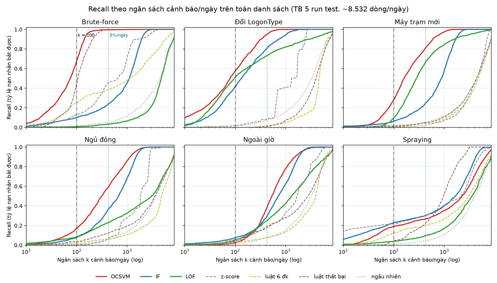
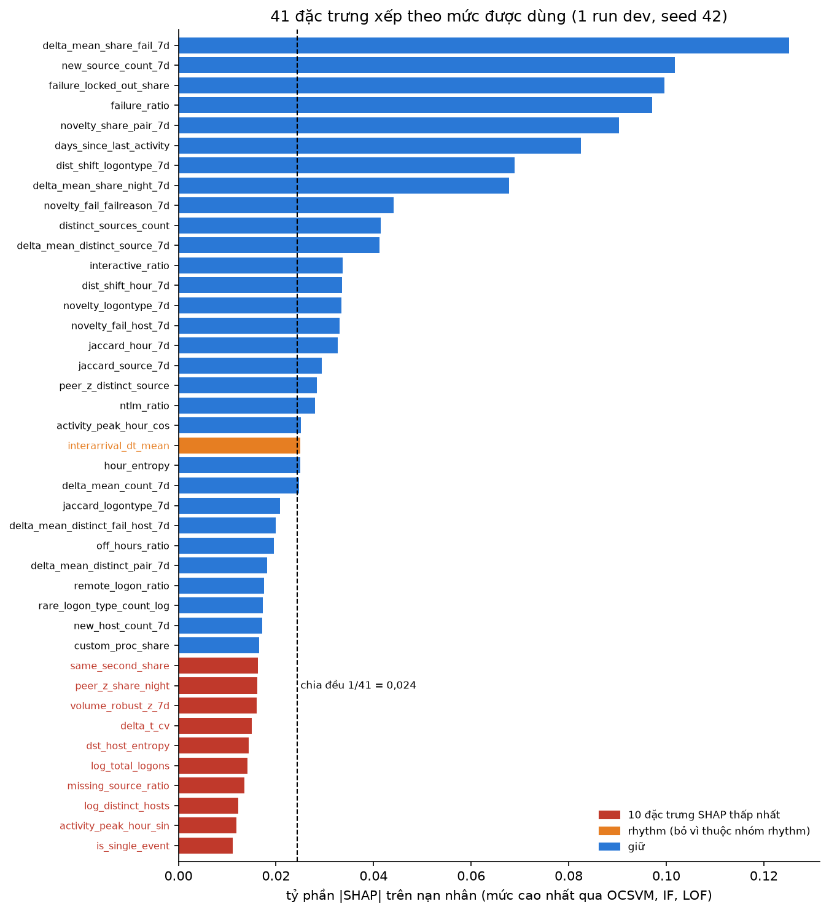
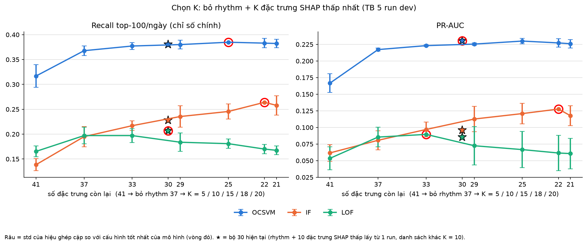
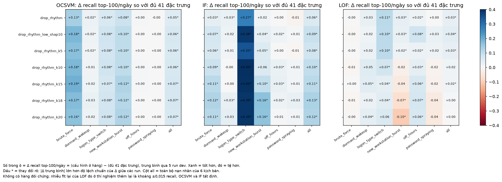
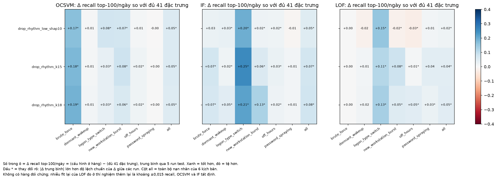

# Báo cáo tuần 5

Nội dung gồm 6 phần:
1. độ dài cửa sổ lịch sử;
2. phân tích theo kịch bản tấn công;
3. giải thích mô hình bằng SHAP: từ nhóm đặc trưng đến từng đặc trưng;
4. loại bỏ đặc trưng trên dev: bộ 30, chọn K và chốt K = 18 (22 đặc trưng);
5. kiểm tra trên test và benchmark cuối với bộ 22;
6. review thủ công.

Mọi số liệu tính trên nhãn tiêm tổng hợp: 6 kịch bản tấn công được tiêm vào log thật, phân khúc User. Vì vậy các con số là **cận trên lạc quan**, vì tấn công thật thường kín đáo hơn.

## 0. Chỉ số dùng trong báo cáo

| Chỉ số | Định nghĩa | Vai trò |
|---|---|---|
| **Recall top-100/ngày** (recall@K, K = 100 cảnh báo mỗi ngày) | Mỗi ngày lấy 100 tài khoản có điểm dị biệt cao nhất. Chỉ số là tỷ lệ nạn nhân (dòng tài khoản-ngày bị tiêm) nằm trong 100 cảnh báo đó, gộp qua mọi ngày chấm. Theo kịch bản: tỷ lệ nạn nhân **của kịch bản đó** lọt vào top-100 | **Chỉ số chính** |
| PR-AUC | Diện tích dưới đường precision–recall trên toàn bộ danh sách xếp hạng | Chỉ số phụ, đo chất lượng xếp hạng tổng thể |
| ROC-AUC | Xác suất một nạn nhân có điểm cao hơn một dòng bình thường chọn ngẫu nhiên | Chỉ số phụ, dùng khi so theo kịch bản |
| P@50 | Tỷ lệ nạn nhân trong 50 dòng điểm cao nhất của cả khối chấm | Đo độ "sạch" của phần đầu danh sách |
| Δ (delta) | Hiệu ghép cặp: (cấu hình mới) − (cấu hình gốc), tính trên cùng run và cùng seed | Dùng trong ablation |
| Tỷ phần \|SHAP\| | \|φⱼ\| / Σ\|φ\| của một dòng: phần trăm điểm dị biệt do đặc trưng j đẩy lên | Dùng trong phần SHAP |

Mọi giá trị là trung bình ± độ lệch chuẩn (std) qua 5 lần chạy, trừ khi ghi khác.

### Vì sao chọn recall@K làm chỉ số chính

1. **Khớp với cách vận hành thật.** SOC có năng lực xem cố định, khoảng vài chục đến 100 cảnh báo mỗi ngày. Câu hỏi thực tế là "trong số cảnh báo analyst kịp xem, bắt được bao nhiêu % tấn công". Recall@K trả lời đúng câu hỏi đó.
   - Mỗi ngày test có khoảng 8.600 dòng User, nên 100 cảnh báo tương đương ngân sách khoảng 1,2%.
2. **ROC-AUC quá lạc quan khi dữ liệu mất cân bằng.** Nạn nhân chỉ chiếm khoảng 1% số dòng.
   - Ví dụ (bảng 5.3, 22 đặc trưng): ROC-AUC của IF còn nhỉnh hơn OCSVM (0,921 so với 0,908), nhưng recall top-100/ngày của IF (0,24) chỉ bằng khoảng hai phần ba OCSVM (0,37).
   - ROC-AUC tính cả phần cuối danh sách mà không ai đọc tới, nên không phân biệt được hai mô hình này.
3. **PR-AUC tốt hơn ROC-AUC nhưng vẫn tính trên toàn bộ danh sách.** Nó cộng cả precision ở những mức recall cao mà analyst không bao giờ đạt tới. Vì vậy PR-AUC được giữ làm chỉ số phụ, không phải chỉ số chính.
4. **Precision@K không so được giữa các kịch bản.** Top-100 mỗi ngày chứa nạn nhân của cả 6 kịch bản. Precision của "riêng brute_force" vì thế không có nghĩa rõ ràng, và số nạn nhân mỗi kịch bản cũng khác nhau. Recall theo kịch bản thì so được: mẫu số là số nạn nhân của chính kịch bản đó.
5. **Không phụ thuộc ngưỡng của từng mô hình.** Ngưỡng contamination (ví dụ 5% trên train) làm mỗi mô hình bật số cảnh báo khác nhau, nên so recall tại ngưỡng là không công bằng. Recall@K cho mọi mô hình cùng một ngân sách cảnh báo.
6. **Tính theo từng ngày** để một ngày có nhiều hoạt động không chiếm hết ngân sách của các ngày khác.

---

## 1. Cửa sổ lịch sử 7 / 14 / 21 ngày → giữ 7 ngày

**Câu hỏi:** các đặc trưng lịch sử (`novelty_*`, `jaccard_*`, `dist_shift_*`, `delta_mean_*`, `new_*_count_7d`, `volume_robust_z_7d`) so ngày t với N ngày trước. Kéo dài N có giúp phát hiện tốt hơn không?

**Thiết lập:**
- Một run tiêm test (`test_seed20261061`): fit ngày 1–42, chấm ngày 43–60.
- Cấu hình mô hình chốt từ dev, không chọn lại. Mỗi cửa sổ chạy 5 model seed (42, 7, 2024, 1, 2) trên cùng run, nên std chỉ đo nhiễu của mô hình.
- Thứ tự dòng được sắp cố định trước khi fit.

**Bảng 1.1: Recall top-100/ngày (chỉ số chính), TB ± std qua 5 seed**

| Mô hình | 7 ngày | 14 ngày | 21 ngày |
|---|---|---|---|
| OCSVM | **0,317 ± 0,027** | 0,318 ± 0,031 | 0,294 ± 0,030 |
| IF | **0,159 ± 0,015** | 0,156 ± 0,004 | 0,146 ± 0,006 |
| LOF | **0,121 ± 0,006** | 0,034 ± 0,004 | 0,003 ± 0,003 |

**Bảng 1.2: PR-AUC và ROC-AUC (chỉ số phụ)**

| Mô hình | PR-AUC 7 / 14 / 21 | ROC-AUC 7 / 14 / 21 |
|---|---|---|
| OCSVM | 0,165 ± 0,011 / 0,169 ± 0,012 / 0,160 ± 0,009 | 0,915 / 0,925 / 0,929 |
| IF | 0,066 ± 0,004 / 0,063 ± 0,002 / 0,059 ± 0,002 | 0,885 / 0,885 / 0,882 |
| LOF | 0,043 ± 0,002 / 0,027 ± 0,001 / 0,020 ± 0,001 | 0,680 / 0,633 / 0,660 |

**Bảng 1.3: ROC-AUC theo kịch bản của OCSVM, các kịch bản thay đổi rõ**

| Kịch bản | 7 ngày | 14 ngày | 21 ngày |
|---|---|---|---|
| password_spraying | 0,690 | 0,739 | **0,770** |
| off_hours | 0,911 | 0,917 | 0,929 |
| dormant_wakeup | **0,940** | 0,939 | 0,924 |

ROC-AUC dùng ở đây vì bảng theo kịch bản của thí nghiệm cửa sổ chỉ lưu ROC/PR-AUC. IF ở dormant_wakeup giảm mạnh hơn: 0,908 → 0,850.

**Bảng 1.4: Chi phí tính đặc trưng lịch sử**

| | 7 ngày | 14 ngày | 21 ngày |
|---|---|---|---|
| Thời gian bước ghép lịch sử | mốc | ~200 s | ~570 s |
| RAM | mốc | gần gấp đôi (lần đầu chạy bị dừng vì thiếu RAM) | cao hơn nữa |


**Đọc biểu đồ:** trục ngang là độ dài cửa sổ, mỗi đường là một mô hình, thanh sai số là ±1 std qua 5 seed. OCSVM và IF gần như nằm ngang rồi đi xuống ở 21 ngày; LOF rơi mạnh ngay từ 14 ngày.

**Vì sao giữ 7 ngày:**
1. **14 ngày không tốt hơn.** Recall top-100/ngày của OCSVM gần như bằng nhau (0,317 so với 0,318), chênh lệch nhỏ hơn rất nhiều so với std 0,03. PR-AUC chỉ tăng 0,004, nhỏ hơn std 0,011. IF không đổi, LOF giảm mạnh (0,121 → 0,034).
2. **21 ngày làm giảm recall của cả ba mô hình ML:** OCSVM 0,317 → 0,294, IF 0,159 → 0,146, LOF gần như mất khả năng xếp hạng (0,003). Trong khi đó chi phí tính toán gấp khoảng 3 lần.
3. **Lợi ích của cửa sổ dài chỉ nằm ở một kịch bản.** password_spraying tăng ROC-AUC 0,69 → 0,77, nhưng dormant_wakeup lại giảm: cửa sổ càng dài thì khoảng ngủ đông càng dễ lọt vào cửa sổ, nên ngày "thức dậy" bớt nổi bật. Lợi ích cho spraying nên lấy bằng đặc trưng riêng (fan-out theo máy nguồn) thay vì kéo dài cửa sổ cho cả bộ đặc trưng.
4. **Lý do LOF giảm (giả thuyết, chưa kiểm):** N ngày đầu của train không đủ lịch sử nên các đặc trưng `delta_mean_*` được điền median. N càng lớn thì càng nhiều dòng train bị "làm phẳng" (21/42 ngày khi N = 21), tạo cụm dày giả; LOF dựa trên mật độ nên nhạy nhất với điều này.

Không chạy 28 ngày vì xu hướng đã đi xuống từ 21 ngày, và khi đó phần warm-up chiếm 2/3 train.

📁 Số liệu: [`experiments/grid/window_ablation/`](../../experiments/grid/window_ablation/), gồm `window_comparison.csv` và `window_scenarios.csv`.

---

## 2. Phân tích theo kịch bản

**Thiết lập:**
- 5 run tiêm khối test: fit ngày 1–42, chấm ngày 43–60, phân khúc User. Mỗi run có 1.543 nạn nhân, tổng 7.715.
- Cấu hình chốt từ dev (OCSVM 1.000 thành phần Nystroem, IF 300 cây, LOF k = 20) với **41 đặc trưng**, cùng 4 baseline. Kết quả với bộ 22 đặc trưng nằm ở mục 5.

**Bảng 2.1: Recall top-100/ngày theo kịch bản (chỉ số chính), TB qua 5 run test**

| Kịch bản | OCSVM | IF | LOF | z-score | Luật thất bại ≥ 5 | Luật 6 điều kiện |
|---|---|---|---|---|---|---|
| brute_force | **0,68** | 0,10 | 0,01 | 0,13 | 0,45 | 0,26 |
| logon_type_switch | **0,58** | 0,42 | 0,51 | 0,02 | 0,00 | 0,00 |
| new_workstation_burst | **0,29** | 0,07 | 0,10 | 0,02 | 0,01 | 0,00 |
| password_spraying | 0,19 | **0,23** | 0,04 | 0,22 | 0,05 | 0,12 |
| dormant_wakeup | **0,17** | 0,08 | 0,08 | 0,00 | 0,04 | 0,02 |
| off_hours | 0,03 | **0,08** | 0,05 | 0,06 | 0,04 | 0,03 |
| **Tất cả** | **0,32** | 0,16 | 0,13 | 0,08 | 0,10 | 0,07 |

Mô hình ngẫu nhiên đạt khoảng 0,014 ở mọi kịch bản.


**Đọc biểu đồ:** mỗi ô là recall top-100/ngày (cùng số với bảng 2.1), màu càng đậm thì bắt được càng nhiều. Hàng OCSVM đậm nhất ở 4/6 cột. Cột off_hours nhạt ở mọi hàng.

**Bảng 2.2: Hạng trung vị của nạn nhân theo OCSVM**

Hạng tính theo % từ trên xuống của danh sách xếp hạng; càng nhỏ càng tốt.

| brute_force | logon_type_switch | new_workstation_burst | dormant_wakeup | off_hours | password_spraying |
|---|---|---|---|---|---|
| top 0,8% | top 1,2% | top 1,8% | top 4,0% | top 7,7% | top 26% |



**Đọc biểu đồ:** mỗi ô là một kịch bản; trục ngang là ngân sách k cảnh báo/ngày (thang log), trục dọc là tỷ lệ nạn nhân lọt vào k cảnh báo đầu mỗi ngày. Nét gạch–chấm là k = 100 (ngân sách chính), nét chấm là 5%/ngày (khoảng 430 cảnh báo). Đường càng lên sớm càng tốt.
- brute_force: OCSVM gần 0,7 ở k = 100 và gần 1,0 ở 5%/ngày; LOF gần như nằm sát đường ngẫu nhiên.
- Ngoài giờ: mọi đường còn thấp ở k = 100, chỉ bắt đầu tăng sau khoảng 300 cảnh báo/ngày.
- Spraying: mọi mô hình đi gần đường ngẫu nhiên; z-score và luật thất bại chỉ bắt được một phần nhỏ nạn nhân ở rất sớm.

**Giải thích từng kịch bản:**

- **brute_force: OCSVM bắt tốt nhất (0,68, hạng trung vị top 0,8%).**
  - Luật "thất bại ≥ 5" cờ được 100% nạn nhân tại ngưỡng của nó, nhưng chỉ 0,45 lọt top-100/ngày. Lý do: nhiều tài khoản thật cũng có ≥ 5 lần thất bại, nên luật không xếp hạng được nạn nhân lên trên.
  - LOF gần như mù (0,01) vì train có khoảng 600 dòng thật trông giống brute-force. Các nạn nhân rơi vào vùng có mật độ "bình thường".
- **logon_type_switch: cả ba mô hình ML đều bắt khá (0,42–0,58).** Hai đặc trưng `novelty_logontype_7d` và `jaccard_logontype_7d` tách nạn nhân rất rõ: AUC của riêng từng đặc trưng đạt 0,95–1,00.
- **new_workstation_burst: chỉ OCSVM bắt được đáng kể (0,29).** Nạn nhân bị bỏ sót có ít máy mới hơn (trung vị 6 so với 9 máy) và ít sự kiện hơn (12 so với 18). Một bùng nổ nhỏ chìm vào biến động tự nhiên.
- **dormant_wakeup: yếu ở mọi mô hình (OCSVM 0,17).**
  - Điều ngược trực giác: nạn nhân bị bỏ sót có **nhiều** sự kiện hơn nạn nhân bị bắt (trung vị 150 so với 85).
  - Ngày "thức dậy" được phát lại từ một ngày train của chính tài khoản. Khi khối lượng lớn, nó giống một tài khoản bận bình thường; chỉ còn `days_since_last_activity` là lệch.
- **off_hours: không mô hình nào bắt được (tốt nhất là IF với 0,08; OCSVM 0,03).**
  - Nạn nhân bị bỏ sót có trung vị 107 sự kiện, nạn nhân bị bắt chỉ 9,5. Một ngày bận bị dời sang đêm vẫn trông như một tài khoản bận.
  - Hai đặc trưng về ban đêm chỉ chiếm 2/41 chiều, nên bị các chiều khối lượng lấn át trong khoảng cách mà OCSVM dùng.
- **password_spraying: IF (0,23) ≈ z-score (0,22) > OCSVM (0,19), nhưng đều thấp.**
  - Nguyên nhân gốc: mỗi nạn nhân chỉ nhận **1–3 lần thử** (trung vị 2). Chiến dịch rải trên nhiều tài khoản, nên ở mức (tài khoản, ngày) gần như không có tín hiệu.
  - Không chỉnh mô hình nào giải được việc này. Cần đặc trưng **theo máy nguồn**, tức một Source thử nhiều tài khoản trong thời gian ngắn.

**Kết luận phần 2:**
1. OCSVM là mô hình chính: tốt nhất ở 4/6 kịch bản và gấp đôi IF ở recall tổng (0,32 so với 0,16).
2. Có hai điểm mù chung cho mọi mô hình:
   - **off_hours:** cần đặc trưng giờ so với lịch sử giờ của chính tài khoản;
   - **password_spraying:** cần đặc trưng fan-out theo máy nguồn.

📁 Số liệu: [`experiments/analysis/scenario/`](../../experiments/analysis/scenario/), gồm `scenario_detection.csv` và `missed_victims.csv`.

---

## 3. SHAP: đặc trưng nào đẩy điểm dị biệt lên

**Mục đích:** biết đặc trưng nào thực sự được mô hình dùng, để chọn ứng viên loại bỏ ở mục 4.

**Thiết lập:**
- Run **dev** `dev_seed20261036`: fit ngày 1–35, chấm ngày 36–42. Không dùng khối test để tránh rò rỉ, vì kết quả sẽ được dùng để chọn đặc trưng.
- Giải thích ba mô hình chốt (seed 42) trên 180 nạn nhân (30 mỗi kịch bản) và 30 báo nhầm điểm cao nhất của mỗi mô hình.
- **Báo nhầm không phải kịch bản tiêm.** Đó là 30 dòng tài khoản–ngày **bình thường** (không bị tiêm) mà mô hình chấm điểm cao nhất. Nhóm này được giải thích song song với nạn nhân để biết đặc trưng nào khiến mô hình **báo sai**, khác với đặc trưng giúp mô hình **bắt đúng**. Trong bảng và hình, nó luôn đứng ở cột cuối, tách khỏi 6 kịch bản.
- **SHAP** (KernelSHAP): nền 50 dòng train, 1.000 mẫu. Tổng đóng góp cộng với giá trị nền khớp đúng điểm (sai số ≤ 3·10⁻¹⁴).
- Ba mô hình có thang điểm khác nhau, nên mỗi dòng được chuẩn hoá thành **tỷ phần |SHAP|** (xem mục 0).
- Luồng phân tích đi từ thô đến chi tiết: SHAP theo nhóm (3.1) → SHAP theo từng đặc trưng để chọn ứng viên (3.2) → nhóm rhythm (3.3). Mục 4 bỏ thật các ứng viên rồi đo lại.
- 41 đặc trưng được chia thành 8 nhóm theo nghĩa:

| Nhóm | Số đặc trưng | Ví dụ |
|---|---|---|
| volume | 3 | log_total_logons, volume_robust_z_7d |
| failure | 6 | failure_ratio, failure_locked_out_share |
| time | 8 | off_hours_ratio, hour_entropy, 2 đặc trưng đêm |
| rhythm | 4 | interarrival_dt_mean, delta_t_cv, same_second_share |
| logon_type | 6 | interactive_ratio, ntlm_ratio |
| fanout | 6 | distinct_sources_count, dst_host_entropy |
| novelty | 5 | new_source_count_7d, days_since_last_activity |
| context | 3 | missing_source_ratio, remote_logon_ratio |

### 3.1 SHAP theo nhóm và kịch bản

**Bảng 3.1: Nhóm đóng góp chính theo kịch bản (tỷ phần |SHAP| trung bình, OCSVM / IF / LOF)**

| Kịch bản | Nhóm chính |
|---|---|
| brute_force | failure 0,76 / 0,51 / 0,60 |
| password_spraying | failure 0,33 / 0,30 / 0,50, sau đó là time |
| off_hours | time 0,52 / 0,50 / 0,29 |
| logon_type_switch | logon_type 0,44 / 0,38 / 0,22 |
| new_workstation_burst | novelty 0,44 / 0,34 / 0,39 và fanout 0,35 / 0,36 / 0,18 |
| dormant_wakeup | novelty 0,49 / 0,40 / 0,30, chủ yếu là `days_since_last_activity` |
| **Báo nhầm** (dòng bình thường, không phải kịch bản) | OCSVM: **rhythm 0,27** · IF: failure 0,26 · LOF: failure 0,29 |

**Bảng 3.2: Tỷ phần |SHAP| trên toàn bộ nạn nhân, so với mức chia đều (số đặc trưng của nhóm / 41)**

| Nhóm | Chia đều | OCSVM | IF | LOF |
|---|---|---|---|---|
| novelty | 0,12 | **0,22** | **0,22** | **0,23** |
| failure | 0,15 | 0,21 | 0,17 | **0,26** |
| time | 0,20 | 0,16 | 0,19 | 0,14 |
| fanout | 0,15 | 0,15 | 0,15 | 0,10 |
| logon_type | 0,15 | 0,14 | 0,15 | 0,13 |
| rhythm | 0,10 | 0,04 | 0,05 | 0,06 |
| volume | 0,07 | 0,05 | 0,04 | 0,04 |
| context | 0,07 | 0,03 | 0,04 | 0,04 |


**Đọc biểu đồ:**
- Mỗi bảng nhiệt là một mô hình. Hàng là nhóm đặc trưng, số trong ô là tỷ phần |SHAP|.
- 6 cột đầu là 6 kịch bản. Sau vạch đen là hai cột không phải kịch bản: "tất cả nạn nhân" (gộp 180 nạn nhân) và "BÁO NHẦM" (30 dòng bình thường điểm cao nhất, xem phần thiết lập).
- Ô đậm nằm gần như trên một "đường chéo": mỗi kịch bản có đúng một nhóm nổi bật.
- Riêng OCSVM có ô rhythm × BÁO NHẦM đậm (0,27), trong khi hàng rhythm nhạt ở mọi cột nạn nhân: rhythm làm OCSVM báo sai chứ không giúp bắt đúng.

**Nhận xét:**
1. **Mô hình bắt đúng tín hiệu.** Ở cả ba mô hình, mỗi kịch bản được giải thích bằng đúng nhóm đặc trưng thiết kế cho nó:
   - failure → brute_force;
   - time → off_hours;
   - logon_type → logon_type_switch;
   - novelty và fanout → burst;
   - `days_since_last_activity` → dormant_wakeup.
2. **Ba mô hình nhất quán:** cùng chỉ ra một nhóm chính cho mỗi kịch bản, chỉ khác nhau về mức độ.
3. **novelty và failure gánh nhiều nhất,** cao hơn hẳn mức chia đều. **rhythm, volume và context** đóng góp dưới mức chia đều ở mọi kịch bản.
4. **off_hours:** nhóm time giải thích phần lớn điểm của nạn nhân (0,52), nhưng điểm tuyệt đối vẫn thấp nên nạn nhân không lọt top. Tỷ phần |SHAP| cho biết **cái gì** đẩy điểm lên, không cho biết điểm có **đủ cao** hay không.
5. **Đặc trưng template v4 có đóng góp thật:** chiếm 44–51% tỷ phần ở nạn nhân, trong khi chỉ chiếm 41% số chiều (17/41).

### 3.2 SHAP theo từng đặc trưng → 10 ứng viên cắt tỉa



**Đọc biểu đồ:** mỗi thanh là một đặc trưng, độ dài là tỷ phần |SHAP| trên nạn nhân, lấy mức **cao nhất** trong ba mô hình. Đỏ là 10 đặc trưng thấp nhất; cam là `interarrival_dt_mean` (bị bỏ vì thuộc nhóm rhythm, xem 3.3); nét đứt là mức chia đều 1/41 = 0,024.

**Cách lọc:**
- Mỗi đặc trưng lấy tỷ phần cao nhất trong OCSVM, IF, LOF. Một đặc trưng chỉ bị xếp thấp khi nó thấp ở **cả ba** mô hình.
- Chọn 10 đặc trưng có giá trị này thấp nhất.

**Bảng 3.3: 10 đặc trưng SHAP thấp nhất và hai đặc trưng kế tiếp**

| Hạng (từ dưới) | Đặc trưng | Nhóm | Tỷ phần cao nhất qua 3 mô hình |
|---|---|---|---|
| 1 | `is_single_event` | rhythm | 0,011 |
| 2 | `activity_peak_hour_sin` | time | 0,012 |
| 3 | `log_distinct_hosts` | fanout | 0,012 |
| 4 | `missing_source_ratio` | context | 0,014 |
| 5 | `log_total_logons` | volume | 0,014 |
| 6 | `dst_host_entropy` | fanout | 0,014 |
| 7 | `delta_t_cv` | rhythm | 0,015 |
| 8 | `volume_robust_z_7d` | volume | 0,016 |
| 9 | `peer_z_share_night` | time | 0,016 |
| 10 | `same_second_share` | rhythm | 0,016 |
| *11* | *`custom_proc_share`* | *context* | *0,017 (giữ)* |
| *12* | *`new_host_count_7d`* | *novelty* | *0,017 (giữ)* |

**Nhận xét:**
1. Cả 10 đặc trưng chỉ đạt 0,011–0,016, dưới mức chia đều 0,024 ở mọi mô hình.
2. **Con số 10 là ngưỡng chọn tròn, không phải điểm gãy.** Hạng 10 (0,0163) và hạng 11 (0,0165) chỉ chênh 0,0002. Vì vậy SHAP chỉ cho **danh sách ứng viên**; số đặc trưng cần bỏ được đo bằng thí nghiệm loại bỏ ở mục 4.2.
3. Ba trong 10 ứng viên thuộc nhóm rhythm (`is_single_event`, `delta_t_cv`, `same_second_share`).

### 3.3 Nhóm rhythm: ít giúp bắt nạn nhân, gây báo nhầm ở OCSVM

**Bảng 3.4: Tỷ phần |SHAP| của cả nhóm rhythm (4 đặc trưng; mức chia đều 4/41 = 0,098)**

| | OCSVM | IF | LOF |
|---|---|---|---|
| Nạn nhân | 0,042 | 0,049 | 0,055 |
| Báo nhầm | **0,266** | 0,054 | 0,106 |

**Nhận xét:**
1. Ở nạn nhân, rhythm chỉ bằng khoảng một nửa mức chia đều ở cả ba mô hình: nhóm này ít giúp bắt đúng.
2. Ở báo nhầm của OCSVM, rhythm chiếm 0,266, gần gấp 3 lần mức chia đều. Phần này gần như toàn bộ do `delta_t_cv` (0,224).
3. Vì vậy rhythm là ứng viên loại bỏ số 1: bỏ đi có thể giảm báo nhầm mà ít mất recall.
4. `interarrival_dt_mean` không thấp ở LOF (0,025, ngang mức chia đều) nên không nằm trong 10 ứng viên ở 3.2. Nó bị bỏ chỉ vì thuộc nhóm rhythm.

**Về LIME:** LIME được chạy song song (105 dòng mỗi mô hình) để đối chiếu. Hai phương pháp khớp ở mức nhóm và ở đặc trưng mạnh nhất nhưng khớp kém ở từng dòng; với LOF, mô hình tuyến tính của LIME chỉ giải thích được 6% điểm (R² 0,06). Vì vậy **SHAP là căn cứ chính**, LIME chỉ để minh hoạ. Chi tiết ở [`shap_lime.md`](shap_lime.md).

📁 Số liệu: [`experiments/analysis/explain/`](../../experiments/analysis/explain/), gồm `feature_importance.csv`, `group_importance.csv` và `shap_lime_agreement.csv`. Vẽ lại hình 05: `python scripts/evaluation/plot_shap_41.py`.

**Hạn chế:**
- Một run dev, một model seed (42).
- Tỷ phần |SHAP| đo đóng góp vào **điểm**, không đo đóng góp vào **khả năng phát hiện**. Chỉ thí nghiệm loại bỏ ở mục 4 mới đo được phần đó.

---

## 4. Loại bỏ đặc trưng trên dev: bộ 30, chọn K → chốt K = 18

**Thiết lập:**
- **Dev:** 5 run (`dev_seed20261036`–`040`), fit ngày 1–35, chấm ngày 36–42. Giữ nguyên tham số mô hình.
- Mỗi cấu hình bỏ một danh sách đặc trưng, huấn luyện lại, rồi so bằng **Δ ghép cặp** trên cùng run và seed. Dấu * nghĩa là |Δ TB| > 1 std của Δ qua 5 run.
- **Mức nhiễu cần vượt:**
  - OCSVM: chỉ xáo thứ tự dòng train đã làm PR-AUC lệch −0,020 ± 0,019 (đối chứng `control_shuffle_rows`).
  - LOF: không tất định vì chỉ mục HNSW dựng đa luồng (`n_jobs: -1`); fit lại cùng dữ liệu lệch khoảng ±0,015 recall, nên hiệu của LOF dưới khoảng 0,03 cần đọc thận trọng.
  - OCSVM và IF cho kết quả giống hệt khi fit lại cùng thứ tự dòng.

### 4.1 Bộ 30: bỏ rhythm và 10 ứng viên SHAP thấp

Bỏ 4 đặc trưng rhythm và 10 ứng viên ở mục 3.2. Ba đặc trưng trùng nhau nên tổng cộng bỏ **11**, còn **30**:
- **rhythm (4):** `interarrival_dt_mean`, `delta_t_cv`, `same_second_share`, `is_single_event`;
- **7 đặc trưng SHAP thấp còn lại:** `activity_peak_hour_sin`, `log_distinct_hosts`, `missing_source_ratio`, `log_total_logons`, `dst_host_entropy`, `volume_robust_z_7d`, `peer_z_share_night`.

**Bảng 4.1: Δ so với đủ 41 đặc trưng, TB qua 5 run dev**

Mốc 41 đặc trưng: recall top-100/ngày OCSVM 0,317, IF 0,139, LOF 0,164; PR-AUC 0,167 / 0,062 / 0,055.

| Cấu hình (số đặc trưng còn lại) | **ΔRecall top-100/ngày** OCSVM / IF / LOF | ΔPR-AUC OCSVM | ΔPR-AUC IF | ΔPR-AUC LOF |
|---|---|---|---|---|
| **bỏ rhythm + 10 SHAP thấp (30)** | **+0,06 / +0,09 / +0,05** | **+0,064 ± 0,014** | **+0,034 ± 0,012** | **+0,037 ± 0,019** |
| bỏ rhythm (37) | +0,05 / +0,06 / +0,03 | +0,050 ± 0,013 | +0,019 ± 0,006 | +0,029 ± 0,012 |
| bỏ 10 SHAP thấp (31) | +0,03 / +0,08 / 0,00 | +0,042 ± 0,010 | +0,028 ± 0,006 | −0,005 ± 0,004 |
| *đối chứng: xáo dòng (41)* | *−0,02 / 0,00 / 0,00* | *−0,020 ± 0,019* | *0,000 ± 0,001* | *−0,005 ± 0,008* |

**Nhận xét:**
1. **Bỏ rhythm giúp cả ba mô hình, đúng như SHAP dự đoán.** Ở OCSVM, P@50 tăng 0,15 và PR-AUC tăng 0,050, gấp 2,5 lần mức nhiễu xáo dòng.
2. **Bỏ cả rhythm và các ứng viên SHAP thấp cho kết quả tốt nhất ở cả ba mô hình,** và không kịch bản nào bị hại rõ.
3. Nhưng số 10 ở mục 3.2 là chọn tròn, nên kết quả này chỉ chứng minh bỏ 11 đặc trưng *không hại*, chưa chứng minh 11 là số hợp lý. Mục 4.2 đo trực tiếp.

### 4.2 Chọn K: bỏ lần lượt thêm các đặc trưng SHAP thấp

**Thiết lập:**
- Xếp 41 đặc trưng theo tỷ phần |SHAP| trên nạn nhân, lấy mức **cao nhất qua 3 mô hình × 3 run dev** (`dev_seed20261036`–`038`). Một đặc trưng chỉ bị xếp thấp khi nó thấp ở mọi mô hình và mọi run.
- Cấu hình `drop_rhythm_kK` bỏ rhythm + K đặc trưng đầu danh sách. Vài đặc trưng rhythm cũng nằm trong nhóm SHAP thấp, nên số đặc trưng bỏ thực tế ít hơn 4 + K.
- **K = 18 là mức cắt trung bình:** đúng 18 đặc trưng này có tỷ phần dưới mức chia đều 1/41 ở mọi mô hình và mọi run.
- **Quy tắc chọn K (đặt trước khi xem kết quả):** với mỗi mô hình, chọn K lớn nhất mà hiệu ghép cặp so với cấu hình tốt nhất vẫn nằm trong 1 std, và không kịch bản nào giảm rõ.
- Danh sách bỏ thêm ở từng K nằm trong [`chon_so_dac_trung_K.md`](chon_so_dac_trung_K.md), mục 2.

**Bảng 4.2: Recall top-100/ngày theo số đặc trưng còn lại, TB ± std qua 5 run dev**

| Còn lại | OCSVM | IF | LOF |
|---|---|---|---|
| 41 (đủ) | 0,317 ± 0,058 | 0,139 ± 0,011 | 0,165 ± 0,017 |
| 37 (bỏ rhythm, K = 0) | 0,368 ± 0,057 | 0,195 ± 0,023 | 0,197 ± 0,014 |
| 33 (K = 5) | 0,377 ± 0,059 | 0,217 ± 0,014 | 0,197 ± 0,018 |
| 30 (bộ 30) | 0,380 ± 0,059 | 0,228 ± 0,017 | **0,207 ± 0,014** |
| 29 (K = 10) | 0,380 ± 0,061 | 0,235 ± 0,022 | 0,184 ± 0,015 |
| 25 (K = 15) | **0,385 ± 0,059** | 0,246 ± 0,019 | 0,181 ± 0,015 |
| **22 (K = 18, chốt)** | 0,383 ± 0,067 | **0,264 ± 0,012** | 0,170 ± 0,006 |
| 21 (K = 20) | 0,382 ± 0,064 | 0,258 ± 0,021 | 0,167 ± 0,016 |

std ở đây là độ phân tán giữa 5 run (khác nhau về dữ liệu tiêm), lớn hơn nhiều so với std của hiệu ghép cặp dùng để so hai cấu hình.



**Đọc biểu đồ:** trục x là số đặc trưng còn lại, đi từ trái sang phải là bỏ dần. Mỗi điểm là TB qua 5 run dev; râu là std của hiệu ghép cặp so với cấu hình tốt nhất của mô hình đó (vòng đỏ). Ngôi sao là bộ 30, vẽ riêng vì danh sách của nó khác K = 10.



**Đọc biểu đồ:** số trong ô là Δ recall top-100/ngày so với đủ 41 đặc trưng, TB 5 run dev; xanh là tốt hơn, đỏ là tệ hơn, dấu * là |Δ TB| > 1 std.

**Nhận xét:**
1. **Ba mô hình muốn ba con số khác nhau, không có K chung tốt nhất.**
   - **OCSVM: đường cong phẳng từ 33 đến 22 đặc trưng.** Mọi cấu hình từ bộ 30 đến K = 18 cách mức tốt nhất ≤ 0,005, trong 1 std.
   - **IF: càng bỏ càng tốt đến 22 đặc trưng rồi dừng.** Recall tăng đều 0,195 → 0,264. K = 20 không tăng thêm (−0,006 ± 0,019 so với K = 18). IF chọn đặc trưng ngẫu nhiên để tách, nên mỗi chiều yếu làm loãng cây.
   - **LOF: tốt nhất ở 30–33 đặc trưng rồi giảm.** K = 15 và K = 18 kém rõ (−0,026 ± 0,010 và −0,037 ± 0,009 recall), vượt mức nhiễu fit lại; mức giảm tập trung ở burst và spraying.
2. **Bộ 30 (con số 10 chọn tròn) nằm giữa đường cong:** trên phần phẳng của OCSVM, tốt nhất cho LOF, nhưng kém IF 0,036 recall so với 22 đặc trưng.
3. **SHAP thấp chưa chắc là vô ích.** `k10` (29 đặc trưng) kém bộ 30 ở LOF (0,184 so với 0,207) dù chỉ khác 5 đặc trưng: ba đặc trưng `k10` bỏ thêm (`custom_proc_share`, `delta_mean_distinct_pair_7d`, `new_host_count_7d`) có ích cho LOF dù SHAP thấp.
4. **Không có lý do cắt sâu hơn 22 đặc trưng:** K = 20 không tốt hơn K = 18 ở mô hình nào (OCSVM −0,001 ± 0,004, IF −0,006 ± 0,019, LOF −0,003 ± 0,012 recall).

**Kết luận mục 4: chốt K = 18, tức bộ 22 đặc trưng** (bỏ 4 đặc trưng rhythm và 15 đặc trưng SHAP thấp; 3 đặc trưng rhythm nằm sẵn trong 18 nên tổng bỏ 19). Lý do:
- **K = 18 là mức cắt có căn cứ, không chọn tròn:** đúng 18 đặc trưng này có tỷ phần |SHAP| dưới mức chia đều 1/41 ở mọi mô hình và mọi run dev.
- **Bỏ thêm không được gì:** K = 20 không tốt hơn K = 18 ở mô hình nào, nên dừng ở 18.
- **OCSVM (mô hình chính) không đổi** so với bộ 30 (vùng phẳng), **IF tăng rõ** (0,228 → 0,264 recall).
- **Đánh đổi:** trên dev, LOF kém bộ 30 rõ (−0,037 ± 0,009 recall), chủ yếu ở burst và spraying. Mục 5 kiểm tra lại trên test.

Bộ 22 được chọn qua `drop_features` trong [`configs/benchmark_grid_test_22f.yaml`](../../configs/benchmark_grid_test_22f.yaml); `configs/feature_schema.yaml` chưa đổi.

📁 Số liệu: [`experiments/ablation/feature_groups/`](../../experiments/ablation/feature_groups/) (bảng 4.1) và [`experiments/ablation/kcurve/`](../../experiments/ablation/kcurve/) (bảng 4.2). Chạy lại:

```
python scripts/evaluation/feature_ablation.py                 # bảng 4.1
python scripts/evaluation/feature_ablation.py --mode kcurve   # bảng 4.2, ~35 phút
python scripts/evaluation/plot_kcurve.py                       # hình 06
```

**Hạn chế:**
- Thứ hạng SHAP lấy từ run dev và ablation cũng chạy trên dev, nên có thiên lệch chọn nhẹ. Mục 5 kiểm tra trên test.
- Tham số mô hình giữ nguyên theo bản 41 đặc trưng. Với ít chiều hơn, k của LOF và số thành phần của OCSVM có thể còn tốt hơn, nhưng chưa dò lại.

---

## 5. Kiểm tra trên test và benchmark cuối với bộ 22

### 5.1 Kiểm tra một lần trên khối test

Bộ 30 và K được chọn trên dev nên kết quả dev có thể lạc quan. Vì vậy chạy lại trên 5 run test (fit ngày 1–42, chấm ngày 43–60): đủ 41 đặc trưng, bộ 30, K = 15 và K = 18. Không chọn lại tham số mô hình trên test.

**Bảng 5.1: Recall top-100/ngày trên test, TB 5 run** (trong ngoặc: hiệu ghép cặp so với bộ 30)

| Cấu hình | Còn lại | OCSVM | IF | LOF |
|---|---|---|---|---|
| đủ 41 | 41 | 0,322 (−0,055 ± 0,021) | 0,162 (−0,047 ± 0,011) | 0,129 (−0,018 ± 0,010) |
| bộ 30 | 30 | **0,376** | 0,209 | 0,146 |
| K = 15 | 25 | 0,375 (−0,002 ± 0,005) | 0,235 (+0,027 ± 0,007) | 0,172 (+0,026 ± 0,012) |
| **K = 18 (chốt)** | **22** | 0,373 (−0,003 ± 0,005) | **0,242 (+0,034 ± 0,013)** | **0,174 (+0,028 ± 0,005)** |

**Bảng 5.2: PR-AUC trên test, TB 5 run**

| Cấu hình | OCSVM | IF | LOF |
|---|---|---|---|
| đủ 41 | 0,170 | 0,066 | 0,046 |
| bộ 30 | 0,192 | 0,089 | 0,059 |
| K = 15 | **0,194** | 0,111 | 0,070 |
| **K = 18 (chốt)** | 0,189 | **0,111** | **0,072** |



**Đọc biểu đồ:** mỗi bảng nhiệt là một mô hình; hàng là cấu hình (bộ 30, K = 15, K = 18), cột là kịch bản (cột cuối "all" là tổng). Số trong ô là Δ recall top-100/ngày so với đủ 41 đặc trưng, TB 5 run test; xanh là tốt hơn, đỏ là tệ hơn, dấu * là |Δ TB| > 1 std. Các ô xanh đậm nhất của hàng K = 18:
- OCSVM ở brute_force: +0,19, tức recall từ 0,68 lên 0,87;
- IF ở logon_type_switch: +0,21 và burst: +0,13;
- LOF ở logon_type_switch: +0,13.

Hàng K = 18 không có ô đỏ nào ở cả ba mô hình.

**So với dev:**

| Mô hình | Dev | Test | Lặp lại? |
|---|---|---|---|
| OCSVM | phẳng từ 30 đến 22 đặc trưng | phẳng (K = 18: −0,003 ± 0,005 so với bộ 30) | **Có** |
| IF | càng bỏ càng tốt, tốt nhất 22 | K = 18 tốt nhất (+0,034 ± 0,013) | **Có** |
| LOF | tốt nhất bộ 30, K = 18 giảm rõ (−0,037) | K = 18 **tăng** rõ (+0,028 ± 0,005) | **Không** |

**Nhận xét:**
1. **K = 18 không làm mô hình nào tệ đi trên test.** OCSVM ngang bộ 30, IF và LOF tốt hơn rõ, vượt nhiễu fit lại của LOF trên test (±0,003–0,005 recall).
   - So với bộ 30 theo từng kịch bản (hiệu ghép cặp), giảm rõ duy nhất là **OCSVM ở logon_type_switch: −0,041 ± 0,014** (0,651 → 0,610). Phần này được bù bằng brute_force (+0,021 ± 0,017), nên tổng của OCSVM không đổi.
   - IF tăng rõ ở burst (+0,107) và brute_force (+0,040); LOF tăng rõ ở burst (+0,071) và off_hours (+0,071).
2. **OCSVM và IF lặp lại đúng như dev.** Với OCSVM (mô hình chính), số đặc trưng từ 22 đến 30 không quan trọng; IF được lợi rõ khi bỏ chiều yếu.
3. **LOF đảo chiều giữa dev và test,** nên phản ứng của LOF với việc bỏ đặc trưng phụ thuộc dữ liệu (dev: 35 ngày fit; test: 42 ngày fit, 18 ngày chấm). Không nên dựa vào LOF để chọn K.
4. **Bớt đặc trưng không chữa được hai điểm mù:** off_hours (+0,02 đến +0,05) và password_spraying (0,00 đến +0,03) vẫn thấp. Hai kịch bản này cần đặc trưng mới.

**Lưu ý thiên lệch chọn:** K = 18 được chốt sau khi đã xem kết quả test ở bảng 5.1. Trên dev, K = 18 đã tốt nhất cho IF và ngang cho OCSVM, nên test chủ yếu xác nhận; riêng LOF, việc chọn có tính đến test.

### 5.2 Bảng benchmark cuối: lưới test chính thức với 22 đặc trưng

**Bảng 5.3: TB ± std qua 5 run test, tỷ lệ dương khoảng 1%** (trong ngoặc: bộ 30; đủ bộ chỉ số kèm std ở bảng 5.4)

| Mô hình | **Recall top-100/ngày** | PR-AUC | ROC-AUC |
|---|---|---|---|
| **OCSVM** | **0,373 ± 0,022** (0,376) | **0,189 ± 0,013** (0,192) | 0,908 (0,911) |
| IF | 0,242 ± 0,016 (0,209) | 0,111 ± 0,011 (0,089) | 0,921 (0,913) |
| LOF | 0,176 ± 0,015 (0,147) | 0,070 ± 0,008 (0,062) | 0,717 (0,701) |
| z-score (baseline tốt nhất) | 0,075 | 0,032 ± 0,003 | 0,743 |
| ngẫu nhiên | 0,014 | 0,010 ± 0,000 | 0,503 |

Baseline không dùng `drop_features`, nên giống hệt bộ 30.

**Tham số mô hình:** dùng lại cấu hình chốt trên lưới dev tuần 4 với 41 đặc trưng (3 mô hình × 3–6 cấu hình × 5 run dev; IF 300 cây, max_samples 1024; LOF k = 20, RobustScaler; OCSVM 1.000 thành phần Nystroem, StandardScaler), **không dò lại cho 22 đặc trưng**. Lý do: giữ cùng tham số thì so sánh 41 / 30 / 22 đặc trưng chỉ phản ánh tác động của đặc trưng. Gamma của OCSVM là "scale" nên tự điều chỉnh theo số đặc trưng; LOF (k = 20) là mô hình dễ lệch nhất khi số chiều đổi. Dò lại trên dev chỉ có thể giữ nguyên hoặc cải thiện kết quả dev, nên số ở bảng 5.3 là mức của tham số chưa tối ưu cho bộ 22.

**Nhận xét:**
1. **Thứ hạng giữ nguyên:** OCSVM > IF > LOF > mọi baseline. OCSVM vẫn bắt gấp khoảng 1,5 lần IF trong ngân sách 100 cảnh báo/ngày, dù ROC-AUC của IF nhỉnh hơn (0,921 so với 0,908). Đây cũng là minh hoạ cho lý do chọn recall@K ở mục 0.
2. **So với bộ 30:** OCSVM ngang (chênh dưới 1 std), IF +0,033 recall và +0,022 PR-AUC, LOF +0,029 recall. Số của lưới chính thức khớp với thí nghiệm ở bảng 5.1.
3. **So với 41 đặc trưng ban đầu:** recall top-100/ngày OCSVM 0,32 → 0,37, IF 0,16 → 0,24, LOF 0,13 → 0,18.

**Bảng 5.4: Đủ bộ chỉ số của đề cương (mục 4.1, tiêu chí 5), TB ± std qua 5 run test, 22 đặc trưng**

| Mô hình | PR-AUC | ROC-AUC | P@10 | P@50 | P@100 | Recall top-100/ngày | Recall top 5% khối | Tỷ lệ cảnh báo | Fit (s) | Chấm (s) |
|---|---|---|---|---|---|---|---|---|---|---|
| OCSVM | 0,189 ± 0,013 | 0,908 ± 0,005 | 0,30 ± 0,19 | 0,29 ± 0,16 | 0,25 ± 0,15 | 0,373 ± 0,022 | 0,639 ± 0,022 | 0,074 ± 0,002 | 47 ± 2 | 3,7 ± 0,1 |
| IF | 0,111 ± 0,011 | 0,921 ± 0,005 | 0,24 ± 0,17 | 0,19 ± 0,03 | 0,22 ± 0,03 | 0,242 ± 0,016 | 0,468 ± 0,028 | 0,067 ± 0,001 | 13 ± 0 | 2,1 ± 0,1 |
| LOF | 0,070 ± 0,008 | 0,717 ± 0,006 | 0,34 ± 0,15 | 0,20 ± 0,11 | 0,14 ± 0,07 | 0,176 ± 0,015 | 0,363 ± 0,012 | 0,065 ± 0,000 | 8 ± 0 | 2,6 ± 0,1 |
| z-score | 0,032 ± 0,003 | 0,743 ± 0,003 | 0,14 ± 0,09 | 0,25 ± 0,10 | 0,23 ± 0,04 | 0,075 ± 0,011 | 0,154 ± 0,010 | 0,072 ± 0,001 | 2 ± 0 | 0,1 ± 0,0 |
| Luật 6 điều kiện | 0,015 ± 0,001 | 0,536 ± 0,004 | 0,00 ± 0,00 | 0,02 ± 0,03 | 0,04 ± 0,03 | 0,073 ± 0,012 | 0,124 ± 0,011 | 0,361 ± 0,000 | 1 ± 0 | 0,1 ± 0,0 |
| Luật thất bại ≥ 5 | 0,025 ± 0,000 | 0,623 ± 0,005 | 0,00 ± 0,00 | 0,00 ± 0,00 | 0,01 ± 0,00 | 0,098 ± 0,010 | 0,198 ± 0,002 | 0,050 ± 0,000 | 1 ± 0 | 0,1 ± 0,0 |
| Ngẫu nhiên | 0,010 ± 0,000 | 0,503 ± 0,013 | 0,02 ± 0,04 | 0,01 ± 0,02 | 0,02 ± 0,01 | 0,014 ± 0,003 | 0,052 ± 0,007 | 0,050 ± 0,001 | 2 ± 0 | 0,3 ± 0,0 |

- P@K: tỷ lệ nạn nhân trong K dòng điểm cao nhất của **cả khối** chấm (18 ngày). Recall top-100/ngày tính theo từng ngày (mục 0).
- Recall top 5% khối: recall khi cảnh báo 5% dòng điểm cao nhất của cả khối.
- Tỷ lệ cảnh báo: tỷ lệ dòng vượt ngưỡng vận hành (phân vị 95% điểm train, contamination 5%). Luật 6 điều kiện không có ngưỡng điều chỉnh được nên cờ tới 36% số dòng.
- Fit / Chấm: thời gian huấn luyện trên 315 nghìn dòng train và chấm 154 nghìn dòng test, trên máy của nhóm (CPU, đa luồng).
- P@10 và P@50 có std rất lớn (ví dụ OCSVM 0,30 ± 0,19) vì chỉ dựa trên 10–50 dòng; đây là lý do recall top-100/ngày được chọn làm chỉ số chính.

Số theo từng run ở `experiments/grid/test_22f/grid_runs.csv`; độ nhạy theo mức contamination 0,1–20% ở `contamination_summary.csv` và `figures/contamination_sensitivity.png`.

**Tái lập:** `python scripts/reproduce.py` chạy lại toàn bộ (đặc trưng, tiêm 5 run test, lưới) và so từng chỉ số với bảng 5.3, đạt khi sai lệch tương đối ≤ 1%. OCSVM, IF và các baseline tất định. **LOF không tất định** (chỉ mục HNSW dựng đa luồng, `n_jobs: -1`): fit lại trên test lệch khoảng ±0,003 recall, khoảng 2% tương đối, nên số LOF chỉ tái lập trong khoảng ±5%. Muốn tất định thì đặt `n_jobs: 1` và chạy lại lưới.

`configs/feature_schema.yaml` chưa đổi; bộ 22 được chọn qua `drop_features` trong [`configs/benchmark_grid_test_22f.yaml`](../../configs/benchmark_grid_test_22f.yaml). Kết quả bộ 30 giữ ở `experiments/grid/test_30f/` để so sánh.

📁 Số liệu: [`experiments/ablation/kcurve_test/`](../../experiments/ablation/kcurve_test/) (bảng 5.1–5.2) và [`experiments/grid/test_22f/`](../../experiments/grid/test_22f/) (bảng 5.3). Chạy lại:

```
python scripts/evaluation/feature_ablation.py --mode kcurve --dev-grid configs/benchmark_grid_test.yaml \n    --only full drop_rhythm_low_shap10 drop_rhythm_k15 drop_rhythm_k18 --out experiments/ablation/kcurve_test   # bảng 5.1–5.2, ~30 phút
python scripts/evaluation/run_grid.py --config configs/benchmark_grid_test_22f.yaml   # bảng 5.3
```

---

## 6. Review thủ công top 50 cảnh báo

**Chưa kịp làm, sẽ bổ sung sau.**

Bộ thẻ cảnh báo đã làm mù và hướng dẫn chấm đã sẵn sàng:
- [`docs/huong_dan_review_top50.md`](../../docs/huong_dan_review_top50.md);
- [`experiments/analysis/review_top50/`](../../experiments/analysis/review_top50/).

Bộ cũ tạo từ mô hình 41 đặc trưng. Bộ mới với **22 đặc trưng** (142 cảnh báo duy nhất) ở [`experiments/analysis/review_top50_22f/`](../../experiments/analysis/review_top50_22f/); hai bạn chấm trên bộ mới này.
