# Báo cáo tuần 5

Nội dung gồm 5 phần:
1. độ dài cửa sổ lịch sử;
2. phân tích theo kịch bản tấn công;
3. giải thích mô hình bằng SHAP/LIME;
4. ablation theo nhóm đặc trưng;
5. review thủ công.

Mọi số liệu tính trên nhãn tiêm tổng hợp: 6 kịch bản tấn công được tiêm vào log thật, phân khúc User. Vì vậy các con số là **cận trên lạc quan**, vì tấn công thật thường kín đáo hơn.

## 0. Chỉ số dùng trong báo cáo

| Chỉ số | Định nghĩa | Vai trò |
|---|---|---|
| **Recall top-100/ngày** (recall@K, K = 100 cảnh báo mỗi ngày) | Mỗi ngày lấy 100 tài khoản có điểm dị biệt cao nhất. Chỉ số là tỷ lệ nạn nhân (dòng tài khoản-ngày bị tiêm) nằm trong 100 cảnh báo đó, gộp qua mọi ngày chấm. Theo kịch bản: tỷ lệ nạn nhân **của kịch bản đó** lọt vào top-100 | **Chỉ số chính** |
| PR-AUC | Diện tích dưới đường precision–recall trên toàn bộ danh sách xếp hạng | Chỉ số phụ, đo chất lượng xếp hạng tổng thể |
| ROC-AUC | Xác suất một nạn nhân có điểm cao hơn một dòng bình thường chọn ngẫu nhiên | Chỉ số phụ, dùng khi so theo kịch bản |
| P@50 | Tỷ lệ nạn nhân trong 50 dòng điểm cao nhất của cả khối chấm | Đo độ "sạch" của phần đầu danh sách |
| Δ (delta) | Hiệu ghép cặp: (cấu hình mới) − (cấu hình gốc), tính trên cùng run và cùng seed | Dùng trong ablation |
| Tỷ phần \|SHAP\| | \|φⱼ\| / Σ\|φ\| của một dòng: phần trăm điểm dị biệt do đặc trưng j đẩy lên | Dùng trong phần SHAP |

Mọi giá trị là trung bình ± độ lệch chuẩn (std) qua 5 lần chạy, trừ khi ghi khác.

### Vì sao chọn recall@K làm chỉ số chính

1. **Khớp với cách vận hành thật.** SOC có năng lực xem cố định, khoảng vài chục đến 100 cảnh báo mỗi ngày. Câu hỏi thực tế là "trong số cảnh báo analyst kịp xem, bắt được bao nhiêu % tấn công". Recall@K trả lời đúng câu hỏi đó.
   - Mỗi ngày test có khoảng 8.600 dòng User, nên 100 cảnh báo tương đương ngân sách khoảng 1,2%.
2. **ROC-AUC quá lạc quan khi dữ liệu mất cân bằng.** Nạn nhân chỉ chiếm khoảng 1% số dòng.
   - Ví dụ (bảng 4.3, 30 đặc trưng): OCSVM và IF có ROC-AUC gần như bằng nhau (0,911 và 0,913), nhưng recall top-100/ngày của IF (0,21) chỉ bằng khoảng một nửa OCSVM (0,38).
   - ROC-AUC tính cả phần cuối danh sách mà không ai đọc tới, nên không phân biệt được hai mô hình này.
3. **PR-AUC tốt hơn ROC-AUC nhưng vẫn tính trên toàn bộ danh sách.** Nó cộng cả precision ở những mức recall cao mà analyst không bao giờ đạt tới. Vì vậy PR-AUC được giữ làm chỉ số phụ, không phải chỉ số chính.
4. **Precision@K không so được giữa các kịch bản.** Top-100 mỗi ngày chứa nạn nhân của cả 6 kịch bản. Precision của "riêng brute_force" vì thế không có nghĩa rõ ràng, và số nạn nhân mỗi kịch bản cũng khác nhau. Recall theo kịch bản thì so được: mẫu số là số nạn nhân của chính kịch bản đó.
5. **Không phụ thuộc ngưỡng của từng mô hình.** Ngưỡng contamination (ví dụ 5% trên train) làm mỗi mô hình bật số cảnh báo khác nhau, nên so recall tại ngưỡng là không công bằng. Recall@K cho mọi mô hình cùng một ngân sách cảnh báo.
6. **Tính theo từng ngày** để một ngày có nhiều hoạt động không chiếm hết ngân sách của các ngày khác.

---

## 1. Cửa sổ lịch sử 7 / 14 / 21 ngày → giữ 7 ngày

**Câu hỏi:** các đặc trưng lịch sử (`novelty_*`, `jaccard_*`, `dist_shift_*`, `delta_mean_*`, `new_*_count_7d`, `volume_robust_z_7d`) so ngày t với N ngày trước. Kéo dài N có giúp phát hiện tốt hơn không?

**Thiết lập:**
- Một run tiêm test (`test_seed20261061`): fit ngày 1–42, chấm ngày 43–60.
- Cấu hình mô hình chốt từ dev, không chọn lại. Mỗi cửa sổ chạy 5 model seed (42, 7, 2024, 1, 2) trên cùng run, nên std chỉ đo nhiễu của mô hình.
- Thứ tự dòng được sắp cố định trước khi fit.

**Bảng 1.1: Recall top-100/ngày (chỉ số chính), TB ± std qua 5 seed**

| Mô hình | 7 ngày | 14 ngày | 21 ngày |
|---|---|---|---|
| OCSVM | **0,317 ± 0,027** | 0,318 ± 0,031 | 0,294 ± 0,030 |
| IF | **0,159 ± 0,015** | 0,156 ± 0,004 | 0,146 ± 0,006 |
| LOF | **0,121 ± 0,006** | 0,034 ± 0,004 | 0,003 ± 0,003 |

**Bảng 1.2: PR-AUC và ROC-AUC (chỉ số phụ)**

| Mô hình | PR-AUC 7 / 14 / 21 | ROC-AUC 7 / 14 / 21 |
|---|---|---|
| OCSVM | 0,165 ± 0,011 / 0,169 ± 0,012 / 0,160 ± 0,009 | 0,915 / 0,925 / 0,929 |
| IF | 0,066 ± 0,004 / 0,063 ± 0,002 / 0,059 ± 0,002 | 0,885 / 0,885 / 0,882 |
| LOF | 0,043 ± 0,002 / 0,027 ± 0,001 / 0,020 ± 0,001 | 0,680 / 0,633 / 0,660 |

**Bảng 1.3: ROC-AUC theo kịch bản của OCSVM, các kịch bản thay đổi rõ**

| Kịch bản | 7 ngày | 14 ngày | 21 ngày |
|---|---|---|---|
| password_spraying | 0,690 | 0,739 | **0,770** |
| off_hours | 0,911 | 0,917 | 0,929 |
| dormant_wakeup | **0,940** | 0,939 | 0,924 |

ROC-AUC dùng ở đây vì bảng theo kịch bản của thí nghiệm cửa sổ chỉ lưu ROC/PR-AUC. IF ở dormant_wakeup giảm mạnh hơn: 0,908 → 0,850.

**Bảng 1.4: Chi phí tính đặc trưng lịch sử**

| | 7 ngày | 14 ngày | 21 ngày |
|---|---|---|---|
| Thời gian bước ghép lịch sử | mốc | ~200 s | ~570 s |
| RAM | mốc | gần gấp đôi (lần đầu chạy bị dừng vì thiếu RAM) | cao hơn nữa |

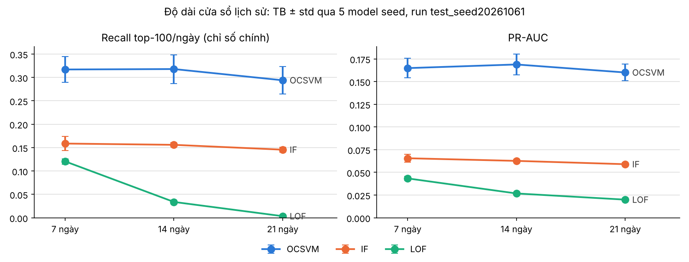

**Đọc biểu đồ:** trục ngang là độ dài cửa sổ, mỗi đường là một mô hình, thanh sai số là ±1 std qua 5 seed. OCSVM và IF gần như nằm ngang rồi đi xuống ở 21 ngày; LOF rơi mạnh ngay từ 14 ngày.

**Vì sao giữ 7 ngày:**
1. **14 ngày không tốt hơn.** Recall top-100/ngày của OCSVM gần như bằng nhau (0,317 so với 0,318), chênh lệch nhỏ hơn rất nhiều so với std 0,03. PR-AUC chỉ tăng 0,004, nhỏ hơn std 0,011. IF không đổi, LOF giảm mạnh (0,121 → 0,034).
2. **21 ngày làm giảm recall của cả ba mô hình ML:** OCSVM 0,317 → 0,294, IF 0,159 → 0,146, LOF gần như mất khả năng xếp hạng (0,003). Trong khi đó chi phí tính toán gấp khoảng 3 lần.
3. **Lợi ích của cửa sổ dài chỉ nằm ở một kịch bản.** password_spraying tăng ROC-AUC 0,69 → 0,77, nhưng dormant_wakeup lại giảm: cửa sổ càng dài thì khoảng ngủ đông càng dễ lọt vào cửa sổ, nên ngày "thức dậy" bớt nổi bật. Lợi ích cho spraying nên lấy bằng đặc trưng riêng (fan-out theo máy nguồn) thay vì kéo dài cửa sổ cho cả bộ đặc trưng.
4. **Lý do LOF giảm (giả thuyết, chưa kiểm):** N ngày đầu của train không đủ lịch sử nên các đặc trưng `delta_mean_*` được điền median. N càng lớn thì càng nhiều dòng train bị "làm phẳng" (21/42 ngày khi N = 21), tạo cụm dày giả; LOF dựa trên mật độ nên nhạy nhất với điều này.

Không chạy 28 ngày vì xu hướng đã đi xuống từ 21 ngày, và khi đó phần warm-up chiếm 2/3 train.

📁 Số liệu: [`experiments/grid/window_ablation/`](../../experiments/grid/window_ablation/), gồm `window_comparison.csv` và `window_scenarios.csv`.

---

## 2. Phân tích theo kịch bản

**Thiết lập:**
- 5 run tiêm khối test: fit ngày 1–42, chấm ngày 43–60, phân khúc User. Mỗi run có 1.543 nạn nhân, tổng 7.715.
- Cấu hình chốt từ dev (OCSVM 1.000 thành phần Nystroem, IF 300 cây, LOF k = 20) với **41 đặc trưng**, cùng 4 baseline. Kết quả với bộ 30 đặc trưng nằm ở mục 4.

**Bảng 2.1: Recall top-100/ngày theo kịch bản (chỉ số chính), TB qua 5 run test**

| Kịch bản | OCSVM | IF | LOF | z-score | Luật thất bại ≥ 5 | Luật 6 điều kiện |
|---|---|---|---|---|---|---|
| brute_force | **0,68** | 0,10 | 0,01 | 0,13 | 0,45 | 0,26 |
| logon_type_switch | **0,58** | 0,42 | 0,51 | 0,02 | 0,00 | 0,00 |
| new_workstation_burst | **0,29** | 0,07 | 0,10 | 0,02 | 0,01 | 0,00 |
| password_spraying | 0,19 | **0,23** | 0,04 | 0,22 | 0,05 | 0,12 |
| dormant_wakeup | **0,17** | 0,08 | 0,08 | 0,00 | 0,04 | 0,02 |
| off_hours | 0,03 | **0,08** | 0,05 | 0,06 | 0,04 | 0,03 |
| **Tất cả** | **0,32** | 0,16 | 0,13 | 0,08 | 0,10 | 0,07 |

Mô hình ngẫu nhiên đạt khoảng 0,014 ở mọi kịch bản.

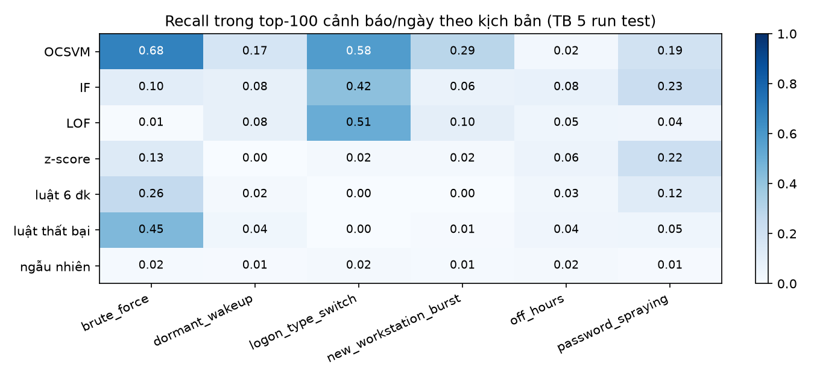

**Đọc biểu đồ:** mỗi ô là recall top-100/ngày (cùng số với bảng 2.1), màu càng đậm thì bắt được càng nhiều. Hàng OCSVM đậm nhất ở 4/6 cột. Cột off_hours nhạt ở mọi hàng.

**Bảng 2.2: Hạng trung vị của nạn nhân theo OCSVM**

Hạng tính theo % từ trên xuống của danh sách xếp hạng; càng nhỏ càng tốt.

| brute_force | logon_type_switch | new_workstation_burst | dormant_wakeup | off_hours | password_spraying |
|---|---|---|---|---|---|
| top 0,8% | top 1,2% | top 1,8% | top 4,0% | top 7,7% | top 26% |

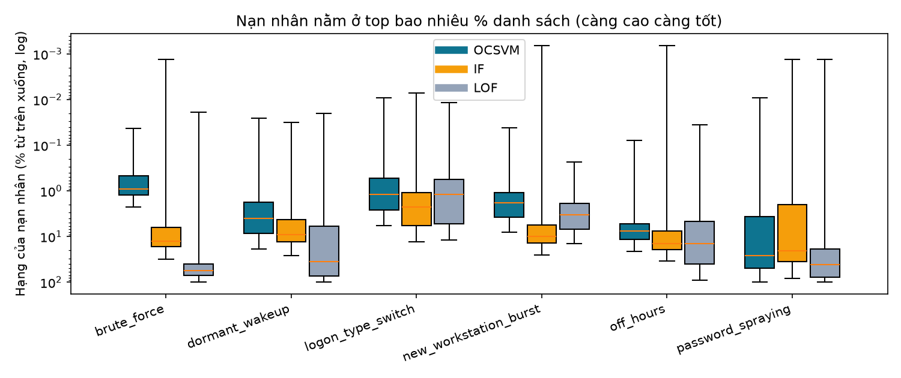

**Đọc biểu đồ:** mỗi hộp là phân bố hạng của nạn nhân một kịch bản theo một mô hình, trục dọc theo thang log, **càng cao càng tốt**. Vạch giữa hộp là trung vị. Ngân sách 100 cảnh báo/ngày tương đương khoảng top 1,2%: hộp nào nằm phía trên mức đó thì phần lớn nạn nhân đã lọt top-100.
- brute_force: hộp OCSVM nằm cao và hẹp, trong khi hộp LOF nằm sát đáy.
- password_spraying: cả ba hộp đều thấp và trải rộng, tức nạn nhân rải khắp danh sách.

**Giải thích từng kịch bản:**

- **brute_force: OCSVM bắt tốt nhất (0,68, hạng trung vị top 0,8%).**
  - Luật "thất bại ≥ 5" cờ được 100% nạn nhân tại ngưỡng của nó, nhưng chỉ 0,45 lọt top-100/ngày. Lý do: nhiều tài khoản thật cũng có ≥ 5 lần thất bại, nên luật không xếp hạng được nạn nhân lên trên.
  - LOF gần như mù (0,01) vì train có khoảng 600 dòng thật trông giống brute-force. Các nạn nhân rơi vào vùng có mật độ "bình thường".
- **logon_type_switch: cả ba mô hình ML đều bắt khá (0,42–0,58).** Hai đặc trưng `novelty_logontype_7d` và `jaccard_logontype_7d` tách nạn nhân rất rõ: AUC của riêng từng đặc trưng đạt 0,95–1,00.
- **new_workstation_burst: chỉ OCSVM bắt được đáng kể (0,29).** Nạn nhân bị bỏ sót có ít máy mới hơn (trung vị 6 so với 9 máy) và ít sự kiện hơn (12 so với 18). Một bùng nổ nhỏ chìm vào biến động tự nhiên.
- **dormant_wakeup: yếu ở mọi mô hình (OCSVM 0,17).**
  - Điều ngược trực giác: nạn nhân bị bỏ sót có **nhiều** sự kiện hơn nạn nhân bị bắt (trung vị 150 so với 85).
  - Ngày "thức dậy" được phát lại từ một ngày train của chính tài khoản. Khi khối lượng lớn, nó giống một tài khoản bận bình thường; chỉ còn `days_since_last_activity` là lệch.
- **off_hours: không mô hình nào bắt được (tốt nhất là IF với 0,08; OCSVM 0,03).**
  - Nạn nhân bị bỏ sót có trung vị 107 sự kiện, nạn nhân bị bắt chỉ 9,5. Một ngày bận bị dời sang đêm vẫn trông như một tài khoản bận.
  - Hai đặc trưng về ban đêm chỉ chiếm 2/41 chiều, nên bị các chiều khối lượng lấn át trong khoảng cách mà OCSVM dùng.
- **password_spraying: IF (0,23) ≈ z-score (0,22) > OCSVM (0,19), nhưng đều thấp.**
  - Nguyên nhân gốc: mỗi nạn nhân chỉ nhận **1–3 lần thử** (trung vị 2). Chiến dịch rải trên nhiều tài khoản, nên ở mức (tài khoản, ngày) gần như không có tín hiệu.
  - Không chỉnh mô hình nào giải được việc này. Cần đặc trưng **theo máy nguồn**, tức một Source thử nhiều tài khoản trong thời gian ngắn.

### 2.1 PR-AUC theo kịch bản (heatmap, bộ 30 đặc trưng)

Phần này dùng lưới test chính thức với **bộ 30 đặc trưng** (mục 4.3), khác với bảng 2.1 ở trên dùng 41 đặc trưng.

**Cách tính PR-AUC theo kịch bản:**
- So nạn nhân của **riêng một kịch bản** với **mọi** dòng bình thường; nạn nhân của các kịch bản khác bị bỏ ra.
- Vì vậy mức ngẫu nhiên chỉ khoảng **0,0018**, bằng tỷ lệ nạn nhân của một kịch bản. Mức này thấp hơn nhiều so với khoảng 0,01 của PR-AUC tổng.
- Để so giữa các kịch bản, mỗi ô ghi thêm **bội số so với ngẫu nhiên**: lift = PR-AUC / PR-AUC của mô hình ngẫu nhiên ở cùng kịch bản.

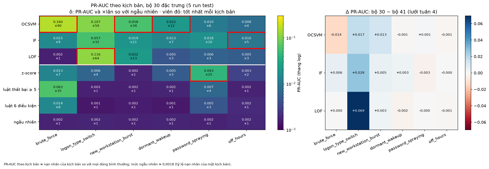

**Đọc biểu đồ:**
- **Hình trái:**
  - mỗi ô ghi PR-AUC (TB qua 5 run test) và ×lift;
  - màu theo thang log, vàng là cao, tím là gần ngẫu nhiên;
  - viền đỏ đánh dấu mô hình tốt nhất của từng kịch bản;
  - vạch trắng tách 3 mô hình ML với các baseline.
- **Hình phải:** Δ PR-AUC của bộ 30 so với bộ 41 (lưới tuần 4). Xanh là bộ 30 tốt hơn, đỏ là kém hơn.

**Bảng 2.3: PR-AUC theo kịch bản (TB ± std qua 5 run test, 30 đặc trưng) và lift so với ngẫu nhiên**

| Kịch bản | OCSVM | IF | LOF | z-score | Luật thất bại ≥ 5 |
|---|---|---|---|---|---|
| brute_force | **0,160 ± 0,071** (×90) | 0,015 (×9) | 0,002 (×1) | 0,013 (×7) | 0,063 (×35) |
| logon_type_switch | 0,107 ± 0,028 (×59) | 0,057 (×32) | **0,116 ± 0,029** (×64) | 0,006 (×4) | 0,002 (×1) |
| new_workstation_burst | **0,058 ± 0,015** (×34) | 0,019 (×11) | 0,022 (×13) | 0,002 (×1) | 0,002 (×1) |
| dormant_wakeup | **0,022 ± 0,003** (×12) | 0,013 (×7) | 0,005 (×3) | 0,005 (×3) | 0,002 (×1) |
| password_spraying | 0,010 (×6) | 0,018 ± 0,004 (×10) | 0,006 (×3) | **0,043 ± 0,012** (×25) | 0,007 (×4) |
| off_hours | 0,008 (×4) | **0,010 ± 0,003** (×5) | 0,005 (×3) | 0,003 (×2) | 0,002 (×1) |

Mô hình ngẫu nhiên đạt 0,0018 ở mọi kịch bản. Số đầy đủ, gồm std và luật 6 điều kiện, nằm trong `experiments/grid/test_30f/scenario_pr_auc_table.csv`.

**Nhận xét:**
1. **Theo PR-AUC, có ba nhóm kịch bản tách bạch:**
   - **dễ:** brute_force, logon_type_switch, cao hơn ngẫu nhiên ×59–90;
   - **trung bình:** new_workstation_burst ×34, dormant_wakeup ×12;
   - **gần mù:** password_spraying, off_hours, ×4–10 với mô hình ML.

   Thứ tự này trùng với hạng trung vị ở bảng 2.2.
2. **OCSVM tốt nhất ở 3/6 kịch bản theo PR-AUC,** gồm brute_force, burst và dormant. PR-AUC cho cùng kết luận với recall@100 về vai trò mô hình chính của OCSVM.
3. **logon_type_switch: LOF ngang OCSVM** (0,116 so với 0,107). Hiệu số nhỏ hơn 1 std, nên không phân định được.
   - LOF có được mức này là nhờ bỏ 11 đặc trưng: PR-AUC +0,069 so với bộ 41 (hình phải).
   - Đây là mức tăng lớn nhất của cả bảng Δ.
4. **password_spraying: z-score đứng đầu theo PR-AUC (×25), gấp 2–4 lần các mô hình ML,** dù recall@100 của z-score chỉ ngang IF (0,22 so với 0,23, bảng 2.1).
   - Nghĩa là z-score đẩy **một phần nhỏ** nạn nhân spraying lên đúng đầu danh sách, có lẽ là những nạn nhân bị thử nhiều lần nhất. Phần còn lại rải khắp danh sách như ở mọi mô hình.
   - Gợi ý: một tín hiệu thống kê đơn giản về thất bại vẫn có ích cho spraying, nhưng không thay được đặc trưng theo máy nguồn.
5. **off_hours: mọi mô hình chỉ cao hơn ngẫu nhiên ×2–5.** IF hơn OCSVM 0,002, nằm trong std. Không mô hình nào thắng thật.
6. **Luật "thất bại ≥ 5" đạt ×35 ở brute_force,** đứng thứ hai sau OCSVM. Ở các kịch bản khác, luật này đúng bằng mức ngẫu nhiên, đúng như thiết kế.
7. **Bộ 30 so với bộ 41 (hình phải):**
   - phần tăng tập trung ở logon_type_switch (cả ba mô hình) và burst;
   - các kịch bản khác thay đổi ≤ 0,006;
   - OCSVM giảm ở brute_force (−0,014), nhưng std của ô này rất lớn (0,071), nên đó là nhiễu thứ tự dòng chứ không phải mất tín hiệu. Recall@100 của brute_force vẫn tăng 0,68 → 0,85 (mục 4.2).

Chạy lại hình: `python scripts/evaluation/plot_scenario_heatmap.py`.

**Kết luận phần 2:**
1. OCSVM là mô hình chính: tốt nhất ở 4/6 kịch bản và gấp đôi IF ở recall tổng (0,32 so với 0,16).
2. Có hai điểm mù chung cho mọi mô hình:
   - **off_hours:** cần đặc trưng giờ so với lịch sử giờ của chính tài khoản;
   - **password_spraying:** cần đặc trưng fan-out theo máy nguồn.

📁 Số liệu: [`experiments/analysis/scenario/`](../../experiments/analysis/scenario/), gồm `scenario_detection.csv` và `missed_victims.csv`.

---

## 3. SHAP và LIME: đặc trưng nào đẩy điểm dị biệt lên

**Mục đích:** biết nhóm đặc trưng nào thực sự được mô hình dùng, để chọn thí nghiệm ablation ở mục 4.

**Thiết lập:**
- Run **dev** `dev_seed20261036`: fit ngày 1–35, chấm ngày 36–42. Không dùng khối test để tránh rò rỉ, vì kết quả sẽ được dùng để chọn đặc trưng.
- Giải thích ba mô hình chốt (seed 42) trên 180 nạn nhân (30 mỗi kịch bản) và 30 báo nhầm điểm cao nhất của mỗi mô hình.
- **Báo nhầm không phải kịch bản tiêm.** Đó là 30 dòng tài khoản–ngày **bình thường** (không bị tiêm) mà mô hình chấm điểm cao nhất. Nhóm này được giải thích song song với nạn nhân để biết đặc trưng nào khiến mô hình **báo sai**, khác với đặc trưng giúp mô hình **bắt đúng**. Trong bảng và hình, nó luôn đứng ở cột cuối, tách khỏi 6 kịch bản.
- **SHAP** (KernelSHAP): nền 50 dòng train, 1.000 mẫu. Tổng đóng góp cộng với giá trị nền khớp đúng điểm (sai số ≤ 3·10⁻¹⁴).
- **LIME:** 105 dòng mỗi mô hình, 2.000 mẫu nhiễu.
- Ba mô hình có thang điểm khác nhau, nên mỗi dòng được chuẩn hoá thành **tỷ phần |SHAP|** (xem mục 0).
- 41 đặc trưng được chia thành 8 nhóm theo nghĩa:

| Nhóm | Số đặc trưng | Ví dụ |
|---|---|---|
| volume | 3 | log_total_logons, volume_robust_z_7d |
| failure | 6 | failure_ratio, failure_locked_out_share |
| time | 8 | off_hours_ratio, hour_entropy, 2 đặc trưng đêm |
| rhythm | 4 | interarrival_dt_mean, delta_t_cv, same_second_share |
| logon_type | 6 | interactive_ratio, ntlm_ratio |
| fanout | 6 | distinct_sources_count, dst_host_entropy |
| novelty | 5 | new_source_count_7d, days_since_last_activity |
| context | 3 | missing_source_ratio, remote_logon_ratio |

### 3.1 Kết quả SHAP theo nhóm và kịch bản

**Bảng 3.1: Nhóm đóng góp chính theo kịch bản (tỷ phần |SHAP| trung bình, OCSVM / IF / LOF)**

| Kịch bản | Nhóm chính |
|---|---|
| brute_force | failure 0,76 / 0,51 / 0,60 |
| password_spraying | failure 0,33 / 0,30 / 0,50, sau đó là time |
| off_hours | time 0,52 / 0,50 / 0,29 |
| logon_type_switch | logon_type 0,44 / 0,38 / 0,22 |
| new_workstation_burst | novelty 0,44 / 0,34 / 0,39 và fanout 0,35 / 0,36 / 0,18 |
| dormant_wakeup | novelty 0,49 / 0,40 / 0,30, chủ yếu là `days_since_last_activity` |
| **Báo nhầm** (dòng bình thường, không phải kịch bản) | OCSVM: **rhythm 0,27** · IF: failure 0,26 · LOF: failure 0,29 |

**Bảng 3.2: Tỷ phần |SHAP| trên toàn bộ nạn nhân, so với mức chia đều (số đặc trưng của nhóm / 41)**

| Nhóm | Chia đều | OCSVM | IF | LOF |
|---|---|---|---|---|
| novelty | 0,12 | **0,22** | **0,22** | **0,23** |
| failure | 0,15 | 0,21 | 0,17 | **0,26** |
| time | 0,20 | 0,16 | 0,19 | 0,14 |
| fanout | 0,15 | 0,15 | 0,15 | 0,10 |
| logon_type | 0,15 | 0,14 | 0,15 | 0,13 |
| rhythm | 0,10 | 0,04 | 0,05 | 0,06 |
| volume | 0,07 | 0,05 | 0,04 | 0,04 |
| context | 0,07 | 0,03 | 0,04 | 0,04 |


**Đọc biểu đồ:**
- Mỗi bảng nhiệt là một mô hình. Hàng là nhóm đặc trưng, số trong ô là tỷ phần |SHAP|.
- 6 cột đầu là 6 kịch bản. Sau vạch đen là hai cột không phải kịch bản: "tất cả nạn nhân" (gộp 180 nạn nhân) và "BÁO NHẦM" (30 dòng bình thường điểm cao nhất, xem phần thiết lập).
- Ô đậm nằm gần như trên một "đường chéo": mỗi kịch bản có đúng một nhóm nổi bật.
- Riêng OCSVM có ô rhythm × BÁO NHẦM đậm (0,27), trong khi hàng rhythm nhạt ở mọi cột nạn nhân: rhythm làm OCSVM báo sai chứ không giúp bắt đúng.

### 3.2 So sánh SHAP và LIME

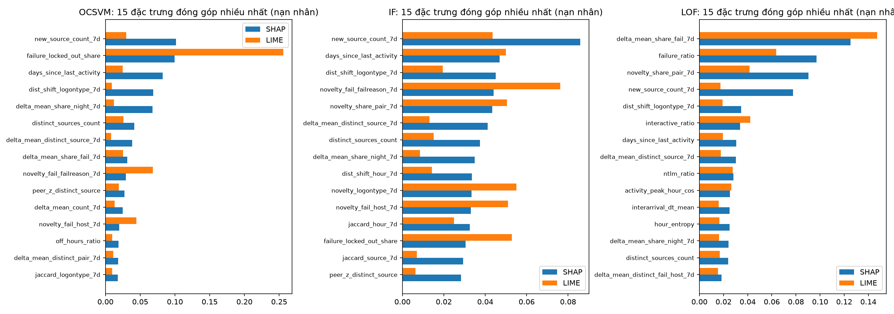

**Đọc biểu đồ:** 15 đặc trưng có tỷ phần SHAP cao nhất của mỗi mô hình (thanh xanh), đặt cạnh tỷ phần LIME của cùng đặc trưng (thanh cam). Hai thanh dài gần bằng nhau nghĩa là hai phương pháp đồng ý.
- Đặc trưng mạnh nhất khớp nhau ở LOF: `delta_mean_share_fail_7d` đứng đầu theo cả hai.
- Ở OCSVM, LIME dồn gần hết trọng số cho `failure_locked_out_share` (0,26), trong khi SHAP chia đều hơn.
- Các đặc trưng novelty như `new_source_count_7d` được SHAP xếp cao nhưng LIME xếp thấp.

**Bảng 3.3: Mức khớp giữa SHAP và LIME**

| Mô hình | Spearman của hạng toàn cục | Trùng top-5 trên từng dòng | R² cục bộ của LIME |
|---|---|---|---|
| OCSVM | 0,44 | 0,22 | 0,35 |
| IF | 0,37 | 0,17 | 0,54 |
| LOF | 0,23 | 0,32 | **0,06** |

Spearman = tương quan hạng giữa hai bảng xếp hạng đặc trưng (1 là khớp hoàn toàn). R² cục bộ = mô hình tuyến tính của LIME giải thích được bao nhiêu phần điểm quanh mỗi dòng.

### 3.3 Rút ra điều gì

1. **Bộ đặc trưng hoạt động đúng ý đồ thiết kế.** Ở cả ba mô hình, mỗi kịch bản được giải thích bằng đúng nhóm đặc trưng thiết kế cho nó, và các nhóm ít chồng lấn nhau:
   - failure → brute_force;
   - time → off_hours;
   - logon_type → logon_type_switch;
   - novelty và fanout → burst;
   - `days_since_last_activity` → dormant_wakeup.
2. **novelty và failure gánh nhiều nhất,** cao hơn hẳn mức chia đều. Đặc trưng đơn lẻ mạnh nhất là `new_source_count_7d` (hạng 1 ở OCSVM và IF).
3. **rhythm, volume và context đóng góp dưới mức chia đều ở mọi kịch bản.** Riêng với OCSVM, rhythm lại là nguồn chính của **báo nhầm** (`delta_t_cv` chiếm 0,22 tỷ phần ở báo nhầm). Vì vậy rhythm là ứng viên ablation số 1: bỏ đi có thể giảm báo nhầm mà ít mất recall.
4. **off_hours:** nhóm time giải thích phần lớn điểm của nạn nhân (0,52), nhưng điểm tuyệt đối vẫn thấp nên nạn nhân không lọt top. Mục 3.4 cho thấy phần 0,52 này gần như chỉ đến từ một đặc trưng, `delta_mean_share_night_7d`. SHAP cho biết **cái gì** đẩy điểm lên, không cho biết điểm có **đủ cao** hay không. Ablation ở mục 4 trả lời câu hỏi thứ hai.
5. **Đặc trưng template v4 có đóng góp thật:** chiếm 44–51% tỷ phần ở nạn nhân, trong khi chỉ chiếm 41% số chiều (17/41).
6. **10 đặc trưng ít được dùng nhất** có tỷ phần cao nhất qua ba mô hình chỉ khoảng 0,011–0,016, thấp hơn mức chia đều 0,024. Ví dụ: `is_single_event`, `log_total_logons`, `dst_host_entropy`, `peer_z_share_night`. Đây là ứng viên cắt tỉa.
7. **Dùng SHAP làm căn cứ, LIME chỉ để minh hoạ.** Hai phương pháp khớp ở mức nhóm và ở đặc trưng mạnh nhất, nhưng khớp kém ở từng dòng. Với LOF, mô hình tuyến tính của LIME chỉ giải thích được 6% điểm (R² 0,06) vì LOF rất phi tuyến. LIME còn rời rạc hoá theo tứ phân vị, nên đánh giá thấp các đặc trưng novelty (đa số dòng bằng 0).

📁 Số liệu mục 3.1–3.3: [`experiments/analysis/explain/`](../../experiments/analysis/explain/), gồm `feature_importance.csv`, `group_importance.csv` và `shap_lime_agreement.csv`.

### 3.4 Bổ sung: SHAP theo từng đặc trưng trên 3 run dev

**Vì sao bổ sung:**
- Các mục 3.1–3.3 kết luận ở mức 8 nhóm. Các nhóm này do nhóm thực hiện tự chia theo nghĩa của đặc trưng, không suy ra từ dữ liệu.
- Danh sách "SHAP thấp" dùng để bỏ đặc trưng chỉ lấy từ một run.
- Vì vậy cần kiểm tra ba điều:
  1. thứ hạng **từng đặc trưng** có ổn định không;
  2. nhóm theo nghĩa có trùng với cụm theo tương quan thật không;
  3. trong mỗi kịch bản, có phải cả nhóm đóng góp, hay chỉ một vài đặc trưng.

**Thiết lập:**
- Chạy lại KernelSHAP trên thêm 2 run dev (`dev_seed20261037`, `038`), giữ nguyên cấu hình mục 3, không chạy LIME. Tổng cộng 3 run dev, mỗi run có 180 nạn nhân và 30 báo nhầm cho mỗi mô hình.
- Cụm tương quan:
  - tính |Spearman| giữa 41 đặc trưng trên dòng train User, ngày 1–35;
  - phân cụm phân cấp (average linkage) với khoảng cách 1 − |ρ|;
  - cắt cây ở 0,3, tức các đặc trưng trong một cụm có |ρ| trung bình ≥ 0,7.

**Bảng 3.4: Độ ổn định thứ hạng giữa 3 run dev** (Spearman của tỷ phần |SHAP| trên nạn nhân, TB qua 3 cặp run)

| Mức | OCSVM | IF | LOF | Trùng top-k giữa các cặp run |
|---|---|---|---|---|
| Từng đặc trưng (41) | 0,93 | 0,99 | 0,96 | top-10: 0,93–1,00 |
| Nhóm theo nghĩa (8) | 0,97 | 0,98 | 0,98 | top-3: 1,00 |
| Cụm tương quan (33) | 0,92 | 0,99 | 0,97 | top-5: 0,87 |

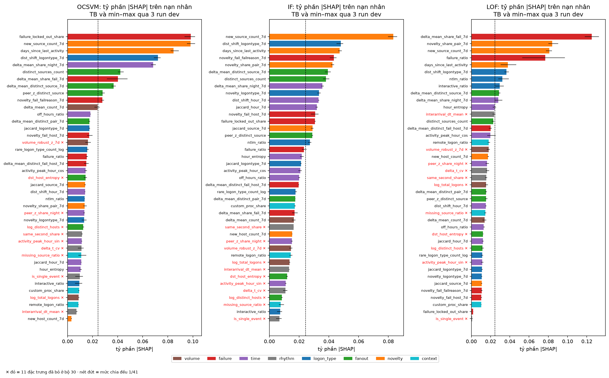

**Đọc biểu đồ:**
- Mỗi cột là một mô hình; mỗi thanh là tỷ phần |SHAP| trung bình trên nạn nhân của một đặc trưng. Râu là min–max qua 3 run, màu là nhóm theo nghĩa.
- Tên màu đỏ có dấu ✕ là 11 đặc trưng đã bỏ ở bộ 30. Nét đứt là mức chia đều 1/41.
- Râu ngắn nghĩa là thứ hạng gần như không đổi giữa các run.
- Hầu hết các thanh đỏ nằm ở nửa dưới, bên trái nét đứt.

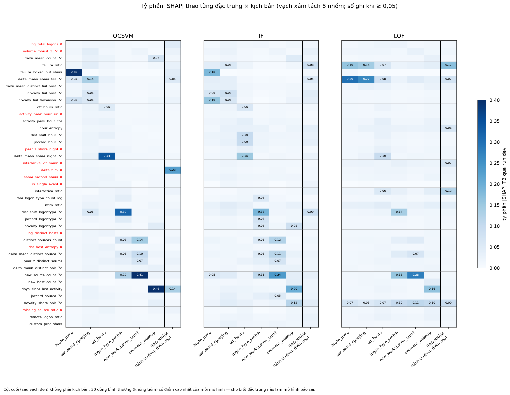

**Đọc biểu đồ:** hàng là 41 đặc trưng xếp theo nhóm (vạch xám tách nhóm), màu là tỷ phần |SHAP| TB qua 3 run. 6 cột đầu là 6 kịch bản; cột cuối, sau vạch đen, là **báo nhầm** (30 dòng bình thường điểm cao nhất), không phải kịch bản. Mỗi cột kịch bản thường chỉ có 1–2 ô đậm, không phải cả một khối nhóm. Ở cột báo nhầm của OCSVM, ô đậm nhất là `delta_t_cv` (0,23).

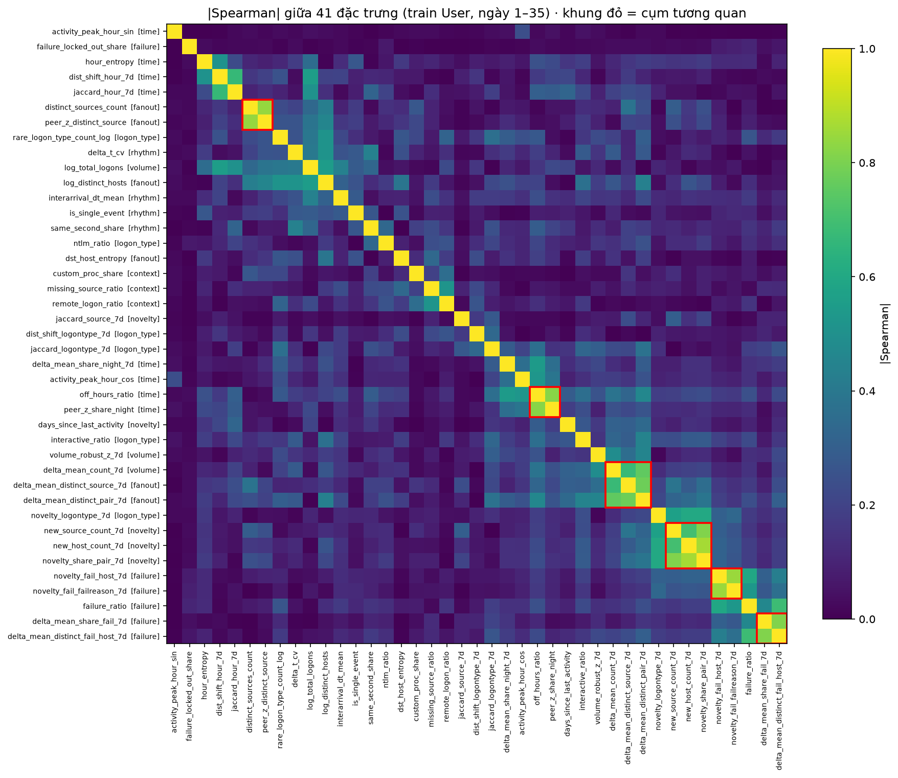

**Đọc biểu đồ:** ma trận |Spearman| đã sắp theo cây phân cụm; khung đỏ là các cụm có |ρ| ≥ 0,7. Nhãn hàng ghi nhóm theo nghĩa trong ngoặc vuông.

**Bảng 3.5: Đặc trưng dẫn đầu từng kịch bản** (tỷ phần |SHAP| TB qua 3 run; mọi đặc trưng trong bảng lọt top-5 ở cả 3 run, trừ khi ghi khác)

| Kịch bản | OCSVM | IF | LOF |
|---|---|---|---|
| brute_force | `failure_locked_out_share` **0,58** | `failure_locked_out_share` 0,18, `novelty_fail_failreason_7d` 0,16 | `delta_mean_share_fail_7d` 0,30, `failure_ratio` 0,16 |
| password_spraying | `delta_mean_share_fail_7d` 0,14 | `novelty_fail_host_7d` 0,08 | `delta_mean_share_fail_7d` 0,27, `failure_ratio` 0,14 |
| off_hours | `delta_mean_share_night_7d` **0,34** | `delta_mean_share_night_7d` 0,15 | `delta_mean_share_night_7d` 0,10 |
| logon_type_switch | `dist_shift_logontype_7d` **0,32** | `dist_shift_logontype_7d` 0,18 | `new_source_count_7d` 0,16, `dist_shift_logontype_7d` 0,14 |
| new_workstation_burst | `new_source_count_7d` **0,41** | `new_source_count_7d` 0,24 | `new_source_count_7d` 0,28 |
| dormant_wakeup | `days_since_last_activity` **0,46** | `days_since_last_activity` 0,20 | `days_since_last_activity` 0,16 |
| Báo nhầm (dòng bình thường) | `delta_t_cv` **0,23**, `days_since_last_activity` 0,14 | `dist_shift_logontype_7d` 0,09, `failure_ratio` 0,08 | `failure_ratio` 0,17, `interactive_ratio` 0,12 |

Danh sách top-5 đầy đủ của từng (mô hình, kịch bản), kèm số run lọt top-5, nằm trong `top5_by_scenario.csv`.

**Bảng 3.6: 11 đặc trưng đã bỏ ở bộ 30 — hạng theo tỷ phần |SHAP| trên nạn nhân** (hạng tốt nhất – tệ nhất qua 3 run, trên 41 đặc trưng)

| Đặc trưng | OCSVM | IF | LOF |
|---|---|---|---|
| `interarrival_dt_mean` | 38–40 | 33–34 | **11–12** |
| `delta_t_cv` | 28–37 | 36–37 | 17–20 |
| `same_second_share` | 28–34 | 27–28 | 21–23 |
| `is_single_event` | 30–39 | 40–41 | 41 |
| `activity_peak_hour_sin` | 30–35 | 36–37 | 32–38 |
| `log_distinct_hosts` | 24–32 | 38–41 | 29–36 |
| `missing_source_ratio` | 21–39 | 38–41 | 25–26 |
| `log_total_logons` | 35–38 | 33–34 | 20–25 |
| `dst_host_entropy` | 17–27 | 35 | 28–31 |
| `volume_robust_z_7d` | **12–22** | 29–32 | **15–19** |
| `peer_z_share_night` | 23–27 | 28–31 | 18–24 |

**Nhận xét:**
1. **Thứ hạng từng đặc trưng ổn định gần như nhóm.** Spearman giữa các run đạt 0,93–0,99 ở mức đặc trưng, so với 0,97–0,98 ở mức nhóm. Top-10 của IF và OCSVM trùng hoàn toàn giữa các run.
   - Hạn chế "chỉ một run" ở mục 3 không làm sai kết luận theo từng đặc trưng.
   - Vì vậy có thể đọc kết quả ở mức từng đặc trưng, không bắt buộc phải gộp nhóm.
2. **Nhóm theo nghĩa phần lớn không phải cụm tương quan.**
   - Chỉ có 6 cụm nhiều phần tử (14/41 đặc trưng) đạt |ρ| ≥ 0,7:
     - `new_source_count_7d` + `new_host_count_7d` + `novelty_share_pair_7d`;
     - `novelty_fail_host_7d` + `novelty_fail_failreason_7d`;
     - `delta_mean_share_fail_7d` + `delta_mean_distinct_fail_host_7d`;
     - `distinct_sources_count` + `peer_z_distinct_source`;
     - `off_hours_ratio` + `peer_z_share_night`;
     - `delta_mean_count_7d` + `delta_mean_distinct_source_7d` + `delta_mean_distinct_pair_7d`. Cụm này cắt ngang hai nhóm volume và fanout.
   - 27 đặc trưng còn lại không tương quan mạnh với đặc trưng nào. Ví dụ, trong 8 đặc trưng của nhóm time chỉ có cặp `off_hours_ratio` + `peer_z_share_night` tương quan mạnh; 6 đặc trưng còn lại gần như độc lập.
   - Vì vậy lý do "đọc theo nhóm để tránh SHAP chia công giữa các đặc trưng tương quan" chỉ đúng với 6 cụm trên, không đúng cho cả 8 nhóm.
3. **Mỗi kịch bản do 1–2 đặc trưng cụ thể dẫn dắt, không phải cả nhóm.**
   - off_hours: tỷ phần 0,52 của nhóm time ở mục 3.1 chủ yếu đến từ **một** đặc trưng, `delta_mean_share_night_7d` (0,34 với OCSVM). 7 đặc trưng giờ còn lại đều ≤ 0,053 (`off_hours_ratio`), phần lớn ≤ 0,03.
   - Điều này giải thích vì sao bỏ cả nhóm time mà off_hours không đổi (mục 4.1): tín hiệu của nhóm chỉ là một đặc trưng, và đặc trưng đó vẫn không đủ để đẩy nạn nhân vào top.
   - Tương tự:
     - dormant_wakeup chỉ dựa vào `days_since_last_activity`;
     - burst dựa vào `new_source_count_7d`;
     - logon_type_switch dựa vào `dist_shift_logontype_7d`;
     - brute_force của OCSVM dựa gần như hoàn toàn vào `failure_locked_out_share` (0,58).
4. **Báo nhầm của OCSVM do đúng một đặc trưng, `delta_t_cv` (0,23).** Ba đặc trưng rhythm còn lại có tỷ phần ≈ 0 ở báo nhầm. Mục 4.4 kiểm tra xem chỉ bỏ `delta_t_cv` có đủ hay không.
5. **11 đặc trưng đã bỏ có hạng thấp ở cả 3 run với OCSVM và IF.** Danh sách SHAP thấp lấy từ một run được xác nhận lại. Có hai ngoại lệ đáng ngờ:
   - `interarrival_dt_mean` đứng hạng 11–12 ở LOF, trên mức chia đều;
   - `volume_robust_z_7d` đứng hạng 12–22 ở OCSVM và 15–19 ở LOF.

   Đây là hai ứng viên "bỏ oan", được kiểm tra bằng thí nghiệm thêm lại ở mục 4.4.

📁 Số liệu: [`experiments/analysis/explain_stability/`](../../experiments/analysis/explain_stability/), gồm `rank_stability.csv`, `feature_share_by_run.csv`, `top5_by_scenario.csv`, `correlation_clusters.csv` và `dropped_features.csv`. Chạy lại:

```
python scripts/evaluation/explain_models.py --run data/injection_runs/dev_seed20261037 --skip-lime --out experiments/analysis/explain_runs/dev_seed20261037
python scripts/evaluation/explain_models.py --run data/injection_runs/dev_seed20261038 --skip-lime --out experiments/analysis/explain_runs/dev_seed20261038
python scripts/evaluation/shap_feature_stability.py
```

**Hạn chế:**
- SHAP vẫn dùng 1 model seed (42) trên mỗi run.
- Trong 6 cụm tương quan, cách KernelSHAP chia công giữa các đặc trưng cùng cụm vẫn tuỳ ý. Ví dụ, `new_host_count_7d` có tỷ phần gần 0 có thể vì `new_source_count_7d` đã nhận phần đóng góp thay nó. Với các cụm này nên đọc tổng của cả cụm.
- Tỷ phần |SHAP| đo đóng góp vào điểm, không đo đóng góp vào khả năng phát hiện. Ablation ở mục 4 mới đo phần đó.

---

## 4. Ablation theo nhóm đặc trưng

**Thiết lập:**
- **Dev:** 5 run (`dev_seed20261036`–`040`), fit ngày 1–35, chấm ngày 36–42. Giữ nguyên tham số mô hình.
- Mỗi cấu hình bỏ một nhóm (theo 8 nhóm ở mục 3) hoặc một tổ hợp, rồi so với bản đủ 41 đặc trưng bằng **Δ ghép cặp** trên cùng run và seed.
  - Dấu * nghĩa là |Δ TB| > 1 std của Δ qua 5 run.
- **Đối chứng `control_shuffle_rows`:** giữ đủ 41 đặc trưng, chỉ xáo thứ tự dòng train.
  - OCSVM nhiễu đáng kể chỉ vì thứ tự dòng: PR-AUC −0,020 ± 0,019.
  - Vì vậy một thay đổi của OCSVM chỉ được tính là thật khi vượt mức đối chứng này.
- Sau đó kiểm tra **một lần trên khối test** với cấu hình tốt nhất.

### 4.1 Kết quả trên dev

Mốc đủ 41 đặc trưng:

| Mô hình | Recall top-100/ngày | PR-AUC |
|---|---|---|
| OCSVM | 0,317 | 0,167 |
| IF | 0,139 | 0,062 |
| LOF | 0,164 | 0,055 |

**Bảng 4.1: Δ so với đủ 41 đặc trưng, TB ± std qua 5 run dev**

Cột chính là Δ recall top-100/ngày; ΔPR-AUC là chỉ số phụ.

| Cấu hình (số đặc trưng còn lại) | **ΔRecall top-100/ngày** OCSVM / IF / LOF | ΔPR-AUC OCSVM | ΔPR-AUC IF | ΔPR-AUC LOF |
|---|---|---|---|---|
| **bỏ rhythm + đặc trưng SHAP thấp (30)** | **+0,06 / +0,09 / +0,05** | **+0,064 ± 0,014** | **+0,034 ± 0,012** | **+0,037 ± 0,019** |
| bỏ rhythm (37) | +0,05 / +0,06 / +0,03 | +0,050 ± 0,013 | +0,019 ± 0,006 | +0,029 ± 0,012 |
| bỏ 10 đặc trưng SHAP thấp (31) | +0,03 / +0,08 / 0,00 | +0,042 ± 0,010 | +0,028 ± 0,006 | −0,005 ± 0,004 |
| bỏ volume + context (35) | +0,01 / +0,08 / +0,01 | +0,014 ± 0,003 | +0,038 ± 0,010 | +0,003 ± 0,011 |
| bỏ time (33) | +0,01 / +0,07 / −0,02 | −0,002 ± 0,003 | +0,012 ± 0,002 | −0,012 ± 0,005 |
| bỏ logon_type (35) | −0,01 / −0,01 / −0,02 | −0,011 ± 0,005 | +0,004 ± 0,006 | −0,012 ± 0,012 |
| bỏ fanout (35) | −0,03 / −0,03 / 0,00 | −0,014 ± 0,003 | −0,012 ± 0,002 | +0,002 ± 0,014 |
| bỏ novelty (36) | −0,03 / −0,04 / −0,10 | −0,039 ± 0,016 | −0,018 ± 0,006 | −0,028 ± 0,006 |
| bỏ failure (35) | −0,08 / 0,00 / 0,00 | **−0,056 ± 0,018** | −0,007 ± 0,005 | +0,002 ± 0,006 |
| bỏ template_v4 (24) | −0,04 / −0,07 / −0,08 | −0,048 ± 0,014 | −0,030 ± 0,005 | −0,020 ± 0,004 |
| *đối chứng: xáo dòng (41)* | *−0,02 / 0,00 / 0,00* | *−0,020 ± 0,019* | *0,000 ± 0,001* | *−0,005 ± 0,008* |

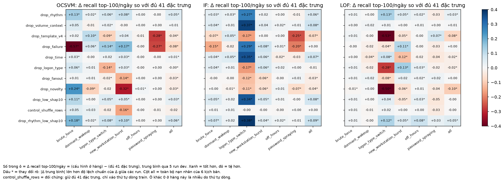

**Đọc biểu đồ:** mỗi bảng nhiệt là một mô hình. Hàng là cấu hình ablation, cột là kịch bản (cột cuối "all" là tổng), số trong ô là Δ recall top-100/ngày.
- Xanh là tốt hơn bản đủ 41 đặc trưng, đỏ là tệ hơn, trắng là không đổi.
- Hàng `control_shuffle_rows` cho biết mức nhiễu: với OCSVM, chỉ xáo dòng đã làm burst thay đổi −0,16.
- Hàng cuối (`drop_rhythm_low_shap10`, bộ 30 đặc trưng) gần như toàn xanh hoặc trắng ở cả ba mô hình.

**Giải thích:**
1. **Bỏ rhythm giúp cả ba mô hình, đúng như SHAP dự đoán.** Ở OCSVM, rhythm là nguồn chính của báo nhầm; bỏ đi thì P@50 tăng 0,15 và PR-AUC tăng 0,050, gấp 2,5 lần mức nhiễu đối chứng. Bỏ thêm các đặc trưng SHAP thấp (tổng 11 đặc trưng, còn 30) cho kết quả tốt nhất ở cả ba mô hình, và không kịch bản nào bị hại.
2. **Nhóm thiết kế cho kịch bản nào thì cứu kịch bản đó.** Điều này khớp với bảng SHAP ở mục 3:
   - bỏ failure: OCSVM mất 0,57 recall ở brute_force và 0,27 ở spraying;
   - bỏ novelty: OCSVM mất 0,32 ở burst, LOF mất 0,50 ở logon_type_switch;
   - bỏ logon_type: cả ba mô hình mất 0,14–0,28 ở logon_type_switch;
   - bỏ fanout: OCSVM mất 0,14 ở burst.

   Vì vậy **giữ** failure, novelty, logon_type và fanout.
3. **Khối template v4 có giá trị thật.** Bỏ 17 đặc trưng v4 làm cả ba mô hình tụt, nặng nhất ở spraying (−0,28 với OCSVM) và logon_type_switch (−0,53 với LOF).
4. **Nhóm time không giúp off_hours.** Bỏ cả 8 đặc trưng thời gian mà recall off_hours gần như không đổi (−0,02 đến 0,00). Kết hợp với SHAP: nhóm time có giải thích điểm của nạn nhân, nhưng không đủ để đưa họ vào top-100. Cần đặc trưng giờ mới, không chỉ chỉnh bộ hiện có.
5. **Các nhóm cạnh tranh nhau trong khoảng cách.** Bỏ failure làm burst và logon_type_switch *tăng*; bỏ novelty làm brute_force *tăng*. IF đặc biệt nhạy với số chiều: bỏ bất kỳ nhóm "ít dùng" nào cũng làm logon_type_switch tăng 0,27–0,38, vì còn ít chiều nhiễu hơn để cây chọn nhầm.

**Bộ 30 đặc trưng:** bỏ 4 đặc trưng rhythm (`interarrival_dt_mean`, `delta_t_cv`, `same_second_share`, `is_single_event`) và 7 đặc trưng SHAP thấp (`activity_peak_hour_sin`, `log_distinct_hosts`, `missing_source_ratio`, `log_total_logons`, `dst_host_entropy`, `volume_robust_z_7d`, `peer_z_share_night`). Ba đặc trưng rhythm đã nằm sẵn trong danh sách 10 đặc trưng SHAP thấp, nên tổng cộng bỏ 11.

### 4.2 Kiểm tra một lần trên khối test

Bộ 30 đặc trưng được chọn trên dev nên kết quả dev có thể lạc quan. Vì vậy chạy lại đúng 3 cấu hình trên 5 run test (fit ngày 1–42, chấm ngày 43–60): đủ 41 đặc trưng, bộ 30 đặc trưng, và đối chứng xáo dòng. Không chọn lại gì trên test.

**Bảng 4.2: 41 → 30 đặc trưng trên test. Δ là TB ± std; trong ngoặc là Δ của đối chứng xáo dòng**

| Mô hình | **Recall top-100/ngày** 41 → 30 | ΔRecall (đối chứng) | PR-AUC 41 → 30 | ΔPR-AUC (đối chứng) | P@50 41 → 30 |
|---|---|---|---|---|---|
| OCSVM | 0,32 → **0,38** | +0,055 ± 0,020 (+0,019 ± 0,029) | 0,170 → **0,192** | +0,023 ± 0,006 (+0,005 ± 0,015) | 0,20 → 0,26 |
| IF | 0,16 → **0,21** | +0,047 ± 0,010 (−0,003 ± 0,013) | 0,066 → **0,089** | +0,023 ± 0,005 (−0,001 ± 0,007) | 0,17 → 0,20 |
| LOF | 0,13 → **0,15** | +0,021 ± 0,009 (0,000 ± 0,003) | 0,048 → **0,064** | +0,017 ± 0,006 (0,000 ± 0,002) | 0,09 → 0,12 |

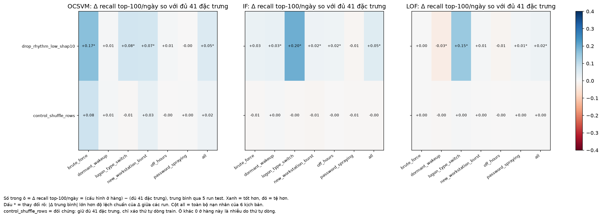

**Đọc biểu đồ:** cùng cách đọc như hình trên dev. Hàng trên là bộ 30 đặc trưng, hàng dưới là đối chứng xáo dòng. Các ô xanh đậm nhất là:
- OCSVM ở brute_force: +0,17, tức recall từ 0,68 lên 0,85;
- IF ở logon_type_switch: +0,20;
- LOF ở logon_type_switch: +0,15.

Không ô nào đỏ rõ. Ô giảm duy nhất là dormant_wakeup của LOF (−0,03 ± 0,03), nằm trong nhiễu.

**Giải thích:**
1. **Bộ 30 đặc trưng tốt hơn trên test ở cả ba mô hình,** và mức tăng vượt rõ mức nhiễu đối chứng. Recall top-100/ngày tăng 0,02–0,06; PR-AUC tăng khoảng 13% ở OCSVM, khoảng 35% ở IF và LOF.
2. **Mức tăng của OCSVM trên test nhỏ hơn trên dev ở PR-AUC** (+0,023 so với +0,064), đúng như dự đoán vì bộ 30 được chọn trên dev. Ở chỉ số chính thì mức tăng giữ gần nguyên: recall top-100/ngày +0,055 trên test so với +0,064 trên dev.
3. **Bớt đặc trưng không chữa được hai điểm mù:** off_hours (+0,01) và password_spraying (0,00) gần như không đổi. Hai kịch bản này cần đặc trưng mới.

### 4.3 Bảng benchmark cuối: lưới test chính thức với 30 đặc trưng

**Bảng 4.3: TB ± std qua 5 run test, tỷ lệ dương khoảng 1%**

| Mô hình | **Recall top-100/ngày** | PR-AUC | ROC-AUC |
|---|---|---|---|
| **OCSVM** | **0,376** | **0,192 ± 0,016** | 0,911 |
| IF | 0,209 | 0,089 ± 0,006 | 0,913 |
| LOF | 0,147 | 0,062 ± 0,004 | 0,701 |
| z-score (baseline tốt nhất) | 0,075 | 0,032 ± 0,003 | 0,743 |
| ngẫu nhiên | 0,014 | 0,010 ± 0,000 | 0,503 |

Thứ hạng giữ nguyên: OCSVM > IF > LOF > mọi baseline. Bảng này cũng minh hoạ lý do chọn recall@K ở mục 0: IF và OCSVM có ROC-AUC gần như bằng nhau, nhưng OCSVM bắt gần gấp đôi số nạn nhân trong ngân sách 100 cảnh báo/ngày.

### 4.4 Bổ sung: thêm lại từng đặc trưng vào bộ 30 (dev)

**Câu hỏi:**
- Ablation ở 4.1 bỏ theo **nhóm hoặc cụm**, nên chưa biết từng đặc trưng trong 11 đặc trưng bị bỏ có thật sự vô ích không.
- Mục 3.4 còn chỉ ra hai ứng viên đáng ngờ:
  - `interarrival_dt_mean`, hạng SHAP 11–12 ở LOF;
  - `volume_robust_z_7d`, hạng 12–22 ở OCSVM.
- Cũng cần biết: báo nhầm của OCSVM do `delta_t_cv`, vậy chỉ bỏ riêng đặc trưng đó có đủ không?

**Thiết lập:**
- Cùng 5 run dev, cùng mô hình, seed và cách tính Δ ghép cặp như 4.1.
- Mốc so sánh là **bộ 30**. Mỗi cấu hình thêm lại **đúng một** trong 11 đặc trưng, thành 31 đặc trưng.
- **Đối chứng mới `control_refit_base30`:** fit lại y nguyên bộ 30.
  - Đối chứng này cần vì LOF không tất định: LOF dùng chỉ mục láng giềng xấp xỉ HNSW, dựng đa luồng (`n_jobs: -1` trong `configs/model_params.yaml`), nên thứ tự chèn đổi giữa các lần fit.
  - Trên cùng dữ liệu, PR-AUC của LOF dao động tới 0,03 giữa hai lần fit.
  - OCSVM và IF cho kết quả giống hệt khi fit lại (Δ = 0).

**Bảng 4.4: Δ khi thêm lại một đặc trưng vào bộ 30, TB ± std qua 5 run dev**

Mốc bộ 30: recall top-100/ngày OCSVM 0,380, IF 0,228, LOF 0,212; PR-AUC 0,230 / 0,096 / 0,094. In đậm: |Δ TB| > 1 std và |Δ| ≥ 0,015; với LOF cần |Δ| ≥ 0,03 để vượt nhiễu fit lại.

| Thêm lại | ΔRecall top-100/ngày OCSVM / IF / LOF | ΔPR-AUC OCSVM | ΔPR-AUC IF | ΔPR-AUC LOF |
|---|---|---|---|---|
| `interarrival_dt_mean` | **−0,029** / −0,012 / **−0,039** | **−0,022 ± 0,005** | −0,006 ± 0,013 | **−0,039 ± 0,020** |
| `delta_t_cv` | −0,013 / −0,007 / +0,001 | **−0,024 ± 0,007** | −0,004 ± 0,016 | −0,001 ± 0,025 |
| `is_single_event` | **−0,022** / **−0,026** / −0,022 | **−0,015 ± 0,003** | −0,008 ± 0,012 | −0,022 ± 0,021 |
| `same_second_share` | −0,003 / −0,014 / −0,005 | −0,002 ± 0,002 | −0,007 ± 0,012 | −0,005 ± 0,012 |
| `missing_source_ratio` | −0,008 / −0,012 / −0,014 | −0,006 ± 0,002 | −0,002 ± 0,014 | −0,020 ± 0,019 |
| `volume_robust_z_7d` | 0,000 / −0,005 / −0,016 | −0,005 ± 0,002 | −0,002 ± 0,008 | −0,020 ± 0,019 |
| `peer_z_share_night` | −0,003 / +0,001 / −0,022 | −0,002 ± 0,002 | +0,008 ± 0,010 | −0,012 ± 0,015 |
| `log_distinct_hosts` | +0,002 / −0,004 / −0,011 | +0,002 ± 0,001 | −0,001 ± 0,013 | −0,018 ± 0,010 |
| `activity_peak_hour_sin` | +0,003 / −0,015 / −0,002 | 0,000 ± 0,000 | −0,007 ± 0,013 | −0,012 ± 0,010 |
| `log_total_logons` | +0,001 / −0,006 / +0,002 | 0,000 ± 0,001 | −0,003 ± 0,010 | −0,003 ± 0,011 |
| `dst_host_entropy` | −0,002 / −0,005 / −0,001 | −0,003 ± 0,001 | 0,000 ± 0,012 | −0,007 ± 0,009 |
| *đối chứng: fit lại bộ 30* | *0,000 / 0,000 / −0,015* | *0,000 ± 0,000* | *0,000 ± 0,000* | *−0,016 ± 0,014* |

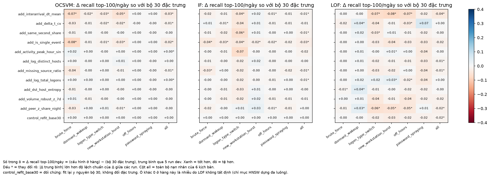

**Đọc biểu đồ:**
- Mỗi bảng nhiệt là một mô hình; hàng là đặc trưng được thêm lại, cột là kịch bản.
- Số trong ô là Δ recall top-100/ngày so với bộ 30. Đỏ là thêm vào làm tệ hơn, xanh là tốt hơn. Dấu * nghĩa là |Δ TB| > 1 std.
- Gần như không có ô xanh rõ. Các ô đỏ rõ tập trung ở hai hàng `interarrival_dt_mean` và `is_single_event`.
- Hàng cuối là đối chứng fit lại: với LOF, riêng việc fit lại đã cho các ô tới −0,03. Ô của LOF chỉ đáng tin khi vượt mức này.

**Giải thích:**
1. **Không đặc trưng nào bị bỏ oan.** Thêm lại bất kỳ đặc trưng nào trong 11 đặc trưng đều không cải thiện rõ ở mô hình nào. Mức tăng lớn nhất chỉ +0,008 PR-AUC (IF, `peer_z_share_night`), nhỏ hơn std. Bộ 30 được xác nhận ở mức từng đặc trưng, không chỉ ở mức cụm.
2. **SHAP cao không có nghĩa là đặc trưng có ích.**
   - `interarrival_dt_mean` đứng hạng 11–12 theo SHAP ở LOF, tức LOF có dùng nó để chấm điểm.
   - Nhưng thêm nó lại làm LOF **tệ hơn rõ nhất** (PR-AUC −0,039, recall −0,039), vượt mức nhiễu fit lại (−0,016).
   - Đặc trưng này đẩy điểm lên ở cả dòng bình thường, nên đóng vai trò nhiễu chứ không phải tín hiệu.
   - Đây là minh chứng rõ nhất cho việc SHAP (đóng góp vào điểm) phải đi kèm ablation (đóng góp vào phát hiện).
3. **Báo nhầm của OCSVM không chỉ do `delta_t_cv`.**
   - SHAP trên báo nhầm chỉ chỉ ra `delta_t_cv` (0,23).
   - Ablation cho thấy ba trong bốn đặc trưng rhythm đều làm OCSVM tệ hơn với mức gần nhau: `delta_t_cv` −0,024, `interarrival_dt_mean` −0,022, `is_single_event` −0,015 PR-AUC.
   - Vì vậy nếu chỉ bỏ `delta_t_cv` theo gợi ý của SHAP thì sẽ còn sót hai đặc trưng gây hại. Bỏ cả nhóm rhythm là đúng trong trường hợp này.
4. **`volume_robust_z_7d` không phải bị bỏ oan.** Thêm lại nó không giúp OCSVM (−0,005) và LOF (−0,020, ngang mức nhiễu fit lại).
5. **Thiệt hại dormant_wakeup của LOF (mục 4.3) chưa quy được về một đặc trưng cụ thể.**
   - Thêm lại từng đặc trưng đổi recall dormant của LOF từ −0,002 đến +0,041 (mốc bộ 30 chỉ 0,05).
   - Ba đặc trưng cho mức tăng vượt 1 std: `dst_host_entropy` +0,041 ± 0,034, `delta_t_cv` +0,037 ± 0,018, `peer_z_share_night` +0,035 ± 0,030. Ba đặc trưng này khác nhóm và không tương quan với nhau, mốc recall rất thấp và LOF có nhiễu fit lại, nên chưa đủ để kết luận đặc trưng nào là nguyên nhân.
   - Giả thuyết trước đây là do `log_total_logons` / `volume_robust_z_7d` không được xác nhận: Δ lần lượt +0,017 và +0,011, đều nhỏ hơn std.
6. **LOF có nhiễu không tất định đáng kể.** Fit lại cùng dữ liệu cho PR-AUC −0,016 ± 0,014. Mọi kết luận về LOF có hiệu nhỏ hơn khoảng 0,03 cần đọc thận trọng; điều này áp dụng cả cho các bảng 4.1–4.3.
   - Muốn LOF tất định thì đặt `n_jobs: 1`. Khi đó dựng chỉ mục chậm hơn.

Chạy lại: `python scripts/evaluation/feature_ablation.py --mode addback`, khoảng 1 giờ. Kết quả ở `experiments/ablation/addback/`.

**Hạn chế:**
- Danh sách đặc trưng SHAP thấp ban đầu lấy từ một run dev. Mục 3.4 và 4.4 đã kiểm tra lại trên 3 run SHAP và 5 run ablation.
- Thí nghiệm thêm lại chỉ thử **từng** đặc trưng một, chưa thử các cặp đặc trưng.
- Tham số mô hình giữ nguyên theo bản 41 đặc trưng. Với ít chiều hơn, k của LOF và số thành phần của OCSVM có thể còn tốt hơn, nhưng chưa dò lại.
- `configs/feature_schema.yaml` chưa đổi; bộ 30 được chọn qua `drop_features` trong cấu hình lưới.

📁 Số liệu: [`experiments/ablation/feature_groups/`](../../experiments/ablation/feature_groups/) (dev), [`experiments/ablation/feature_groups_test/`](../../experiments/ablation/feature_groups_test/) (test), [`experiments/grid/test_30f/`](../../experiments/grid/test_30f/) (lưới cuối) và [`experiments/ablation/addback/`](../../experiments/ablation/addback/) (thêm lại từng đặc trưng).

---

## 5. Review thủ công top 50 cảnh báo

**Chưa kịp làm, sẽ bổ sung sau.**

Bộ thẻ cảnh báo đã làm mù và hướng dẫn chấm đã sẵn sàng:
- [`docs/huong_dan_review_top50.md`](../../docs/huong_dan_review_top50.md);
- [`experiments/analysis/review_top50/`](../../experiments/analysis/review_top50/).

Bộ hiện tại tạo từ mô hình 41 đặc trưng. Nếu chốt bộ 30 đặc trưng thì nên tạo lại bộ review trước khi chấm, vì top-50 có thể thay đổi.
