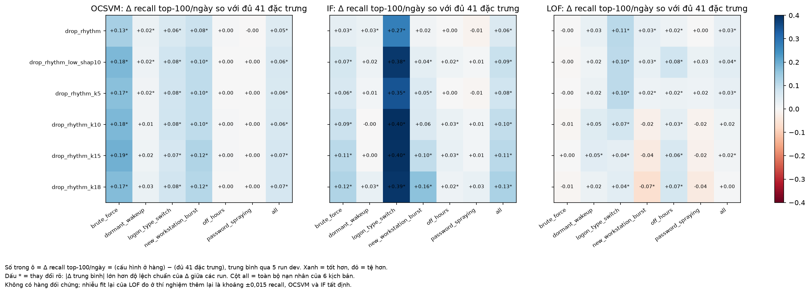

# Chọn số đặc trưng bỏ thêm theo SHAP (đường cong K)

> **Cập nhật sau khi kiểm tra trên test** ([`kiem_tra_test_K_va_context.md`](kiem_tra_test_K_va_context.md)): kết luận của OCSVM (phẳng) và IF (tốt nhất khoảng 22 đặc trưng) lặp lại trên test; kết luận của LOF (tốt nhất ở 30–33) **không** lặp lại, vì trên test K = 15/18 làm LOF tăng. Bộ đặc trưng chung đề xuất đổi thành **bộ 28** (bộ 30 bỏ nốt nhóm context).

> Bổ sung cho báo cáo tuần 5, mục 4. Khối **dev** (5 run `dev_seed20261036`–`040`, fit ngày 1–35, chấm ngày 36–42), phân khúc User, cấu hình mô hình chốt, model seed 42 / 7 / 2024 / 1 / 2. Chỉ số chính: **recall top-100/ngày**; phụ: PR-AUC.

## 1. Vì sao làm thí nghiệm này

Bộ 30 đặc trưng ở mục 4 được tạo bằng cách bỏ:
- **nhóm rhythm (4 đặc trưng):** có căn cứ. SHAP cho thấy rhythm là nguồn báo nhầm của OCSVM, ablation bỏ rhythm làm cả 3 mô hình tăng, và thí nghiệm thêm lại (mục 4.4) xác nhận 3/4 đặc trưng rhythm gây hại;
- **"10 đặc trưng SHAP thấp nhất":** **con số 10 được chọn cho tròn**, danh sách lấy từ 1 run. Do trùng 3 đặc trưng với rhythm nên tổng bỏ 11, còn 30.

Kết quả tốt của bộ 30 chỉ chứng minh bỏ 11 đặc trưng này *không hại*, không chứng minh 11 là số hợp lý. SHAP cũng không tự cho ra con số: xếp 41 đặc trưng theo tỷ phần |SHAP|, các giá trị giảm đều, không có chỗ gãy (theo tỷ phần TB 3 run, lấy mức cao nhất qua 3 mô hình: hạng 10 là 0,0164, hạng 11 là 0,0171). Vì vậy cần đo trực tiếp bằng ablation.

## 2. Thiết lập

**Xếp hạng SHAP:** với mỗi đặc trưng, lấy tỷ phần |SHAP| trên nạn nhân **cao nhất qua 3 mô hình × 3 run dev** (`experiments/analysis/explain_stability/feature_share_by_run.csv`). Một đặc trưng chỉ bị xếp thấp khi nó thấp ở *mọi* mô hình và *mọi* run. Sắp tăng dần.

**Cấu hình:** bỏ rhythm + K đặc trưng đầu danh sách. Vài đặc trưng rhythm cũng nằm trong nhóm SHAP thấp, nên số đặc trưng bỏ thực tế ít hơn 4 + K.

| Cấu hình | K | Còn lại | Đặc trưng bỏ thêm so với cấu hình liền trước |
|---|---|---|---|
| `full` | – | 41 | – |
| `drop_rhythm` | 0 | 37 | `interarrival_dt_mean`, `delta_t_cv`, `same_second_share`, `is_single_event` |
| `drop_rhythm_k5` | 5 | 33 | `activity_peak_hour_sin`, `log_distinct_hosts`, `missing_source_ratio`, `dst_host_entropy` |
| `drop_rhythm_k10` | 10 | 29 | `log_total_logons`, `custom_proc_share`, `delta_mean_distinct_pair_7d`, `new_host_count_7d` |
| `drop_rhythm_k15` | 15 | 25 | `peer_z_share_night`, `rare_logon_type_count_log`, `remote_logon_ratio`, `volume_robust_z_7d` |
| `drop_rhythm_k18` | 18 | 22 | `off_hours_ratio`, `delta_mean_distinct_fail_host_7d`, `jaccard_logontype_7d` |
| `drop_rhythm_k20` | 20 | 21 | `activity_peak_hour_cos` (hạng 19 và 20 còn lại là `interarrival_dt_mean`, đã bỏ cùng rhythm) |
| `drop_rhythm_low_shap10` (**bộ 30 hiện tại**) | – | 30 | rhythm + danh sách 10 cũ (từ 1 run) |

- **K = 18 là mức cắt trung bình:** đúng 18 đặc trưng này có tỷ phần **dưới mức chia đều 1/41 ở mọi mô hình và mọi run**.
- **Bộ 30 hiện tại khác `k10`:** bộ 30 giữ `custom_proc_share`, `delta_mean_distinct_pair_7d`, `new_host_count_7d` nhưng bỏ `peer_z_share_night`, `volume_robust_z_7d`.
- `full` và `drop_rhythm` được chạy lại cùng đợt để mọi hiệu là **ghép cặp** trên cùng run và seed.

**Quy tắc chọn K (đặt trước khi xem kết quả):** với mỗi mô hình, tìm cấu hình có recall TB cao nhất; chọn K **lớn nhất** (ít đặc trưng nhất) mà hiệu ghép cặp so với cấu hình tốt nhất vẫn nằm trong 1 std, và không kịch bản nào giảm rõ.

**Nhiễu cần nhớ:** OCSVM và IF tất định; LOF fit lại cùng dữ liệu lệch khoảng ±0,015 recall (mục 4.4), nên hiệu của LOF dưới khoảng 0,03 cần đọc thận trọng.

## 3. Kết quả

**Bảng K.1: Recall top-100/ngày TB 5 run dev; trong ngoặc là hiệu ghép cặp so với cấu hình tốt nhất của mô hình (TB ± std)**

| Còn lại | OCSVM | IF | LOF |
|---|---|---|---|
| 41 (`full`) | 0,317 (−0,068 ± 0,023) | 0,139 (−0,125 ± 0,012) | 0,165 (−0,042 ± 0,011) |
| 37 (K = 0) | 0,368 (−0,017 ± 0,010) | 0,195 (−0,069 ± 0,020) | 0,197 (−0,010 ± 0,017) |
| 33 (K = 5) | 0,377 (−0,008 ± 0,007) | 0,217 (−0,047 ± 0,010) | 0,197 (−0,010 ± 0,014) |
| **30 (bộ hiện tại)** | 0,380 (−0,004 ± 0,004) | 0,228 (−0,036 ± 0,010) | **0,207 (tốt nhất)** |
| 29 (K = 10) | 0,380 (−0,005 ± 0,009) | 0,235 (−0,029 ± 0,022) | 0,184 (−0,023 ± 0,019) |
| 25 (K = 15) | **0,385 (tốt nhất)** | 0,246 (−0,018 ± 0,015) | 0,181 (−0,026 ± 0,010) |
| 22 (K = 18) | 0,383 (−0,002 ± 0,009) | **0,264 (tốt nhất)** | 0,170 (−0,037 ± 0,009) |
| 21 (K = 20) | 0,382 (−0,003 ± 0,008) | 0,258 (−0,006 ± 0,019) | 0,168 (−0,039 ± 0,009) |

**Bảng K.2: PR-AUC TB 5 run dev**

| Còn lại | OCSVM | IF | LOF |
|---|---|---|---|
| 41 | 0,167 | 0,062 | 0,054 |
| 37 (K = 0) | 0,217 | 0,081 | 0,086 |
| 33 (K = 5) | 0,223 | 0,097 | **0,090** |
| 30 (bộ hiện tại) | **0,230** | 0,096 | 0,085 |
| 29 (K = 10) | 0,225 | 0,113 | 0,073 |
| 25 (K = 15) | 0,230 | 0,121 | 0,067 |
| 22 (K = 18) | 0,227 | **0,128** | 0,062 |
| 21 (K = 20) | 0,226 | 0,118 | 0,061 |


**Đọc biểu đồ:** trục x là số đặc trưng còn lại, đi từ trái sang phải là bỏ dần. Mỗi điểm là TB qua 5 run dev; râu là std của hiệu ghép cặp so với cấu hình tốt nhất của mô hình đó (vòng đỏ). Ngôi sao là bộ 30 hiện tại, vẽ riêng vì danh sách khác K = 10.



**Đọc biểu đồ:** số trong ô là Δ recall top-100/ngày so với đủ 41 đặc trưng, TB 5 run dev; xanh là tốt hơn, đỏ là tệ hơn, dấu * là |Δ TB| > 1 std.

## 4. Nhận xét

1. **Ba mô hình muốn ba con số khác nhau, không có K chung tốt nhất.**
   - **OCSVM: đường cong phẳng từ 33 đến 22 đặc trưng.** Mọi cấu hình từ bộ 30 đến K = 18 cách mức tốt nhất ≤ 0,005, trong 1 std. Theo quy tắc, K = 18 (22 đặc trưng) được chọn, nhưng khác biệt giữa 30, 29, 25 và 22 đặc trưng chỉ là nhiễu.
   - **IF: càng bỏ càng tốt đến 22 đặc trưng, rồi dừng.** Recall tăng đều 0,195 → 0,264 và PR-AUC 0,081 → 0,128. K = 15 kém K = 18 rõ (−0,018 ± 0,015 recall). Bỏ thêm `activity_peak_hour_cos` (K = 20, 21 đặc trưng) không tăng nữa: −0,006 ± 0,019 recall và −0,010 ± 0,015 PR-AUC so với K = 18, nằm trong nhiễu. Đường cong của IF đã bão hoà ở khoảng 22 đặc trưng. Cách giải thích hợp lý: IF chọn đặc trưng ngẫu nhiên để tách, nên mỗi chiều yếu làm loãng cây; bớt chiều yếu thì cây tập trung vào chiều có tín hiệu.
   - **LOF: tốt nhất ở 30–33 đặc trưng rồi giảm.** K = 15 và K = 18 kém rõ (−0,026 ± 0,010 và −0,037 ± 0,009 recall), vượt cả mức nhiễu fit lại. Mức giảm tập trung ở new_workstation_burst (0,19 → 0,10) và password_spraying (0,10 → 0,04). LOF dựa vào khoảng cách trên toàn bộ chiều, nên bỏ các đặc trưng yếu nhưng có tương quan (ví dụ `new_host_count_7d` cùng cụm với `new_source_count_7d`) làm đổi cấu trúc láng giềng.

2. **Bộ 30 hiện tại là điểm thỏa hiệp tốt, dù con số 10 ban đầu là chọn cho tròn.**
   - OCSVM: nằm trên phần phẳng (−0,004 ± 0,004 so với mức tốt nhất).
   - LOF: là cấu hình tốt nhất về recall.
   - IF: kém mức tốt nhất 0,036 recall.

   So với K = 18 (22 đặc trưng), bộ 30 đổi 0,036 recall của IF lấy 0,037 recall của LOF, còn OCSVM gần như không đổi.

3. **`k10` (29) kém bộ 30 ở LOF dù chỉ khác 5 đặc trưng.** LOF recall 0,184 so với 0,207, burst 0,141 so với 0,191. Ba đặc trưng `k10` bỏ thêm (`custom_proc_share`, `delta_mean_distinct_pair_7d`, `new_host_count_7d`) có ích cho LOF dù SHAP thấp. Một lần nữa, SHAP thấp chưa chắc là vô ích, nhất là với đặc trưng trong cụm tương quan (mục 3.4: SHAP chia công tuỳ ý giữa các đặc trưng cùng cụm). Hiệu này nằm gần mức nhiễu của LOF (−0,023 ± 0,019), cần thêm run để chắc.

4. **Mức cắt trung bình (K = 18) không phải lựa chọn an toàn cho cả ba mô hình.** Nó tốt nhất cho IF, ngang cho OCSVM nhưng làm LOF tệ hơn rõ.
5. **Rút xuống K = 20 (21 đặc trưng) không tốt hơn K = 18 ở mô hình nào.** So với K = 18 (hiệu ghép cặp, 5 run): OCSVM −0,001 ± 0,004, IF −0,006 ± 0,019, LOF −0,003 ± 0,012 recall; mọi kịch bản lệch ≤ 0,02 trừ burst của LOF (−0,04, trong nhiễu fit lại). Không có lý do cắt sâu hơn 22 đặc trưng.

## 5. Đề xuất

- **Giữ bộ 30 làm bộ đặc trưng chung của benchmark.** Nay đã có căn cứ: nằm trên vùng phẳng của OCSVM (mô hình chính), tốt nhất cho LOF, chỉ thiệt IF. Trong báo cáo, thay câu "bỏ 10 đặc trưng SHAP thấp nhất" bằng đường cong này làm căn cứ, và nói rõ 10 ban đầu là chọn cho tròn.
- **Nếu chỉ quan tâm OCSVM:** từ 22 đến 30 đặc trưng đều như nhau; có thể chọn 22 cho gọn, nhưng không cải thiện.
- **Nếu muốn tối ưu từng mô hình:** dùng bộ riêng, ví dụ IF 22 đặc trưng (K = 20 đã cho thấy cắt sâu hơn không tăng thêm), LOF 30–33, OCSVM 22–30. Đổi bộ đặc trưng cho từng mô hình cần kiểm tra lại một lần trên test.
- Không đổi `configs/feature_schema.yaml`; mọi lựa chọn đi qua `drop_features` trong cấu hình lưới.

## 6. Hạn chế

- Thứ hạng SHAP lấy từ run dev 36–38, mà ablation cũng chạy trên dev, nên có thiên lệch chọn nhẹ. Kết quả chưa kiểm tra trên test.
- Chỉ thử 5 giá trị K, không chạy đối chứng fit lại trong đợt này; nhiễu LOF lấy từ mục 4.4.
- K đếm trên thứ hạng của cả 41 đặc trưng, nên K = 5 chỉ bỏ thêm 4 đặc trưng ngoài rhythm (và tương tự với các K khác).
- Tham số mô hình giữ nguyên theo bản 41 đặc trưng; với ít chiều hơn, k của LOF và tham số OCSVM có thể cần dò lại.

## 7. Số liệu và chạy lại

📁 [`experiments/ablation/kcurve/`](../../experiments/ablation/kcurve/): `runs.csv`, `scenario_runs.csv`, `summary.csv`, `delta_overall.csv`, `delta_scenario.csv`, `kcurve_vs_best.csv`, `ablation_configs.json`, `figures/`.

```
python scripts/evaluation/feature_ablation.py --mode kcurve   # ~35 phút: 8 cấu hình × 3 mô hình × 5 run dev
python scripts/evaluation/plot_kcurve.py                       # hình 13
```
